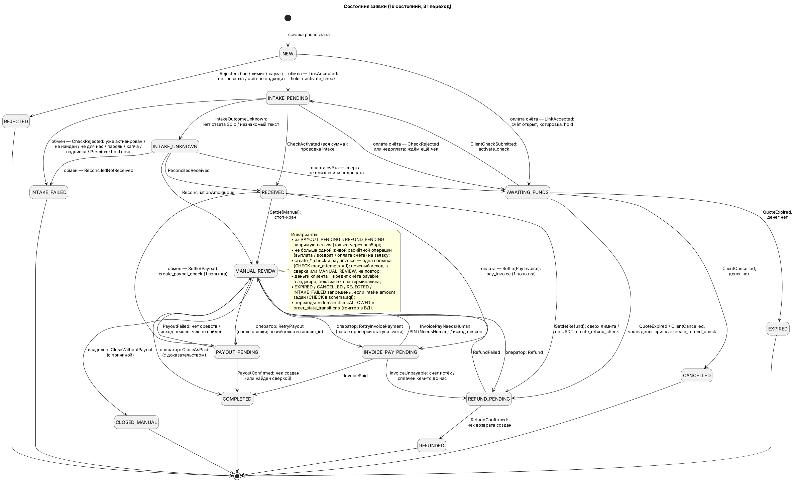
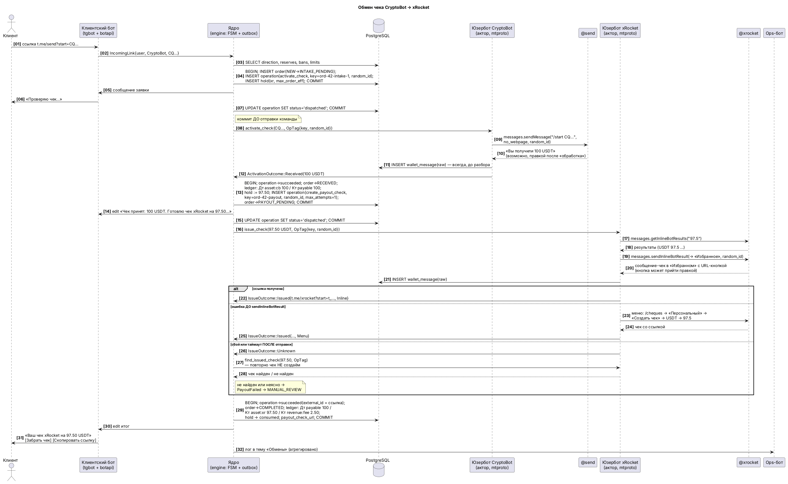

# SPEC: бот-обменник xRocket ⇄ CryptoBot

Версия 0.2 · 10 октября 2026 · проектный пакет для разработки.
Состав пакета: этот файл (разделы 1–15), [`schema.sql`](schema.sql) (= `migrations/0001_init.sql`), [`diagrams/*.puml`](diagrams/) с картинками в [`diagrams/png/`](diagrams/png/), [`CLAUDE.md`](CLAUDE.md) и документы в [`docs/`](docs/): [`DESIGN-v0.2.md`](docs/DESIGN-v0.2.md) (решения владельца), [`HANDOVER.md`](docs/HANDOVER.md) (состояние и порядок работ), [`LOVEC-PORTING.md`](docs/LOVEC-PORTING.md) (что берём из ловца lovec), [`PROGRESS.md`](docs/PROGRESS.md).

Старшинство источников: `DESIGN-v0.2.md` → `CLAUDE.md` → `HANDOVER.md` → код и тесты → этот файл. Если SPEC с ними расходится, прав источник выше, а SPEC нужно поправить.

## Что изменилось в v0.2

Решения владельца от 7 октября 2026 (DESIGN-v0.2, Р1–Р7) поменяли основу v0.1.

| Было в v0.1 | Стало в v0.2 | Где |
|---|---|---|
| Основной спрос — xRocket → CryptoBot | Основной спрос — **CryptoBot → xRocket** (2,5 %); xRocket → CryptoBot — встречный поток (1,5 %) | §1.1, §2, §3 |
| Гибрид: приём юзерботом, выплата через платёжные API кошельков | **Всё через юзербота**: приём, выплата, возврат, оплата счетов. Платёжные API кошельков, их токены и баланс приложения не используются | §1.1, §3, §10, §12 |
| Четыре кошелька: личный баланс и баланс приложения на каждой платформе | Два кошелька: личный баланс аккаунта юзербота на платформе, метки `cb` и `xr` | §3, §10.4 |
| Выплата — перевод с ключом идемпотентности на стороне кошелька | Выплата и возврат — **чек, который создаёт юзербот**: инлайн `@send 10usdt` / `@xrocket 10` в «Избранное», запасной путь — меню бота | §1.5, §4 |
| Защита от дубля — ключ кошелька | `random_id` Telegram и **одна попытка** у операций, выводящих деньги; неясный исход → сверка или человек | §4.20, §10.5 |
| Активация отдельным методом запуска бота с параметром | `messages.sendMessage("/start <код>")` с `no_webpage` и своим `random_id`, как в lovec | §1.3, §10.5.7 |
| Чек с паролем: спрашиваем пароль у клиента | **Не принимаем**: «чек с паролем не принимаю — деньги остались в чеке». Состояние, экран и ошибки про пароль удалены | §1.3, §4 (П17), §6 |
| Капча xRocket: решатель по фикстурам | Чек с капчей не принимаем (отказ, деньги в чеке) | §1.3 |
| Чужой счёт CryptoBot: платим, только если не нужен PIN; мини-приложение отвергнуто | Счёт оплачивает юзербот: кнопка валюты → «Оплатить» → мини-приложение → PIN (`CRYPTOBOT_PIN`). Протокол мини-приложения пока неизвестен, до записи HAR платит оператор | §1.5, §4 (П3) |
| Клиент мог оплатить наш счёт | Клиент платит только чеком | §4, §6 |
| FSM: 17 состояний, 36 переходов | 16 состояний, **31 переход**: `domain::fsm::ALLOWED` = `order_state_transitions` | §4, §5 |
| Bot API — `frankenstein`; grammers из git | Свой тонкий клиент `botapi` (Bot API 10.3); grammers `=0.10.0` с crates.io, только в крейте `mtproto` | §10.2, §10.3 |
| Вехи: M2 «API кошельков», M6 «оплата счетов» | Вехи M2–M6 из HANDOVER §5: юзербот → движок → клиентский бот → эксплуатация → пилот | §14 |

Не изменилось: деньги только в `Decimal`, леджер с двойной записью, комиссия признаётся при выплате, outbox в одной транзакции с переходом заявки, охрана переходов в БД, админка в отдельном ops-боте, логи по темам, статистика, деплой на одном дроплете.

## Сводка

1. **Продукт.** Telegram-бот: прислал чек или ссылку на счёт — получил результат. Обмен чеков USDT CryptoBot ⇄ xRocket и оплата чужих счетов одного кошелька деньгами из другого. Условия видны до отправки денег, после — итог с разбивкой.
2. **Спрос.** Основной поток — CryptoBot → xRocket: люди уходят из CryptoBot и забирают баланс в xRocket (Р1). Встречный поток xRocket → CryptoBot и оплата счетов CryptoBot деньгами из xRocket пополняют сторону xRocket.
3. **Как работает.** Всё делает юзербот — обычный выделенный аккаунт Telegram через MTProto, по одному на платформу. Он активирует чек клиента командой `/start <код>`, создаёт чек выплаты на другой платформе (инлайн `@xrocket 97.5` или `@send 97.5usdt` → сообщение-чек в «Избранном» → ссылка из кнопки) и оплачивает чужие счета. Клиент получает ссылку и забирает чек одной кнопкой. Кошелёк сервиса — личный баланс аккаунта юзербота (`cb`, `xr`).
4. **MVP** = вехи M0–M5 и пилот M6 (§14): USDT, обмен чеков в обе стороны, оплата счетов (CryptoBot — пока руками оператора), базовая админка, логи по темам, сверка балансов, ручной разбор. Уже готово: фундамент (M1), доменная модель и схема БД v0.2, парсеры, симулятор кошельков, MTProto-транспорт, клиент Bot API, экраны клиента. Следующее — сценарии юзербота (M2.1).
5. **Экономика (базовый сценарий).** 40 обменов в день по 25 $, оборот 30 000 $ в месяц. Комиссия 2,5 % в основном направлении и 1,5 % во встречном, средняя 2,2 % — это 660 $ валовой прибыли. Платформы за активацию и создание чеков не берут [допущение M0]. Чистая прибыль — около 560 $ в месяц после сервера, Premium, ребалансировки и ожидаемых потерь от заморозок. Безубыточность — около 4 000 $ оборота в месяц (≈ 5 обменов в день). Оборотный капитал — 2 000 $: xRocket ≈ 1 200 $, CryptoBot ≈ 800 $ [допущение: ждёт подтверждения владельца].
6. **Цена решения «всё через юзербота».** У создания чека и у нажатия «Оплатить» нет ключа идемпотентности на стороне кошелька. Поэтому каждой операции заранее назначаем `random_id`: Telegram не создаёт второе сообщение с тем же `random_id`. Операции, которые выводят деньги, — одна попытка (CHECK в схеме). При неясном исходе — сверка (`find_issued_check`, статус счёта, баланс) или человек, но никогда не слепой повтор.
7. **Главные риски.** Заморозка аккаунтов кошельков вместе с резервами: AML у CryptoBot, ответа поддержки ждут неделями. Бан аккаунта Telegram за автоматизацию. Смена текстов ботов кошельков. Ввод PIN CryptoBot программой: справка CryptoBot это прямо запрещает. Неясный правовой статус обменника. Защита: минимальные резервы, ежедневный вывод прибыли, два выделенных аккаунта, при незнакомом ответе кошелька направление само встаёт на паузу.
8. **Технические решения.** Rust, один процесс на tokio. MTProto — `grammers` `=0.10.0`, только в крейте `mtproto`; остальной код знает лишь трейт `Transport`. Bot API — свой тонкий клиент `botapi` (Bot API 10.3: rich messages, цветные кнопки, `copy_text`). PostgreSQL 16 + `sqlx` 0.9, деньги только в `rust_decimal`, леджер с двойной записью. Transactional outbox, FSM заявки с охраной переходов в БД, актор на аккаунт юзербота (одно денежное действие в полёте), сверка с реальными балансами.
9. **Двойную выплату исключают три уровня.** (а) `random_id` операции: повтор отправки внутри попытки — только с ним. (б) Уникальные индексы БД: на заявку не больше одной расчётной операции, один чек — одна активация, один счёт — одна оплата. (в) Одна попытка для операций, выводящих деньги, и сверка вместо повтора.
10. **Принятый чек не теряется.** Операцию записываем в БД до отправки команды. Каждый ответ бота кошелька сохраняем в `wallet_messages` до разбора. После рестарта догоняем историю чата с кошельком.
11. **Интерфейс.** Главное меню reply-клавиатурой, инлайн-кнопки, одно сообщение на заявку, которое правится по шагам. Итог — «Ваш чек xRocket на 97.50 USDT» с кнопками «Забрать чек» и «Скопировать ссылку». Справочные экраны — rich messages с HTML-фолбэком. Логи владельцу — в отдельном ops-боте с темами.
12. **Деплой.** DigitalOcean AMS3: Docker Compose (приложение + PostgreSQL), ufw, бэкапы `pg_dump` с шифрованием `age`, healthchecks.io как «пульс». Пошагово — раздел 12.

## Параметры: что не заполнено и какие умолчания приняты

`<параметры>` в исходном запросе остались незаполненными. В v0.1 для них приняли значения по умолчанию; в v0.2 часть из них решил владелец. Ответ «по умолчанию» — оставляем как есть. Любой другой ответ меняет разделы, указанные в скобках.

| № | Вопрос | Принято | Что изменится, если иначе |
|---|---|---|---|
| П1 | Страна резидентства оператора? | Неизвестна. Проект юрисдикционно нейтрален; до публичного запуска — закрытая бета и консультация юриста | §1.8, §13 (правовой риск), §14 (юр. проверка) |
| П2 | Объём в первый месяц? | 40 обменов в день × 25 $ (базовый сценарий); пессимистичный — 10 × 15 $, оптимистичный — 150 × 30 $ | §2.5, §3 (резервы), §12 (размер сервера) |
| П3 | Оборотный капитал? | 2 000 $: xRocket ≈ 1 200 $, CryptoBot ≈ 800 $ [допущение: ждёт подтверждения владельца, HANDOVER §7, п. 8] | §3 (пороги), §2.5 |
| П4 | Стартовая комиссия? | Решено владельцем (Р1): CryptoBot → xRocket 2,5 %, xRocket → CryptoBot 1,5 %, оплата счёта CryptoBot 3,0 %, счёта xRocket 2,0 %; минимум 0,10 USDT за обмен и 0,20 USDT за оплату счёта | §2.3, `schema.sql` (сид `directions`) |
| П5 | Telegram Premium у владельца бота? | Да (≈ 5 $ в месяц). Без Premium бот сам переключится на обычные эмодзи | §6.4 |
| П6 | Код lovec? | Есть: lovec 0.4.3, старый ловец чеков владельца. Что берём — `docs/LOVEC-PORTING.md`. Код только читаем, не запускаем | §1.3, §10.2 |
| П7 | Активы на старте? | Только USDT; TON — в v1.0 (код TON в xRocket — `TONCOIN`, в CryptoBot — `TON`) | §1.7, §10.4 |

Остальные параметры заданы в запросе: сервер DigitalOcean AMS3, разработка на Windows, опыта деплоя нет, интерфейс на русском (английский позже).

## Как проверялись факты

- **Ограничение среды.** Из среды разработки сеть к Telegram и к сайтам кошельков закрыта. Факты сверялись по копиям первоисточников и по коду:
  - **Bot API.** Спецификация с core.telegram.org, выгруженная в репозиторий [PaulSonOfLars/telegram-bot-api-spec](https://github.com/PaulSonOfLars/telegram-bot-api-spec) (`api.json`: «Bot API 10.3, August 24, 2026»). Исходники сервера [tdlib/telegram-bot-api](https://github.com/tdlib/telegram-bot-api) и парсер HTML в [tdlib/td `MessageEntity.cpp`](https://github.com/tdlib/td/blob/master/td/telegram/MessageEntity.cpp).
  - **Поведение ботов кошельков.** Код, тесты и аудиты lovec 0.4.3 (боевые логи владельца за неделю работы ловца); выжимка — DESIGN-v0.2 §3 и LOVEC-PORTING §2–§3. Ни одна строка ответа ботов не записана с живого чата exch: фикстуры парсеров пока синтетические, настоящие тексты — задача M0 (§15).
  - **MTProto.** Исходники `grammers-*` 0.10.0 (слой TL 227).
  - **Крейты.** Версии и даты — из API crates.io.
- **Метки.** `[проверено: источник]` — факт подтверждён первоисточником, его копией или боевыми логами lovec. `[допущение: как проверить]` — проверить можно только руками или на живом аккаунте; такие пункты собраны в §15. `[допущение M0]` — проверяет владелец в вехе M0 (HANDOVER §7).
- **Обозначения.** Р1–Р7 без уточнения — решения владельца (DESIGN-v0.2 §1). Риски из §13 называем «риск Р…».

---

## 1. Проверка платформ

### 1.1. Итоговая таблица «операция × способ»

Все операции делает **юзербот** — обычный аккаунт Telegram, которым программа управляет через MTProto (grammers). На каждую платформу — свой выделенный аккаунт; руками им не пользуются. Юзербот работает с **личным балансом** аккаунта, и этот баланс и есть кошелёк сервиса: `cb` (CryptoBot) и `xr` (xRocket). Платёжные API кошельков (для приложений-мерчантов) не используем совсем (Р2): ни токенов, ни баланса приложения, ни вебхуков.

Боты кошельков — только закреплённые по peer ID: CryptoBot `@send` (`1559501630`), xRocket `@xrocket` (`5014831088`) [проверено: lovec `claimer.rs:431`; при старте сверяются через resolve].

| # | Операция | Как (юзербот, MTProto) | Комиссия | Лимиты и условия | Скорость | Надёжность | Риск блокировки | Статус |
|---|---|---|---|---|---|---|---|---|
| 1 | Принять чек CryptoBot | `messages.sendMessage(@send, "/start CQ…")`, `no_webpage`, заранее сохранённый `random_id` | 0 [допущение M0: сверить баланс до и после] | сумма чека | ответ 1–5 с [допущение]; отправка p50 63 мс [проверено: lovec AUDIT-2.md] | средняя: разбор текста по словарям lovec, формулировки меняются | средний | основной путь (`activate_check`) |
| 2 | Принять чек xRocket | `sendMessage(@xrocket, "/start t_…")`; мульти-чеки xRocket (`mci_…`, `mc_…`) активируются только в приложении xRocket — не принимаем (DESIGN-v0.2 Р8) | 0 [допущение M0] | пароль, капча, подписка, Premium → отказ; мульти-чек xRocket → отказ до `/start` [решение владельца; для `mc_` + 10 — ещё и lovec AUDIT-2.md:1776] | 1–5 с | средняя; на совсем свежий чек xRocket иногда отвечает «не найден» → один повтор, выигрывает в 8 % случаев [проверено: lovec] | средний | основной путь |
| 3 | Выплата или возврат в CryptoBot | создать чек: инлайн `@send 97.5usdt` → результат USDT на эту сумму → `messages.sendInlineBotResult` в «Избранное» с заранее сохранённым `random_id` → ссылка `t.me/send?start=CQ…` из URL-кнопки. Запасной путь — `/checks` → «Создать чек» → USDT → сумма → ссылка | 0 [допущение M0] | минимум чека [допущение: 0,10 USDT, `platform_assets.min_check`]; не больше личного баланса | 2–10 с [допущение] | средняя: у кошелька нет ключа идемпотентности → одна попытка, `random_id`, сверка `find_issued_check` | средний | основной путь (`create_payout_check`, `create_refund_check`, `create_excess_check`) |
| 4 | Выплата или возврат в xRocket | инлайн `@xrocket 97.5` → результат USDT → в «Избранное» → ссылка `t.me/xrocket?start=t_…`. Запасной путь — `/cheques` → «Персональный» → «Создать чек» → USDT → сумма → ссылка | 0 [допущение M0] | чек должен быть без капчи и подписок [допущение M0: проверить настройки инлайн-чека по умолчанию] | 2–10 с | то же | средний | основной путь |
| 5 | Найти созданный чек (сверка после неясного исхода) | «Избранное»: сообщение через нужного бота (`via_bot`) с суммой, отправленное после начала операции; затем список чеков в боте | 0 | несколько кандидатов → человек | 1–5 с | средняя | низкий | `find_issued_check` |
| 6 | Узнать сумму и статус чужого счёта | `/start IV…` (CryptoBot) или `/start inv_…` (xRocket) → карточка счёта, без оплаты | 0 | открытие не оплачивает счёт [допущение M0] | 1–3 с | средняя | низкий | `inspect_invoice` (операция `open_invoice`) |
| 7 | Оплатить чужой счёт CryptoBot | карточка → кнопка USDT → «Оплатить» → кнопка мини-приложения → `messages.requestWebView` → ввод PIN (`CRYPTOBOT_PIN`) | 0 при оплате с баланса [проверено: справка CryptoBot «How do I pay an invoice»] | многоразовые счета и счета без суммы не берём | 5–15 с [допущение] | **неизвестна**: MTProto заканчивается на URL мини-приложения, дальше HTTP самого приложения, протокол не записан → пока `NeedsHuman`, платит оператор | высокий: справка CryptoBot запрещает вводить PIN в сторонних сервисах [проверено] (§1.8) | `pay_invoice`; автоматизация — после HAR владельца (M6) |
| 8 | Оплатить чужой счёт xRocket | `/start inv_…` → кнопка USDT → «Оплатить» (кнопки в чате) | 0 [допущение M0] | многоразовые счета и «любая сумма» не берём | 3–8 с [допущение] | средняя; поток не записан [допущение M0] | средний | `pay_invoice` |
| 9 | Баланс кошелька | экран «Кошелёк» бота → `parsers::replies::parse_balance` | 0 | — | 1–3 с | средняя | низкий | сверка (§4, П14) |
| 10 | Вывод в сеть (ребалансировка между платформами) | меню бота «Вывести» → сеть → адрес → сумма; у CryptoBot для вывода нужен PIN [проверено: справка CryptoBot] | сетевая, USDT-TON ≈ 0,1–0,5 USDT [допущение] | минимум вывода [допущение M0] | 10 с – 30 мин | средняя | низкий–средний | в MVP — руками владельца (§3.5); юзерботом (`withdrawal`, одна попытка) — позже |

**Почему так и чем платим.**

- Владелец решил работать только через юзербота (Р2): один тип интеграции, никаких комиссий платформ за приём, никаких токенов приложений, которые можно украсть отдельно от аккаунта.
- Платим тем, что у создания чека и у нажатия «Оплатить» нет ключа идемпотентности на стороне кошелька. Таймаут после отправки значит: неизвестно, создан ли чек. Защита (§10.5): `random_id` назначается до первой отправки; операции, выводящие деньги, — одна попытка; неясный исход → `find_issued_check`, статус счёта или баланс → событие или `MANUAL_REVIEW`.
- Инлайн — основной путь, меню — запасной. Повтор `sendInlineBotResult` с тем же `random_id` не создаёт второе сообщение [проверено: Telegram, ошибка `RANDOM_ID_DUPLICATE`, lovec `tests/send_outcomes.rs`] и, по нашему допущению, второй чек [допущение M0: чек создаётся при отправке результата, а не при инлайн-запросе — HANDOVER §7, п. 3]. Если окажется, что чек создаётся уже на запросе, основным станет меню.
- Ссылка на чек выплаты не привязана к клиенту: забрать чек может любой, у кого есть ссылка. Отдаём её только в личку клиенту и прямо пишем «не пересылайте». Можно ли в меню кошельков привязать чек к пользователю — вопрос M0; если можно, делаем.

### 1.2. Ссылки на чеки и счета: форматы и распознавание

| Платформа | Бот (точное имя) | Чек | Счёт | Источник |
|---|---|---|---|---|
| CryptoBot | `send`, алиас `CryptoBot`; тестнет `CryptoTestnetBot` — не принимаем | `?start=CQ` + 10 символов (всего 12) | `?start=IV…` | чек и боты — [проверено: lovec `bots.rs:46-86`, `links.rs:141`, боевые логи]; `IV…` — [проверено: справка CryptoBot «How do I pay an invoice»] |
| xRocket | `xrocket`, алиас `tonRocketBot`; тестнет `xrocket_testnet_bot`, `ton_rocket_test_bot` — не принимаем | `t_` + 15 (17); мульти-чеки `mci_` + 15 (19), `mc_` + 15 (18) и `mc_` + 10 (13) активируются только в приложении xRocket → отказ (DESIGN-v0.2 Р8) | `?start=inv_…` | [проверено: lovec `bots.rs:65-86`, AUDIT-2.md:1776]; длина кода счёта не зафиксирована |

Распознавание (`parsers::links`):

1. **Источники ссылок в сообщении:** текст, сущности `url`/`text_link`, URL-кнопки `reply_markup` и голые коды чеков (`CQ…`, `t_…`; голый код мульти-чека xRocket — отказ с объяснением). Кнопки важны: клиенты пересылают сообщение-чек из @send, где ссылка лежит в кнопке, или создают инлайн-чек прямо в чате с нашим ботом (`@send 10usdt`). Голые коды счетов не принимаем: `IV…` легко спутать с обычным словом.
2. **Разбор — через `url::Url`, не регуляркой по всему тексту.** Допустимые формы (тесты открытого ловца [moukpu/cryptobot-link-catcher](https://github.com/moukpu/cryptobot-link-catcher/blob/main/tests/test_links.py) и lovec): `https://t.me/<bot>?start=<p>`, `t.me/<bot>?start=<p>`, `telegram.me`, `telegram.dog`, `www.`-префикс, `https://<bot>.t.me/?start=<p>`, `t.me/<bot>/app?startapp=<p>`, `tg://resolve?domain=<bot>&start=<p>` (и с `start` раньше `domain`), `tg:resolve?domain=@<bot>&start=<p>`, `?ref=…&start=<p>`.
3. **Валидация:** имя бота сравниваем без учёта регистра с белым списком из таблицы; `start` — по формату кода из таблицы; любые не-ASCII символы в имени бота (кириллические двойники «СryptoBot») → отказ «поддельная ссылка». Тестнет определяем по имени бота (известные имена или слово `testnet`), а не по всей ссылке: `t.me/send?ref=testnet_promo&start=…` — обычный чек [проверено: lovec AUDIT-2.md:375-388].
4. **Защита от фишинга:** юзербот **никогда не переходит по ссылке как по URL** и не резолвит имя из ссылки. Наружу уходит только код, и отправляется он боту по **закреплённому peer ID** (`mtproto::config`: CryptoBot `1559501630`, xRocket `5014831088`). При старте транспорт сверяет ботов через resolve; расхождение → CRITICAL и стоп. Переменные `CRYPTOBOT_PEER_ID`, `XROCKET_PEER_ID` — необязательная дополнительная сверка. Ответ засчитывается, только если пришёл от этого peer ID.
5. **Ложные срабатывания:** реферальные и сервисные параметры (`start=r-…`, `start=pay`, `startapp=…` без префикса счёта) → «Это не чек и не счёт». Несколько ссылок в одном сообщении → обрабатываем первую, о прочих говорим «по одной, пожалуйста».
6. **Сумма из ссылки не берётся никогда:** её там нет, а подпись к пересланному сообщению может быть подделана. Сумма — только из ответа бота кошелька нашему аккаунту.

### 1.3. Активация чека из обычного аккаунта: ответы ботов кошельков

**Как отправляем.** `messages.sendMessage` боту по закреплённому peer ID, текст `/start <код>`, `no_webpage`, заранее сохранённый `random_id` [проверено: lovec `fastsend.rs`, 167 доставленных команд]. Так же работают ссылки `startapp` (DESIGN-v0.2 §3). Хелпер `client.send_message` grammers не годится: он генерирует свой `random_id`, и безопасный повтор становится невозможен.

**Как ловим ответ.** Боты кошельков не ставят `reply_to` [проверено: lovec AUDIT-2-notes.md:61]. Подписываемся на поток сообщений **до** отправки. Ответ — первое финальное сообщение бота с id больше id нашей команды. Правки того же сообщения (`UpdateEditMessage`) переклассифицируют ответ, промежуточное «обработка» ждёт дальше. Таймаут — 30 с. На аккаунт в полёте ровно одна денежная команда, поэтому сопоставление идёт по порядку (FIFO).

**Язык.** Язык ответов зависит от языка аккаунта. Юзербот подключается с `lang_code = ru` (`mtproto::config`), словари содержат русские и английские формы.

Классификатор (`parsers::replies`) — словари lovec, подстрока в нижнем регистре [проверено: lovec `replies.rs:41-99`]. Тексты пока синтетические, настоящие — M0 (В3).

| Класс ответа | Признак | Событие и что видит клиент |
|---|---|---|
| Получено | «вы получили», «успешно получили», «you received», «you have received», «successfully received» + `<число> <АКТИВ>`, **без** «от @» | `CheckActivated`; сумма и актив — из ответа; сверка с балансом в ближайшей сверке |
| Уже активирован | «уже активирован», «уже получен», «already activated», «already been activated», «already claimed» | `CheckRejected` → `INTAKE_FAILED`: «деньги у того, кто открыл чек первым». **Ловушка:** если наш первый `/start` выиграл, а второй ушёл с **новым** `random_id`, бот тоже ответит «уже активирован» [проверено: lovec AUDIT.md:46]. Поэтому повтор — только с тем же `random_id`, а после неясного исхода — сверка, не отказ |
| Не найден | «не найден», «не существует», «недоступен», «not found», «does not exist» | `CheckRejected`: «чек не найден — я ничего не получил». На совсем свежий чек xRocket иногда отвечает так по ошибке: если чеку ≤ 3 с — один повтор [проверено: lovec `ledger.rs:19-20`] |
| Не для нас | «не можете активировать», «предназначен для другого», «not intended for you», «cannot activate» | `CheckRejected`: «чек привязан к другому аккаунту, деньги остались в чеке» |
| С паролем | «пароль», «password» (проверяется после «неверный пароль») | `CheckRejected`: «чек с паролем не принимаю — деньги остались в чеке» (Р3). Пароль не спрашиваем и боту не отправляем. CryptoBot после такого ответа ждёт пароль текстом; следующий `/start` начинает новый диалог [проверено: lovec `password.rs:294-304`; допущение M0: ожидание пароля не мешает следующей команде другого чека] |
| Подписка | «подпиш», «подписк», «subscribe», «join the» | `CheckRejected`: «чек требует подписки — такие не принимаю». На каналы не подписываемся никогда |
| Капча | «капч», «captcha», «символы, которые вы видите», «на картинке» | `CheckRejected`: «чек с капчей не принимаю» |
| Только для Premium | упоминание Premium [допущение M0: текст] | `CheckRejected`: «чек только для Telegram Premium» |
| Мульти-чек CryptoBot (`CQ…`, DESIGN-v0.2 Р8) | ответ о зачислении доли [допущение M0] | сумма — доля, зачисленная нам, из ответа, как у обычного чека. Ответ без понятной суммы — `Unknown` → ручной разбор (деньги уже у нас). Мульти-чеки xRocket до `/start` не доходят: парсер отказывает (E08) |
| Обработка | «получение», «обработ», «processing», «подождите», «please wait» | промежуточный ответ: ждём правку или новое сообщение до таймаута |
| «Ваш чек активировал @…» | «ваш чек» + «активировал» или «получил» | не ответ на команду: подтверждение, что клиент забрал наш чек выплаты (отчёт о незабранных чеках) |
| Входящий перевод | «Вы получили 5 USDT от @x» | не ответ на команду и не выигрыш, хотя совпадает со словарём «получено»: отличаем по «от @» и по отсутствию ожидающей команды [проверено: lovec AUDIT.md:82]; сохраняем для сверки |
| Ограничение аккаунта | «аккаунт ограничен», «обратитесь в поддержку» [допущение M0: текст] | `BotError::AccountRestricted`: CRITICAL, автопауза всех направлений этого кошелька, заявка — в сверку или `MANUAL_REVIEW` (П15) |
| FLOOD_WAIT | ошибка Telegram `FLOOD_WAIT_X` | пауза всего аккаунта на X с; операция не начиналась → назад в `pending`, попытка не тратится. Пороги из lovec: 29 с после 10 команд боту за 60 с; xRocket однажды дал 703 с, рестарт паузу не снимает [проверено: lovec AUDIT-2.md:1491, 1787-1791] |
| Нет ответа 30 с | — | `IntakeOutcomeUnknown` → `INTAKE_UNKNOWN` → сверка: догон истории чата и баланс |
| Незнакомый текст | ни один класс не подошёл или подошли два | `Unknown` → `INTAKE_UNKNOWN`, **автопауза направления**, CRITICAL с замаскированным сырым текстом (§10.6) |

Извлечение суммы: регулярное выражение по числу с разделителями `.`/`,`/тонкий пробел и кодом актива из словаря платформы (`USDT`, `TON`/`TONCOIN`, …). Результат — в `Decimal` без промежуточного `f64`. Защита от абсурда: сумма > 10 × `max_amount` → `MANUAL_REVIEW`.

### 1.4. Виды счетов

Платёжные API кошельков больше не источник фактов о счетах: юзербот видит только карточку счёта в чате с ботом. Всё ниже, кроме префиксов ссылок, — [допущение M0: снять карточки счетов обеих платформ, HANDOVER §7, п. 6].

| Признак | Счёт CryptoBot (`IV…`) | Счёт xRocket (`inv_…`) |
|---|---|---|
| Валюта | крипта или фиат (USD, EUR, RUB и другие); у фиатного счёта карточка показывает и сумму в выбранном активе | только крипта |
| Количество оплат | одна | бывают многоразовые и «любая сумма» — такие не принимаем |
| Статус на карточке | активен / оплачен / истёк. `parsers::replies::parse_invoice_card` ставит статус, только если в тексте ровно одно слово статуса без отрицания, иначе `Unknown` | то же |
| Оплата | кнопка валюты → «Оплатить» → мини-приложение → PIN | кнопка валюты → «Оплатить» |

Как получаем сумму, актив и статус **чужого** счёта: `inspect_invoice` — `/start IV…` или `/start inv_…` и разбор карточки. Открытие не оплачивает счёт [допущение M0]. Принимаем счёт, только если он одноразовый, с фиксированной суммой, оплачивается в USDT, активен и истекает не раньше чем через TTL котировки + 5 минут.

**Счёт в фиате.** Сумму в USDT берём у самого кошелька: из карточки счёта или с экрана после выбора USDT, не нажимая «Оплатить» [допущение M0]. Добавляем буфер `fiat_buffer_pct` = 1 % и фиксируем котировку на 15 минут (`domain::pricing::fiat_to_asset`). Перед нажатием «Оплатить» юзербот ещё раз читает сумму в USDT. Если она больше `A` из котировки — заявка уходит в возврат с объяснением «курс сдвинулся сильнее буфера», а не в доплату за свой счёт. Если кошелёк не показывает сумму в USDT до оплаты — фиатные счета не принимаем (E17).

### 1.5. Создание чека и оплата счёта из обычного аккаунта

| Способ | Как работает через MTProto | Что автоматизируется надёжно | Вердикт |
|---|---|---|---|
| Инлайн-режим `@send 97.5usdt` / `@xrocket 97.5` | `messages.getInlineBotResults` (peer — «Избранное») → результат с USDT и ровно этой суммой → `messages.sendInlineBotResult` в «Избранное» с заранее сохранённым `random_id` → ссылка из URL-кнопки отправленного сообщения. Кнопка может появиться не сразу, а правкой сообщения [проверено: lovec `ingest.rs:112-128`] | создание чека из личного баланса; повтор отправки тем же `random_id` не создаёт второе сообщение | **основной путь** выплаты и возврата (Р5) |
| Меню бота | CryptoBot: `/checks` → «Создать чек» → USDT → сумма → ссылка. xRocket: `/cheques` → «Персональный» → «Создать чек» → USDT → сумма → ссылка. Кнопки нажимаем через `messages.getBotCallbackAnswer` и ищем **по тексту**, не по позиции | работает, но у нажатий кнопок нет `random_id`: таймаут после ввода суммы значит «исход неизвестен» | **запасной путь**, только если инлайн не удался **до** отправки результата |
| Кнопки чужого счёта | `/start IV…` или `/start inv_…` → кнопка валюты → «Оплатить» (`messages.getBotCallbackAnswer`) | открыть счёт и выбрать валюту; у xRocket — и оплатить [допущение M0] | часть `pay_invoice` |
| Мини-приложение CryptoBot | кнопка «Оплатить» ведёт в мини-приложение → `messages.requestWebView` → URL с `tgWebAppData` → дальше HTTP самого мини-приложения и ввод PIN | MTProto заканчивается на URL. Дальше два варианта: повторить запросы мини-приложения по записи HAR (быстро, хрупко) или headless-браузер (тяжело) [LOVEC-PORTING §8.3] | решение владельца (Р4): PIN вводит программа. До записи HAR — `PayOutcome::NeedsHuman`, платит оператор |

Правила `issue_check` (DESIGN-v0.2 §4, HANDOVER M2.1):

- ошибка **до** `sendInlineBotResult` (нет нужного результата, транспорт недоступен) → меню;
- ошибка или таймаут **после** отправки → `IssueOutcome::Unknown`. Меню нельзя: чек мог создаться. Дальше — только `find_issued_check`;
- в меню любая неясность после ввода суммы → `Unknown`;
- «недостаточно средств» → `InsufficientFunds`: чек точно не создан, направление встаёт на автопаузу.

### 1.6. Комиссии и лимиты (сводка)

| Платформа | Операция | Комиссия | Статус факта |
|---|---|---|---|
| CryptoBot | Активация чека | 0 | [допущение M0: сверить баланс до и после] |
| CryptoBot | Создание чека из личного баланса | 0 | [допущение M0: LOVEC-PORTING §8.1, I7] |
| CryptoBot | Переводы между пользователями | 0 % | [проверено: справка «Комиссии и лимиты», пересказ поисковой выдачи] |
| CryptoBot | Оплата счёта монетами кошелька | 0 % для плательщика | [проверено: справка «How do I pay an invoice»] |
| CryptoBot | P2P / биржа | P2P продажа 1 %, биржа 0,5 % мейкер / 0,75 % тейкер | [проверено: поисковая выдача по справке; для нас не нужно] |
| CryptoBot | Вывод в сеть | сетевая комиссия + PIN обязателен | [проверено: PIN]; размер — [допущение: таблица «Комиссии и лимиты»] |
| xRocket | Активация и создание чека | 0 | [допущение M0] |
| xRocket | Вывод в сеть | сетевая, по сетям | [допущение: экран вывода в боте] |
| Telegram | Темп юзербота | FLOOD_WAIT 29 с после 10 команд боту за 60 с; у xRocket — до 703 с. Держим ≤ 1 действие в 1,5 с и ≤ 6–8 сообщений боту в минуту на аккаунт | [проверено: lovec AUDIT-2.md:1491, 1787-1791] |

Изменения цен CryptoBot в 2026 году обсуждаются публично ([vc.ru: «Криптобот в 2026 повышает комиссии»](https://vc.ru/money/2920313-kriptobot-povysil-komissii-alternativy-obmena-kriptovalyuty)). Цифры перед запуском перепроверяем по официальной странице [«Комиссии и лимиты»](https://help.send.tg/en/articles/9717243-fees-and-limits) — вопрос В4.

### 1.7. Точность активов

| Актив | CryptoBot | xRocket | Шаг выплаты в проекте |
|---|---|---|---|
| USDT | [допущение: 6 знаков, `platform_assets.decimals`] | [допущение: 6 знаков] | 0,01 |
| TON | [допущение: 9 знаков]; код `TON` | [допущение: 9 знаков]; код `TONCOIN` | 0,001 |

Сумму чека выплаты округляем до шага сами, до инлайн-запроса: бот кошелька не должен ничего отбрасывать.

### 1.8. Правила Telegram и кошельков

| Правило | Суть | Источник | Что делаем |
|---|---|---|---|
| Telegram API ToS | Аккаунты, входящие через неофициальные клиенты API, автоматически попадают под наблюдение. Флуд, спам, накрутка → вечный бан | [проверено: core.telegram.org/api/obtaining_api_id, пересказ поисковой выдачи] | Свой `api_id`; выделенные аккаунты; ≤ 1 действия в 1,5 с; юзербот пишет только закреплённым ботам кошельков и в «Избранное», никому больше; приватность «никто не может писать и добавлять в группы»; при бане — письмо на recover@telegram.org с честным описанием |
| Bot Developer Terms | У бота должна быть политика конфиденциальности; без неё действует стандартная политика Telegram | [допущение: проверить актуальную редакцию] | Своя короткая политика (`/privacy`) |
| Правила CryptoBot | Замораживает операции, связанные с санкционными площадками, даркнетом, миксерами, мошенничеством; проверки AML; пользователи сообщают о блокировках без объяснений и ответе поддержки через недели | [проверено: факты основателя; [vc.ru](https://vc.ru/crypto/3053491-problemy-s-podderzhkoy-cryptobot-i-zamorozka-akkaunta), [vc.ru](https://vc.ru/claim/2988669-kak-crypto-bot-zablokiroval-sredstva-iz-za-otmenennoy-sdelki)] | Минимальные резервы, ежедневный вывод прибыли, правила сервиса с запретами, лимиты для новых пользователей |
| CryptoBot про PIN | PIN обязателен для выводов; никогда не вводить его в сторонних ботах и на сайтах | [проверено: help.send.tg «How to set up a PIN code»] | **Конфликт с решением Р4** (PIN для оплаты счёта вводит программа). Риск — блокировка кошелька (риск Р3, §13). Пока протокола мини-приложения нет, PIN вводит оператор руками. Автоматизацию включаем только после записи HAR и явного подтверждения владельца, что риск принят (§15, В1) |
| Правила xRocket и CryptoBot об автоматизации личных аккаунтов и коммерческом использовании | Текст не получен | [допущение — вопрос В5] | Прочитать правила до живого запуска (M6); спорное — спросить поддержку письменно. При запрете — закрыть направления этой платформы |

**Проверка рыночной гипотезы.**

- **Подтверждено:** CryptoBot блокирует аккаунты и средства с проверками AML; поддержка отвечает медленно (публикации vc.ru 2025–2026); комиссии CryptoBot обсуждают как растущие.
- **Решение владельца (Р1):** основной спрос — уход из CryptoBot в xRocket с балансом.
- **Не подтверждено источниками:**
  - масштаб перехода пользователей в xRocket;
  - что Spins берёт 3 % [допущение: сделать пробный обмен на 5 $ и записать фактическую комиссию и время — вопрос В6].
- **Вывод:** спрос правдоподобен, но его объём неизвестен. Поэтому MVP минимальный, а резервы небольшие.

---

## 2. Бизнес-модель

### 2.1. Business Model Canvas

| Блок | Содержание |
|---|---|
| Сегменты клиентов | С1 — пользователи CryptoBot, которые уходят в xRocket и забирают баланс (основной поток CryptoBot → xRocket, Р1). С2 — те, кому нужно оплатить счёт CryptoBot, а денег в CryptoBot нет или аккаунт ограничен: платят из xRocket. С3 — владельцы балансов xRocket, которым надо платить сервисам «только CryptoBot» (встречный поток xRocket → CryptoBot). С4 — мелкие продавцы, принимающие только CryptoBot, как будущие партнёры |
| Ценностное предложение | Баланс переезжает между кошельками за секунды: клиент присылает чек и получает чек другого кошелька, который забирает одной кнопкой. Счёт CryptoBot оплачивается деньгами из xRocket. Итоговая сумма видна **до** отправки денег. Комиссия ниже, чем у Spins. Специализированный сервис без казино (Spins — казино-бот, и для части клиентов это минус) |
| Каналы | Сам бот; поиск Telegram по имени и описанию; посты в тематических каналах; партнёрские ссылки у продавцов; реферальная программа |
| Отношения с клиентами | Самообслуживание; главное меню и одно сообщение на заявку с прогрессом; поддержка с номером заявки; история заявок |
| Потоки доходов | Комиссия-спред по направлению (0,5–4,0 %, динамическая); минимальная комиссия 0,10 USDT за обмен и 0,20 USDT за оплату счёта; буфер 1 % для счетов в фиате (остаток курса — в доход) |
| Ключевые ресурсы | Оборотный капитал на двух кошельках (личные балансы аккаунтов юзерботов `cb` и `xr`); два выделенных аккаунта Telegram с историей; код; репутация |
| Ключевые действия | Обработка заявок; управление ликвидностью и ребалансировка; сверка; поддержка; ручная оплата счетов CryptoBot, пока не автоматизирован PIN; мониторинг правил кошельков и форматов ответов |
| Ключевые партнёры | CryptoBot и xRocket (инфраструктура, но не партнёры по договору — это риск); DigitalOcean; продавцы, принимающие только CryptoBot; админы тематических каналов |
| Структура затрат | Сервер и бэкапы ≈ 30 $/мес; Telegram Premium ≈ 5 $; номера для аккаунтов юзерботов ≈ 4 $; ребалансировка через сеть (≈ 0,5 USDT за пачку); ожидаемые потери от заморозок (≈ 2 % капитала в месяц, допущение); реклама; время владельца и оператора |

### 2.2. Денежные потоки

```
 Обмен CryptoBot → xRocket на 100 USDT (комиссия 2,5 %), основной поток:

 клиент ──чек CryptoBot 100 USDT──▶ [cb] +100            вход: юзербот CryptoBot, /start CQ…
 [xr] −97,50 ──чек xRocket 97,50──▶ клиент              выход: юзербот xRocket, @xrocket 97.5 → «Избранное» → ссылка
                    комиссия 2,50 USDT остаётся на стороне CryptoBot

 Основной поток наполняет [cb] и опустошает [xr].
 Встречные потоки наполняют [xr] и опустошают [cb]:
   xRocket → CryptoBot (чек на чек, 1,5 %) и оплата счёта CryptoBot деньгами из xRocket (3,0 %).
 Оплата счёта xRocket деньгами из CryptoBot (2,0 %) работает как основной поток.

 Ребалансировка (§3.5):
   [cb] ──вывод в сеть USDT-TON, ≈ 0,5 USDT──▶ депозитный адрес [xr]

 Прибыль: раз в сутки излишек выше порога high ──▶ кошелёк владельца вне сервиса (§3.5).
```

Где теряются деньги:

- сетевые комиссии ребалансировки (0,04–0,1 % оборота);
- округление в пользу сервиса — это **доход** (≤ 0,01 USDT на заявку);
- заморозка аккаунта — **вся сумма** на заблокированном кошельке до разблокировки;
- чек выплаты, который забрал не клиент: ссылка не привязана к получателю, и если клиент её переслал или её перехватили, деньги ушли другому. Ссылку отдаём только в личку клиенту; спорные случаи — ручной разбор, компенсация — только владельцем;
- ошибки и ручные компенсации.

### 2.3. Ценообразование

Значения — сид таблицы `directions` в `schema.sql`; меняются в админке (П11).

| Направление (`directions.code`) | База | Пол / потолок | Мин. комиссия | Почему |
|---|---|---|---|---|
| Чек CryptoBot → чек xRocket (`cb_to_xr_check`) | 2,5 % | 1,5 / 3,5 % | 0,10 USDT | Основной спрос (Р1); на 0,5 п.п. дешевле Spins (3 % [допущение]) |
| Чек xRocket → чек CryptoBot (`xr_to_cb_check`) | 1,5 % | 0,5 / 3,0 % | 0,10 USDT | Встречный поток: пополняет сторону xRocket, которую опустошает основной, — делаем дешевле |
| Оплата счёта CryptoBot деньгами из xRocket (`pay_cb_invoice`) | 3,0 % | 2,0 / 4,0 % | 0,20 USDT | Больше шагов и риска: счёт истекает, мини-приложение и PIN, пока платит оператор. Тоже пополняет `xr` |
| Оплата счёта xRocket деньгами из CryptoBot (`pay_xr_invoice`) | 2,0 % | 1,0 / 3,5 % | 0,20 USDT | Тратит `xr`, как основной поток |

Лимиты по умолчанию: 2–300 USDT на заявку, новый клиент — до 100. Все направления в сиде закрыты (`is_open = FALSE`): открывает владелец.

**Ценовой рычаг балансировки.** Для направления `d`, которое платит (выплатой или оплатой счёта) со стороны `S`, вычисляем `s = clamp(1 − available(S) / target(S), −1, 1)`. Тогда `fee_d = clamp(base_d + k · s, floor_d, cap_d)`, где `k = 0,75 п.п.` (`directions.skew_k_pct`); результат округляется вверх до 0,01 п.п. (`domain::pricing::Lever`). Чем меньше денег на стороне выплаты, тем дороже направление.

Пример: сторона xRocket на 40 % от целевого резерва (480 из 1 200, `s = +0,6`), сторона CryptoBot на 160 % (1 280 из 800, `s = −0,6`). Комиссия CryptoBot → xRocket = 2,5 + 0,45 = **2,95 %**, xRocket → CryptoBot = 1,5 − 0,45 = **1,05 %**. Цена пересчитывается раз в минуту и фиксируется в котировке заявки. Клиент всегда видит ту цену, по которой будет обмен.

**Формулы и округление** (`domain::pricing`, все в `Decimal`, шаг `step` из `platform_assets.payout_step`, USDT = 0,01):

- Обмен чека: `fee_raw = max(amount_in · fee%, min_fee)`; `payout = floor_step(amount_in − fee_raw)`; `fee = amount_in − payout`. Остаток округления уходит в комиссию. Пример: 33,33 USDT при 2,5 % → `fee_raw` = 0,83325 → выплата 32,49, комиссия 0,84.
- Оплата счёта: клиент присылает `X = max(ceil_step(A · (1 + fee%)), ceil_step(A + min_fee))`, где `A` — сумма счёта в USDT. Комиссия = `X − A`. Пример: счёт 10 USDT при 3 % → `X` = 10,30.
- Счёт в фиате: `A = ceil_step(fiat_amount · (1 + fiat_buffer%) / rate)`. Что останется от буфера после фактической оплаты — доход; если не хватило — возврат (§1.4).
- Чек выплаты меньше минимума чека платформы не создаётся [допущение M0: минимум, `platform_assets.min_check`]. Поэтому минимальная заявка — 2 USDT.

### 2.4. Позиционирование против Spins

| | Spins (казино-бот) [допущение: проверить пробным обменом, вопрос В6] | Наш бот |
|---|---|---|
| Комиссия | 3 % | 1,5–2,5 % за обмен (динамически), 2–3 % за оплату счёта |
| Оплата чужих счетов | неизвестно | да (счета CryptoBot — пока руками оператора) |
| Сумма видна до отправки | неизвестно | да, всегда: «пришлите X → получите чек на Y» |
| Скорость | неизвестно | цель: p50 ≤ 15 с, p95 ≤ 45 с от ссылки до чека выплаты [допущение: уточнить на пилоте] |
| Репутация | казино: часть клиентов не хочет туда заходить; связь с азартными играми может насторожить комплаенс кошельков | специализированный обменник, прозрачные правила |
| Риск ценовой войны | Spins может снизить комиссию: обмен для него — побочный продукт | в основном направлении ниже 1,5 % не опускаемся (§13, риск Р11): конкурируем скоростью и оплатой счетов |

### 2.5. Юнит-экономика и сценарии

Допущения для всех сценариев:

- доля направлений — 70 % CryptoBot → xRocket (и оплата счетов xRocket) и 30 % встречных (xRocket → CryptoBot и оплата счетов CryptoBot), отсюда средняя маржа 2,2 % (в пессимистичном сценарии 1,7 % из-за ценовой войны);
- активация и создание чеков бесплатны [допущение M0];
- чистый перекос 40 % оборота возит ребалансировка, 0,5 USDT за пачку;
- вероятность заморозки — 2 % капитала в месяц: это допущение без статистики, чувствительность разобрана ниже;
- постоянные затраты — 45 $ в месяц: дроплет 2 vCPU/4 ГБ 24 $, бэкапы и хранилище ≈ 10 $, Premium ≈ 5 $, номера ≈ 4 $, мониторинг 0 $ на бесплатном тарифе.

| Показатель (в месяц) | Пессимистичный | Базовый | Оптимистичный |
|---|---|---|---|
| Обменов в день × средняя сумма | 10 × 15 $ | 40 × 25 $ | 150 × 30 $ |
| Оборот `V` | 4 500 $ | 30 000 $ | 135 000 $ |
| Средняя маржа | 1,7 % | 2,2 % | 2,2 % |
| Валовая прибыль | 76,5 $ | 660 $ | 2 970 $ |
| − ребалансировка (0,4·V, пачки 300/500/1000 $) | 3 $ | 12 $ | 27 $ |
| − постоянные затраты | 45 $ | 45 $ | 90 $ |
| Оборотный капитал `C` (§3.3) | 1 000 $ | 2 000 $ | 8 000 $ |
| − ожидаемые потери от заморозок (2 % · C) | 20 $ | 40 $ | 160 $ |
| **Чистая прибыль** | **≈ 8 $** | **≈ 563 $** | **≈ 2 693 $** |
| Доходность на капитал | 0,8 % | 28 % | 34 % |
| Чистыми на один обмен | 0,03 $ | 0,47 $ | 0,60 $ |

**Точка безубыточности:** `V* = (F + p·C) / (m − r)`, где `F` — постоянные затраты, `p·C` — ожидаемые потери от заморозок, `m` — средняя маржа, `r` — доля ребалансировки в обороте. Базовые параметры: `(45 + 40) / (0,022 − 0,0004) ≈ 3 935 $` в месяц, то есть ≈ 131 $ в день, или ≈ 5 обменов по 25 $.

**Чувствительность:**

- Заморозка при `p = 10 %` в месяц: базовая прибыль падает до 403 $.
- Разовая заморозка всех резервов (2 000 $) равна 3,5 месяца базовой прибыли. Это главный финансовый риск: он важнее комиссий, поэтому резервы держим минимальными (§3).
- Если создание чека окажется платным (вопрос M0), маржа падает на эту плату: 0,10 USDT за чек при среднем чеке 25 $ — это −0,4 п.п., базовая прибыль ≈ 443 $. Тогда поднимаем `min_fee` или базовую комиссию.

### 2.6. Привлечение и рефералка (опции)

| Канал | Стоимость | Ожидаемая цена клиента | Оценка |
|---|---|---|---|
| Поиск Telegram (имя и описание бота с «xRocket», «CryptoBot», «обмен») | 0 $ | — | делать сразу |
| Партнёрства с продавцами «только CryptoBot»: ссылка «Оплатить через xRocket» вида `t.me/<бот>?start=pay_<IV…>` открывает сразу оплату счёта | 0,5 % оборота партнёру | 1–3 $ | **лучший канал** для оплаты счетов, после автоматизации PIN |
| Посты в тематических каналах | 20–150 $ за пост [допущение] | 2–10 $ | тест 2–3 постами после пилота, считать конверсию по `start`-меткам |
| Telegram Ads | высокий минимальный депозит [допущение: проверить условия Fragment/Ads] | — | не раньше v1.0 |
| Реферальная программа: 20 % нашей комиссии в течение 90 дней | ≈ 0,11 $ с обмена в базовом сценарии | — | v1.0. Защита от абьюза: нельзя быть своим рефералом; начисления — после двух завершённых обменов приглашённого; выплата раз в неделю чеком юзербота от 1 USDT |
| Спам в чатах, где жалуются на CryptoBot | — | — | **не делаем**: риск бана аккаунтов и репутации |

---

## 3. Ликвидность и резервы

### 3.1. Два кошелька и их роли

Кошелёк сервиса на платформе — личный баланс аккаунта юзербота (`wallet_accounts`, метки `cb` и `xr`; в леджере — `asset:cb:USDT`, `asset:xr:USDT`). Активный кошелёк на платформе ровно один (индекс `wallet_accounts_one_active`); запасной аккаунт (например, `cb-reserve`) заводится с `is_active = false` и включается при бане основного (П15).

| Кошелёк | Наполняется | Расходуется |
|---|---|---|
| `cb` — аккаунт юзербота CryptoBot | чеки клиентов CryptoBot: основной поток `cb_to_xr_check` и оплата счетов xRocket `pay_xr_invoice` | чеки выплаты встречного потока `xr_to_cb_check`; возвраты по чекам CryptoBot; оплата чужих счетов CryptoBot `pay_cb_invoice`; вывод излишка на сторону xRocket |
| `xr` — аккаунт юзербота xRocket | чеки клиентов xRocket: `xr_to_cb_check` и `pay_cb_invoice`; поступления ребалансировки | чеки выплаты основного потока `cb_to_xr_check`; возвраты по чекам xRocket; оплата чужих счетов xRocket `pay_xr_invoice` |

### 3.2. Определения

- **Баланс по леджеру** `L(w)` — сумма проводок по счёту кошелька `w` (`wallet_available.ledger_balance`).
- **Удержания** `H(w)` — сумма активных `holds` по `w`.
- **Доступно** `A(w) = L(w) − H(w)`.
- **Реальный баланс** `R(w)` — экран «Кошелёк» в боте кошелька, который читает юзербот (`WalletBot::balances`). Расхождение `R − L` вне операций «в полёте» — сигнал сверки (§4, П14).
- **Перекос** `skew = (A(xr)/T(xr) − A(cb)/T(cb)) / (A(xr)/T(xr) + A(cb)/T(cb))`, где `T` — целевые резервы. Диапазон −1…+1; > 0 — деньги копятся на стороне xRocket, < 0 — на стороне CryptoBot (обычное состояние при основном потоке).

### 3.3. Сколько держать

Формула для каждой стороны выплаты:

`T(S) = 1,2 · max(k_peak · out_hour(S) · T_rebal, 2 · max_order)` плюс запас на оплату счетов этой платформы, где:

- `k_peak` = 4 — пиковый час к среднему [допущение: уточнить по статистике первого месяца];
- `T_rebal` = 6 ч — время ребалансировки с учётом сна владельца;
- `max_order` = 300 USDT.

Все значения таблицы — [допущение: ждёт подтверждения владельца, HANDOVER §7, п. 8].

| Кошелёк | Расчёт (базовый сценарий) | target | low (WARN, цена ↑) | critical (автопауза) | high (излишек) |
|---|---|---|---|---|---|
| `xr` | выплаты основного потока 700 $/день → 29 $/ч × 4 × 6 = 700 → ×1,2 = 840; запас на оплату счетов xRocket ≈ 360 | **1 200** | 600 | 150 | 2 000 |
| `cb` | выплаты встречного потока 300 $/день → 2 × 300 = 600 → ×1,2 = 720; запас на оплату счетов CryptoBot ≈ 80 | **800** | 400 | 150 | 1 400 |
| **Итого** | | **2 000** | | | |

Пессимистичный сценарий — 1 000 $ (`max_order` = 150). Оптимистичный — 8 000 $ (`max_order` = 500, `T_rebal` = 3 ч с дежурным оператором). Значения хранятся в `reserve_thresholds` и меняются в админке.

### 3.4. Правило «не принимаем, если не можем выплатить»

1. Перед активацией чека сумма неизвестна, а кошелёк зачисляет чек сразу на `/start` [проверено: lovec — ответ «вы получили» приходит на первую команду]. Поэтому удерживаем `hold = max_order_eff` на кошельке выплаты, где `max_order_eff = min(max_amount, A(payout) − 20 USDT)` (`domain::pricing::max_order_effective`).
2. Если `max_order_eff < min_amount`, чек **не активируем**: «Сейчас могу принять не больше N USDT, попробуйте через 10–15 минут». Деньги клиента не тронуты.
3. Удержание создаётся в той же транзакции, что и заявка, под `pg_advisory_xact_lock(wallet_account_id)`. Два одновременных чека не могут вдвоём занять один и тот же резерв.
4. После активации удержание уменьшается до точной суммы выплаты. Если сумма чека больше `max_order_eff` или актив не поддержан — возврат (§4, П8), а не частичная выплата.
5. Для оплаты счёта сумма известна заранее: удерживаем ровно `A` на кошельке платформы счёта (`cb` для счёта CryptoBot, `xr` для счёта xRocket).
6. `max_order_eff` показываем в «Курсе и лимитах» и в ответе на ссылку. Клиент видит лимит до отправки.

### 3.5. Перекос и ребалансировка

**Ловим перекос.**

- Монитор пересчитывает `A(w)` и `skew` раз в минуту.
- `|skew| > 0,5` дольше 30 минут → WARN в тему «Резервы».
- `A < low` → ценовой рычаг уже работает (§2.3), а владелец получает инструкцию.

**Порядок пополнения стороны выплаты (дешевле → дороже):**

1. **Встречный поток.** Рычаг (§2.3) удешевляет направления, которые пополняют истощённую сторону: при нехватке `xr` дешевеют `xr_to_cb_check` и `pay_cb_invoice`. Это бесплатно и работает само.
2. **Вывод в сеть между платформами.** Излишек `cb` → депозитный адрес USDT-TON аккаунта `xr` (обратное направление — так же). Адрес — только из белого списка (`settings.rebalance_whitelist`), добавление — только владельцем с двойным подтверждением. В MVP вывод делает владелец руками в сессии служебного аккаунта (Telegram Desktop), пока юзербот этого аккаунта на паузе (кнопка в `/ub`): ручные действия во время работы юзербота засоряют чат и ломают сопоставление ответов [проверено: lovec AUDIT-2.md:1498]. У CryptoBot для вывода нужен PIN. Бот ведёт заявку `rebalances` и ловит поступление сверкой. Вывод юзерботом (операция `withdrawal`, одна попытка) — позже (M8). [допущение: способ ребалансировки ждёт решения владельца]
3. **Через владельца.** Владелец забирает излишек одной стороны чеком, который юзербот создаёт по команде из ops-бота, и пополняет другую сторону своим чеком, который юзербот активирует как взнос капитала (`capital_in`). PIN для этого не нужен, но нужны деньги владельца на второй платформе.
4. **Размер пачки:** `ceil_50(target − A)`, не меньше 100 USDT, чтобы сетевая комиссия была < 0,5 % пачки.
5. **Проводки:** `Дт asset:transit / Кт asset:cb` при отправке; `Дт asset:xr / Кт asset:transit` при поступлении; `Дт expense:network_fee / Кт asset:cb` на комиссию.

**Автозакрытие направления** (`directions.auto_paused = true`, клиенты видят «временно на паузе»):

| Условие | Снятие |
|---|---|
| `A(payout) < min_amount + 20` | автоматически, когда условие держится 5 минут |
| Аккаунт юзербота в `flood_wait` > 5 мин или `logged_out`/`banned` | автоматически после восстановления и успешной сверки |
| Бот кошелька ответил «недостаточно средств» при создании чека или оплате | автоматически после сверки, если `A(payout)` снова выше порога |
| Незнакомый ответ кошелька (§10.6) | **только вручную** после обновления парсера |
| Расхождение сверки > 1 USDT | **только вручную** |
| Признак заморозки аккаунта кошелька | **только вручную** (§4, П15) |
| `kill_switch_payouts` | **только владелец** |

**Вывод прибыли.** Ежедневно в 03:10 UTC бот считает излишек выше `high` по каждому кошельку и предлагает владельцу «вывести N USDT». По подтверждению юзербот создаёт чек на эту сумму, владелец забирает его своим личным аккаунтом. Деньги вне сервиса не замораживаются вместе с его аккаунтами. [допущение: отдельного вида операции для такого чека в схеме пока нет — добавить в M8]

---

## 4. Бизнес-процессы

Общие правила для всех процессов:

- **Переходы.** Заявка меняет состояние только через `domain::fsm::transition`. Каждый переход записываем в `order_transitions`. Разрешённые переходы — `ALLOWED` в коде (31) = таблица `order_state_transitions` в БД; её охраняет триггер.
- **Деньги.** Каждое денежное действие — сначала строка в `operations` (outbox) в той же транзакции, что и переход. Действие юзербота — только после коммита `status = 'dispatched'`. Транзакция БД не держится во время действия юзербота.
- **Кто делает.** Все операции outbox выполняет юзербот (`operations.via = 'userbot'`; `manual` — если сделал оператор). Каждой операции заранее назначается `random_id` (хранится в `operations.request`). Операции, которые выводят деньги (`create_payout_check`, `create_refund_check`, `create_excess_check`, `pay_invoice`, `withdrawal`), — `max_attempts = 1` (CHECK в схеме). Повторять можно только `activate_check`, `open_invoice` и `read_balance`.
- **Клиент.** Видит одно сообщение прогресса, которое редактируется (§6).

Соответствие результатов юзербота событиям FSM (HANDOVER M3.3):

| Результат `WalletBot` | Событие |
|---|---|
| `ActivationOutcome::Received(m)` | `CheckActivated { fully_funded }` — сумма из ответа, а не из ссылки |
| `ActivationOutcome::Rejected(_)` | `CheckRejected` |
| `ActivationOutcome::Unknown` | `IntakeOutcomeUnknown` |
| `IssueOutcome::Issued` | `PayoutConfirmed` / `RefundConfirmed`, ссылка → `orders.payout_check_url` |
| `IssueOutcome::InsufficientFunds` | `PayoutFailed` / `RefundFailed` + автопауза направления |
| `IssueOutcome::Unknown` | сверка `find_issued_check` → Confirmed или Failed |
| `PayOutcome::Paid`, `AlreadyPaid` | `InvoicePaid` (`AlreadyPaid` — только если сверка подтверждает, что платили мы) |
| `PayOutcome::Expired` | `InvoiceUnpayable` |
| `PayOutcome::NeedsHuman`, `PayOutcome::Unknown` | `InvoicePayNeedsHuman` |
| `BotError::FloodWait`, `BotError::Unavailable` | операция не начиналась: назад в `pending` с `next_attempt_at`, попытка не тратится |

### П1. Обмен чека CryptoBot → xRocket (основной поток)

| | |
|---|---|
| Триггер | Клиент прислал ссылку `t.me/send?start=CQ…`: текстом, пересылкой сообщения-чека или инлайн-чеком `@send 100usdt` прямо в чате бота |
| Шаги | 1) разбор ссылки (§1.2); 2) проверки: бан, частота (5 заявок за 10 мин), дневной лимит, направление открыто, `max_order_eff(xr) ≥ min_amount`; 3) TX: `NEW → INTAKE_PENDING` (`LinkAccepted`), `hold(xr, max_order_eff)`, `operation(activate_check, intake, ord-<id>-intake-1, random_id)`; 4) воркер: `dispatched` (коммит) → юзербот CryptoBot шлёт `/start CQ…` и ждёт ответ (FIFO, 30 с); каждое сообщение бота — в `wallet_messages` до разбора; 5) «вы получили 100 USDT» → TX: `CheckActivated` → `RECEIVED`, проводка `intake` (Дт `asset:cb` / Кт `liability:payable`), котировка: выплата = 100 − 2,5 % = 97,50; 6) TX: `Settle(Payout)` → `PAYOUT_PENDING`, hold сжат до 97,50, `operation(create_payout_check, settle, ord-<id>-payout, random_id, max_attempts = 1)`; 7) воркер: юзербот xRocket — `inline_query("97.5")` у @xrocket → результат USDT → `send_inline` в «Избранное» с сохранённым `random_id` → ссылка `t.me/xrocket?start=t_…` из кнопки; не вышло **до** отправки — меню `/cheques`; 8) `Issued` → TX: `PayoutConfirmed` → `COMPLETED`, проводка `payout` (Дт payable 100 / Кт `asset:xr` 97,50 / Кт `revenue:fee` 2,50), hold → consumed, ссылка в `orders.payout_check_url`; 9) клиенту — «Ваш чек xRocket на 97.50 USDT» с кнопками «Забрать чек» и «Скопировать ссылку», лог в тему «Обмены» |
| Состояния | `NEW → INTAKE_PENDING → RECEIVED → PAYOUT_PENDING → COMPLETED` |
| Что ломается | уже активирован, не найден, не для нас, пароль, капча, подписка, Premium → `CheckRejected` → `INTAKE_FAILED`, hold снят, деньги клиента остались в чеке; нет ответа или незнакомый текст → `INTAKE_UNKNOWN` → сверка (история чата, баланс) → `RECEIVED` / `INTAKE_FAILED` / `MANUAL_REVIEW`; сумма вне лимитов или актив не USDT → возврат (П8); ошибка или таймаут **после** отправки инлайн-результата → `IssueOutcome::Unknown` → `find_issued_check` по `random_id`, сумме и времени: нашли — `PayoutConfirmed`, не нашли или неясно — `PayoutFailed` → `MANUAL_REVIEW`; «недостаточно средств» → `PayoutFailed` и автопауза направления. Повторно чек автоматически не создаём никогда |

### П2. Обмен чека xRocket → CryptoBot (встречный поток)

Симметричен П1, со своими отличиями:

- вход — `/start t_…` юзерботом xRocket, удержание на `cb`; мульти-чеки xRocket (`mci_…`, `mc_…`) не принимаем — они активируются только в приложении xRocket (DESIGN-v0.2 Р8);
- выплата — инлайн `@send 97.5usdt` юзерботом CryptoBot, ссылка `t.me/send?start=CQ…`; запасной путь — `/checks` → «Создать чек» → USDT → сумма;
- на совсем свежий чек xRocket иногда отвечает «не найден»: один повтор, если чеку ≤ 3 с (§1.3);
- мульти-чек CryptoBot (тот же `CQ…`, П1) — как обычный чек: сумма — наша доля из ответа бота. Ту же ссылку второй раз (другой клиент из того же канала) не открываем: наша доля уже получена — отказ `check_used`.

### П3. Оплата счёта CryptoBot деньгами из xRocket (`pay_cb_invoice`)

| | |
|---|---|
| Триггер | Ссылка `t.me/send?start=IV…` или `startapp`-ссылка со счётом |
| Шаги | 1) юзербот CryptoBot открывает счёт без оплаты (`inspect_invoice`, операция `open_invoice`): сумма, актив или фиат, статус, одноразовость; 2) проверки (§1.4) и резерв `A(cb) ≥ A`; 3) TX: `LinkAccepted` → `AWAITING_FUNDS`, котировка `X` с TTL 15 мин (`settings.quote_ttl_seconds`), `hold(cb, A)`; 4) клиент присылает чек xRocket на `X` → `ClientCheckSubmitted` → `INTAKE_PENDING`, `activate_check` (как в П2, заявка та же); 5) пришло `≥ X` → `RECEIVED` (недоплата — П6); 6) TX: `Settle(PayInvoice)` → `INVOICE_PAY_PENDING`, `operation(pay_invoice, settle, ord-<id>-pay, max_attempts = 1)`; 7) юзербот снова открывает счёт: всё ещё активен? → кнопка USDT → «Оплатить» → кнопка мини-приложения → `open_webapp` → PIN; 8) «Счёт оплачен» → `InvoicePaid` → `COMPLETED`, проводка `invoice_paid` (Дт payable X / Кт `asset:cb` A / Кт `revenue:fee` X − A), hold → consumed; 9) клиенту — «Счёт оплачен», продавец видит оплату у себя |
| Пока нет записи HAR | Шаг 7 заканчивается `PayOutcome::NeedsHuman` → `InvoicePayNeedsHuman` → `MANUAL_REVIEW`. Оператор получает в ops-боте задачу «оплати счёт вручную» и платит со служебного аккаунта CryptoBot в Telegram Desktop, пока юзербот этого аккаунта на паузе [допущение: порядок ждёт решения владельца]. Затем нажимает «Оплачено» (`Operator(CloseAsPaid)`, с доказательством) или «Не получилось» (`Operator(Refund)`). SLA — 15 минут в рабочее время, клиент видит экран S8 |
| Что ломается | счёт оплачен или истёк до шага 7 → `InvoiceUnpayable` → `REFUND_PENDING` (П8); таймаут или незнакомый ответ после «Оплатить» → `PayOutcome::Unknown` → `MANUAL_REVIEW`. **Повторно не нажимаем.** Открываем счёт ещё раз: оплачен и баланс `cb` уменьшился на `A` → оператор закрывает «оплачено»; оплачен, а баланс не уменьшился — счёт оплатил кто-то другой → возврат |

### П4. Оплата счёта xRocket деньгами из CryptoBot (`pay_xr_invoice`)

Симметричен П3:

- открытие `inv_…` юзерботом xRocket, удержание на `xr`, клиент присылает чек CryptoBot;
- оплата — кнопками в чате xRocket, без мини-приложения [допущение M0: поток не записан];
- многоразовые счета и счета «любая сумма» отклоняем на шаге проверок: при неясном исходе повторная оплата такого счёта — реальная двойная оплата.

### П5. Счёт в фиате

| | |
|---|---|
| Триггер | При открытии счёта П3 выяснилось, что он в фиате |
| Шаги | сумма в USDT — из карточки кошелька (§1.4) → `A = ceil_step(fiat · 1,01 / rate)` (`domain::pricing::fiat_to_asset`) → котировка `X` по §2.3; перед оплатой юзербот снова читает сумму в USDT: `≤ A` → платим; `> A` → `REFUND_PENDING` с текстом «курс сдвинулся больше чем на 1 %, верну деньги чеком, пришлите ссылку ещё раз» |
| Что ломается | кошелёк не показывает сумму в USDT до оплаты → счёт не принимаем (E17); USDT нельзя выбрать → отказ до приёма денег |

### П6. Недоплата и переплата

| Ситуация | Реакция |
|---|---|
| Пришло меньше `X` (оплата счёта) | `CheckActivated { fully_funded: false }` → назад в `AWAITING_FUNDS` (переход `INTAKE_PENDING → AWAITING_FUNDS`), `intake_amount` накапливается, клиенту — «Пришло 7,00 из 10,30. Дошлите чек на 3,30 до HH:MM — или верну то, что пришло». По истечении TTL → `QuoteExpired { funds_received: true }` → `REFUND_PENDING` на всю полученную сумму (за недоплату комиссию не берём) |
| Пришло больше `X` | Оплачиваем счёт. Излишек ≥ `min_refund_amount` (0,50 USDT) → `operation(create_excess_check, excess_refund, ord-<id>-excess)` — чек на излишек на платформе входа; меньше — проводка `excess_kept` в доход, и прямо пишем об этом в итоге |
| Чек больше `max_order_eff` (обмен) | Полный возврат (П8): частичная выплата сложнее объяснить и сверить |

### П7. Истёкший или уже оплаченный счёт

| Момент | Реакция |
|---|---|
| При открытии (до денег) | Отказ: «Не могу оплатить этот счёт: он уже оплачен / истёк. Деньги не списаны. Попросите у продавца новый счёт» |
| Истёк, пока ждали деньги клиента | Денег ещё нет → `EXPIRED`; часть пришла → `REFUND_PENDING` |
| Оплачен кем-то другим между нашим открытием и нажатием | `InvoiceUnpayable` → `REFUND_PENDING`, клиенту — «Счёт успели оплатить до меня. Верну ваши X чеком» |
| Повторная ссылка на счёт, который мы уже оплатили | Индекс `orders_invoice_param_completed` не даст создать заявку: «Этот счёт уже оплачен, заявка №…» |

### П8. Возврат

| | |
|---|---|
| Триггер | Сверх лимита; неподдерживаемый актив; счёт стал неоплачиваемым; истёк TTL при частичной оплате; отмена клиентом после частичной оплаты; решение оператора |
| Шаги | TX: `REFUND_PENDING`, hold снят, `operation(create_refund_check, settle, ord-<id>-refund, random_id, max_attempts = 1)` на платформе **входа** (деньги возвращаются туда, откуда пришли), сумма = `intake_amount` (комиссию за несостоявшийся обмен не берём) → юзербот создаёт чек, как в П1, шаг 7 → `RefundConfirmed` → `REFUNDED`, проводка `refund` (Дт payable / Кт кошелёк входа); клиенту — «Возврат готов: ваш чек CryptoBot на …» с кнопкой «Забрать чек» |
| Инварианты | Возврат невозможен, пока есть живая или успешная выплата (`operations_one_settle_per_order`). Из `PAYOUT_PENDING` в возврат — только через ручной разбор. Неподдерживаемый актив (например, TON до v1.0) возвращаем чеком в том же активе — он только что пришёл на кошелёк |
| Что ломается | неясный исход создания чека → `find_issued_check` → `RefundConfirmed` или `RefundFailed` → `MANUAL_REVIEW` |

### П9. Ручной разбор

| | |
|---|---|
| Триггер | `MANUAL_REVIEW` из любого шага: неясный исход создания чека или оплаты, неоднозначная сверка приёма, незнакомый ответ, оплата счёта CryptoBot до записи HAR, стоп-кран |
| Шаги | 1) алерт в «Ошибки» с карточкой заявки, сырыми ответами кошелька и кнопками; 2) оператор смотрит факты: ответы бота, «Избранное» и список чеков служебного аккаунта, баланс, статус счёта; 3) решение (событие `Operator(...)`): «Повторить выплату» (`RetryPayout`: новая операция `ord-<id>-payout-2` с новым `random_id` — **только** после того, как оператор убедился, что прежняя попытка чек не создала, и пометил её `failed`), «Повторить оплату» (`RetryInvoicePayment` — после проверки статуса счёта), «Вернуть» (`Refund`), «Закрыть: выплачено» (`CloseAsPaid` — обязательно доказательство: ссылка на созданный чек или скриншот оплаты), «Закрыть без выплаты» (`CloseWithoutPayout` — только владелец, с причиной); 4) запись в `admin_audit`, клиенту — понятный итог |
| SLA | Ответ клиенту ≤ 15 мин в рабочее время; заявка в разборе > 30 мин → повторный CRITICAL |
| Ограничения | Ручная выплата > `staff.max_manual_payout` (оператор — 50 USDT, админ — 300 USDT) требует подтверждения владельца |

### П10. Ребалансировка — §3.5, диаграмма [`04-activity-rebalance`](diagrams/04-activity-rebalance.puml)

| | |
|---|---|
| Состояния `rebalances` | `planned → confirmed → sent → arrived → completed` (или `failed` / `cancelled`) |
| Что ломается | Вывод не прошёл → `failed`, деньги остаются на кошельке (сверка подтвердит); поступление не пришло за 2 ч → CRITICAL, проверка хеша транзакции в обозревателе сети; адрес не из белого списка → отказ на уровне кода |

### П11. Смена маржи и лимитов

Кто: админ или владелец. Шаги: команда → предпросмотр «было/станет», пример расчёта на 25 и 100 USDT → подтверждение → `directions` + `admin_audit`.

- Котировки, уже выданные клиентам, не меняются: цена фиксируется в заявке.
- Изменение > 1 п.п. за раз требует подтверждения владельца.

### П12. Бан и разбан

Кто: админ. Обязательны причина (≥ 3 символов) и срок (1 д / 7 д / 30 д / бессрочно).

- Активные заявки банимого **не обрываются**: доводим до выплаты или возврата. Деньги клиента не конфискуются без решения владельца и причины.
- Клиент видит: «Доступ ограничен до DD.MM. Причина: … Вопросы — /help».
- Разбан — с причиной. Всё пишется в `admin_audit`.

### П13. Пауза направления и режим обслуживания

| Действие | Что видит клиент | Заявки в работе |
|---|---|---|
| Пауза направления | «Направление временно на паузе» до активации чека | доводятся |
| Режим обслуживания | Новые ссылки не принимаются, баннер с причиной и ориентиром по времени | доводятся |
| `kill_switch_payouts` (включить — любой сотрудник, выключить — только владелец) | «Кошелёк отвечает с задержкой, ваши деньги зарезервированы» | операции, выводящие деньги, не отправляются: остаются в `pending`, попытка не тратится; при выключении — продолжаются с теми же `random_id` |

### П14. Сверка балансов — диаграмма [`05-activity-recovery-reconcile`](diagrams/05-activity-recovery-reconcile.puml)

| | |
|---|---|
| Частота | По каждому кошельку раз в 15 мин и после каждых 10 заявок: юзербот читает экран «Кошелёк» (`balances`) |
| Формула | `expected = L(w)`; если по кошельку есть операции `dispatched`/`unknown`, замер помечается `skipped_inflight` и повторяется через 30 с |
| Допуск | `settings.reconcile_tolerance`: `|R − L| ≤ 0,01` → ok; ≤ 1 USDT → WARN; > 1 USDT → пауза направлений этого кошелька и CRITICAL |
| Разбор расхождения | `R > L` — пришли деньги без заявки (входящий перевод? чек мимо бота? ребалансировка не учтена?) → проводка `adjustment` только руками владельца с причиной; `R < L` — **неучтённое списание** (утечка сессии? лишний чек? ручное действие в аккаунте?) → «Безопасность» CRITICAL + стоп выплат с этого кошелька |

### П15. «Аккаунт кошелька заморожен»

| | |
|---|---|
| Сигналы | Ответ бота кошелька об ограничении (`BotError::AccountRestricted`); ошибки авторизации Telegram (`AUTH_KEY_UNREGISTERED`, `USER_DEACTIVATED`); сверка: баланс меньше леджера; сообщения поддержки кошелька |
| Реакция | Автопауза всех направлений, где участвует кошелёк. Заявки в полёте: деньги клиентов ещё не приняты — отказ; приняты — выплата с запасного аккаунта этой платформы (если он есть и в нём есть резерв) или `MANUAL_REVIEW` с честным текстом клиенту. CRITICAL владельцу с чек-листом |
| Чек-лист владельца | 1) не создавать новые аккаунты с тех же устройств и IP; 2) написать в поддержку кошелька с фактами (оборот, правила сервиса, что это обменник); 3) зафиксировать сумму под заморозкой как `expense:loss` (провизия) до разблокировки; 4) решить, включать ли запасной аккаунт (`wallet_accounts.is_active`) |

### П16. Восстановление после падения

| Шаг | Действие |
|---|---|
| 1 | Старт в режиме «прогрев»: новые заявки не принимаются |
| 2 | Юзерботы подключаются и догоняют историю чатов с ботами кошельков и «Избранного» с курсора `wallet_chat_cursors.last_message_id` (`messages.getHistory`); сырые сообщения сохраняются |
| 3 | Операции в полёте — по правилам ниже |
| 4 | Сверка всех кошельков |
| 5 | Нет расхождений → приём открывается, INFO «Перезапуск, восстановлено N заявок» |

| Операция в статусе | Правило |
|---|---|
| любая `pending` | выполняется как обычно: действие ещё не начиналось |
| `activate_check` `dispatched` | Ищем ответ среди сохранённых и догнанных сообщений; нет — повторяем `/start` **с тем же `random_id`**: Telegram вернёт прежнее сообщение или `RANDOM_ID_DUPLICATE` |
| `create_payout_check`, `create_refund_check`, `create_excess_check` `dispatched` | **Не повторяем.** `find_issued_check` в «Избранном» и в списке чеков бота → Confirmed или Failed; при неясности — `MANUAL_REVIEW` |
| `pay_invoice` `dispatched` | **Не повторяем.** Читаем статус счёта и баланс, при неясности — `MANUAL_REVIEW` |

### П17. Чек с паролем

Чек с паролем отклоняем как любой неподходящий чек (Р3): `CheckRejected` → `INTAKE_FAILED`, клиенту — «Чек с паролем не принимаю — деньги остались в чеке. Создайте чек без пароля и пришлите его сюда». Пароль у клиента не спрашиваем, боту не отправляем, нигде не храним. В оплате счёта отказ по чеку возвращает заявку в `AWAITING_FUNDS`: клиент может прислать другой чек.

### П18. Вывод прибыли

Раз в сутки — предложение владельцу (§3.5). Проводка `profit_sweep: Дт equity:owner_withdrawals / Кт кошелёк` — после того, как чек на владельца создан и сверка подтвердила списание.

### П19. Отмена клиентом

Кнопка «Отмена» есть только в `AWAITING_FUNDS` (`ClientCancelled`). Денег ещё нет → `CANCELLED`. Если часть уже пришла (недоплата), отмена превращается в возврат (П8): кнопка «Вернуть деньги».

### 4.20. Порядок шагов, при котором падение не ведёт к двойной выплате или потере денег

Сценарий обмена чека; «падение» — `kill -9` процесса, обрыв сети или рестарт сервера.

| # | Шаг | Падение сразу после шага | Что будет после рестарта | Почему безопасно |
|---|---|---|---|---|
| 1 | TX: заявка `INTAKE_PENDING` + hold + `operation(activate_check, pending, random_id)` | Чек не отправлен кошельку | Воркер берёт `pending` и отправляет | Деньги не тронуты |
| 2 | TX: `operation → dispatched`, `attempts + 1` (**коммит до отправки**) | Неизвестно, ушла ли команда | Догоняем историю чата; ответа нет — повторяем `/start` с **тем же** `random_id` | Telegram не создаст второе сообщение (`RANDOM_ID_DUPLICATE`); второй раз кошелёк чек не зачислит |
| 3 | Юзербот отправил `/start`, кошелёк зачислил | Ответ мог не сохраниться | Догон истории (`getHistory` с курсора) → ответ «вы получили X» найден и разобран | Ответы бота хранятся в Telegram, мы их перечитываем |
| 4 | `wallet_messages` сохранён | — | Повторная обработка того же ответа не задвоит проводку: `ledger_tx_once_per_operation` | Идемпотентность по `operation_id` |
| 5 | TX: `RECEIVED` + проводка `intake` | — | `RECEIVED` без расчётной операции → движок заново решает: выплата или возврат | Решение детерминировано по данным заявки |
| 6 | TX: `PAYOUT_PENDING` + `operation(create_payout_check, pending, random_id, max_attempts = 1)` | Чек не создан | Воркер отправляет как обычно | Вторую расчётную операцию не даст `operations_one_settle_per_order` |
| 7 | TX: `operation → dispatched` (коммит), затем инлайн-запрос и отправка результата в «Избранное» | Неизвестно, создан ли чек | **Не повторяем.** `find_issued_check`: сообщение в «Избранном» с нашей суммой после начала операции, список чеков бота → `PayoutConfirmed` или `MANUAL_REVIEW` | Одна попытка (CHECK `max_attempts = 1`); сверка вместо повтора |
| 8 | Ссылка на чек получена | Не записана в БД | Как шаг 7: сверка найдёт сообщение-чек в «Избранном» | Сообщение хранится в Telegram |
| 9 | TX: `COMPLETED` + проводка `payout` + hold consumed + `payout_check_url` | — | Терминальное состояние, ничего не делаем | Триггер не пустит из `COMPLETED` никуда |
| 10 | Правка сообщения клиенту | Клиент не увидел итог | Отложенная задача «уведомить» по `progress_message_id` — повторяемая, без денег | — |

Внутри одной попытки повтор отправки возможен, но только с тем же `random_id`: например, соединение оборвалось до ответа сервера. Для `sendInlineBotResult` это значит, что повтор не создаст второе сообщение и, по допущению, второй чек [допущение M0]. В меню бота у нажатий кнопок `random_id` нет, поэтому после ввода суммы любая неясность — сразу `Unknown`. Оплата счёта устроена так же: одна попытка, после неясного исхода — только сверка или ручной разбор (П3).

---

## 5. UML

Исходники — PlantUML в [`diagrams/`](diagrams/). Картинки отрендерены PlantUML 1.2026.8 с Graphviz и лежат в [`diagrams/png/`](diagrams/png/). Перерендер из каталога `exchanger/`: `java -jar plantuml.jar -charset UTF-8 -tpng -o png diagrams/*.puml`.

| Диаграмма | Исходник | Картинка |
|---|---|---|
| Варианты использования (клиент, владелец, админ, оператор, юзербот, @send, @xrocket) | [`01-use-cases.puml`](diagrams/01-use-cases.puml) | [PNG](diagrams/png/use-cases.png) |
| Деятельность: обмен чека CryptoBot → xRocket (дорожки «Клиент / Бот-ядро / Юзербот CryptoBot / Юзербот xRocket») | [`02-activity-check-exchange.puml`](diagrams/02-activity-check-exchange.puml) | [PNG](diagrams/png/activity-check-exchange.png) |
| Деятельность: оплата счёта CryptoBot | [`03-activity-invoice-payment.puml`](diagrams/03-activity-invoice-payment.puml) | [PNG](diagrams/png/activity-invoice-payment.png) |
| Деятельность: ребалансировка | [`04-activity-rebalance.puml`](diagrams/04-activity-rebalance.puml) | [PNG](diagrams/png/activity-rebalance.png) |
| Деятельность: восстановление и сверка | [`05-activity-recovery-reconcile.puml`](diagrams/05-activity-recovery-reconcile.puml) | [PNG](diagrams/png/activity-recovery-reconcile.png) |
| Последовательность: обмен чека (бот, ядро, БД, юзерботы CryptoBot и xRocket, @send, @xrocket) | [`06-sequence-check-exchange.puml`](diagrams/06-sequence-check-exchange.puml) | [PNG](diagrams/png/sequence-check-exchange.png) |
| Последовательность: оплата счёта CryptoBot | [`07-sequence-invoice-payment.puml`](diagrams/07-sequence-invoice-payment.puml) | [PNG](diagrams/png/sequence-invoice-payment.png) |
| Состояния заявки — **1:1 с `domain::fsm::ALLOWED` и `order_state_transitions`** (16 состояний, 31 переход, проверено скриптом) | [`08-state-order.puml`](diagrams/08-state-order.puml) | [PNG](diagrams/png/state-order.png) |
| Компоненты (крейты) | [`09-components.puml`](diagrams/09-components.puml) | [PNG](diagrams/png/components.png) |
| Развёртывание | [`10-deployment.puml`](diagrams/10-deployment.puml) | [PNG](diagrams/png/deployment.png) |
| ER-диаграмма (соответствует `schema.sql`) | [`11-er.puml`](diagrams/11-er.puml) | [PNG](diagrams/png/er.png) |

Ключевые диаграммы:





Остальные процессы раздела 4 (бан, пауза, смена маржи, отмена) — линейные сценарии из 3–5 шагов: таблиц в §4 достаточно, отдельные диаграммы деятельности для них не делаем.

Выплата может уйти только из `PAYOUT_PENDING`: одна операция `settle`, одна попытка. Путь `MANUAL_REVIEW → PAYOUT_PENDING` — только решением оператора после сверки, с новым ключом `ord-<id>-payout-2` и новым `random_id`. Терминальные состояния не имеют исходящих переходов — это держит триггер `orders_transition_guard`.

---

## 6. Интерфейс клиента

Все тексты — в [`crates/ui/ru.toml`](crates/ui/ru.toml), экраны — в `crates/ui/src/screens/`, снимки всех экранов — `crates/ui/tests/snapshots/` (41 снимок `insta`). Ниже — что на каком экране и почему; дословный текст — в `ru.toml`.

### 6.1. Принципы и технические решения

- **Главное меню** — reply-клавиатура (`is_persistent`, `resize_keyboard`, подсказка в поле ввода «Пришлите чек или ссылку на счёт»):
  - `💱 Обменять чек` · `🧾 Оплатить счёт`
  - `📈 Курс и лимиты` · `📜 История`
  - `💬 Поддержка`

  При Premium у владельца — иконка `icon_custom_emoji_id` вместо эмодзи в тексте кнопки и `style: primary` у двух главных действий.
- **Главный сценарий без меню.** Чек или ссылка на счёт в любой момент запускает заявку. Меню нужно, чтобы объяснить, что прислать. Команды: `/start`, `/terms` (курс и лимиты), `/history`, `/help`, `/privacy`.
- **Одно сообщение на заявку.** Создаём его при получении ссылки и затем только **редактируем** (`editMessageText`) по шагам: не чаще 1 раза в секунду на чат, промежуточные шаги можно сливать. Новое сообщение отправляем только для итога, если с момента создания прошло больше 60 с: так клиент получит уведомление.
- **Rich messages — только для справочных экранов** (приветствие, курс и лимиты, история, карточка заявки, помощь, админские сводки). Денежный поток (прогресс, котировки, итоги, ошибки) — **обычные HTML-сообщения**, их показывает любой клиент. Обоснование:
  - в Telegram Web и старых клиентах на месте rich-сообщения бывает заглушка «не поддерживается» [факт основателя, пример opencrabs];
  - заглушка вместо «пришлите чек на X» недопустима.
  Отвергнутая альтернатива — rich везде и надежда, что клиент обновится.
- **Фолбэк.** Каждый справочный экран собирается сразу в двух видах — rich-HTML и обычный HTML (`ui::doc::Doc`, по образцу lovec `format.rs`). Rich отправляется через `sendRichMessage` (`rich_message: {html, skip_entity_detection: true}`) клиентом `botapi`. Под rich-экраном — кнопка «Не отображается?»: она переключает клиента на простой вид и сразу присылает HTML-версию. Ниже rich-экраны для наглядности показаны в HTML-нотации (`<h3>`, `<table>`, `<details>`, `<footer>`) [проверено: соответствие блоков тегам в спецификации Bot API 10.3].
- **Разметка обычных сообщений:** `<b>`, `<i>`, `<u>`, `<s>`, `<tg-spoiler>`, `<code>`, `<pre>`, `<blockquote>`, `<blockquote expandable>`, `<a href>`, `<tg-emoji emoji-id>`, `<tg-time unix format>` [проверено: парсер HTML в TDLib `MessageEntity.cpp`]. Все подстановки экранируются (`&`, `<`, `>`); тест `ui/tests/html_valid.rs` проверяет каждый экран. Строки формата `tg-time` (`t`, `dt`) — [допущение: сверить с разделом «date-time entity formatting» Bot API; текст внутри тега — запасной для старых клиентов].
- **Суммы, ссылки, номера заявок — моноширинным.** Рядом кнопка `copy_text` (1–256 символов [проверено]).
- **Кнопки** [проверено: `InlineKeyboardButton.style`, `icon_custom_emoji_id`, `disabled`]:
  - основное действие — `style: "primary"` (синяя) или `"success"` (зелёная, например «Забрать чек»);
  - отмена — без `style` (нейтральная);
  - опасное действие — `"danger"` (красная);
  - недоступное действие — `disabled` (Bot API 10.3).
- **Эмодзи:** не больше одного в строке. Анимированные — только в трёх местах: ожидание, успех, ошибка (§6.4).
- **Каждая ошибка отвечает на два вопроса:** где сейчас деньги клиента и что ему делать дальше.
- **Ссылка на чек выплаты.** Её может забрать любой, у кого она есть, поэтому в итоге всегда строка «Забрать чек может любой, у кого есть ссылка, — не пересылайте её».

Плейсхолдеры `{e_wait}` и подобные раскрываются в `<tg-emoji emoji-id="…">⏳</tg-emoji>`, если у владельца бота есть Premium (§6.4), иначе в обычный эмодзи. `{order}` — публичный номер заявки (`orders.public_id`, 10 символов). Суммы — строкой из `Decimal` без незначащих нулей, кроме двух знаков у USDT.

### 6.2. Каталог экранов

#### S1. `/start` — приветствие (rich + фолбэк)

Назначение: за 5 секунд объяснить, что делает бот, сколько стоит и что прислать. К экрану прикреплено главное меню.

Rich (блоки, показаны HTML-нотацией):
```html
<h3>Обмен CryptoBot ⇄ xRocket</h3>
<p>Пришлите <b>чек</b> или ссылку на <b>счёт</b> — остальное сделаю сам.</p>
<table bordered compact>
  <tr><th>Что прислать</th><th>Что получите</th><th>Комиссия</th></tr>
  <tr><td>{e_cb} Чек CryptoBot</td><td>чек xRocket</td><td>{fee_cb_to_xr}</td></tr>
  <tr><td>{e_xr} Чек xRocket</td><td>чек CryptoBot</td><td>{fee_xr_to_cb}</td></tr>
  <tr><td>Счёт CryptoBot</td><td>оплачу из xRocket</td><td>{fee_pay_cb}</td></tr>
  <tr><td>Счёт xRocket</td><td>оплачу из CryptoBot</td><td>{fee_pay_xr}</td></tr>
</table>
<p>Принимаю от {min} до {max} USDT, комиссия минимум {min_fee} USDT.</p>
<details><summary>Как сделать чек</summary>
  <ul><li>CryptoBot: наберите здесь <code>@send 10usdt</code> и отправьте чек.</li>
      <li>xRocket: наберите здесь <code>@xrocket 10</code> и выберите чек в USDT.</li></ul>
</details>
<footer>Курс 1:1, выплата — чеком другого кошелька. Подробно — «Курс и лимиты».</footer>
```
Фолбэк — те же строки списком в `<blockquote>`, «Как сделать чек» — в `<blockquote expandable>`. Направление на паузе показывается в строке словом «пауза» вместо комиссии; если закрыты все — «Сейчас все направления на паузе: чеки не открываю — деньги остаются в них».

#### S2. «Курс и лимиты» (`/terms`, rich + фолбэк)

```html
<h3>Курс и лимиты</h3>
<table bordered striped>
  <tr><th>Направление</th><th>Комиссия</th><th>Мин., USDT</th><th>Макс., USDT</th><th>Статус</th></tr>
  <tr><td>CryptoBot → xRocket</td><td>{fee}</td><td>{min}</td><td>{max_eff}</td><td>{status}</td></tr>
  …строка на каждое из четырёх направлений
</table>
<details><summary>Какие чеки принимаю</summary>
  <ul><li>В USDT. Мульти-чеки — только CryptoBot: мульти-чеки xRocket открываются только в приложении xRocket.</li>
      <li>Без пароля, капчи, подписок и «только для Premium».</li>
      <li>Чек можно привязать к <code>@{ub_username}</code>.</li></ul>
</details>
<details><summary>Какие счета оплачиваю</summary>
  <ul><li>Одноразовые, с суммой, не истекающие в ближайшие 20 минут.</li>
      <li>В фиате — по курсу кошелька с запасом 1 %, остаток верну.</li></ul>
</details>
<details><summary>Правила</summary>
  <p>Нельзя: средства от мошенничества, даркнета, миксеров, санкционных площадок.
  Могу отказать и вернуть деньги — туда же, откуда они пришли.</p>
</details>
<footer>Комиссия меняется раз в минуту от загрузки направления. В заявке она фиксируется на 15 минут.</footer>
```
Фолбэк — строки списком в `<blockquote>`, правила — в `<blockquote expandable>`. Клавиатура: `[🔒 Конфиденциальность]` (callback `privacy`).

#### S3. Заявка на обмен — прогресс (одно редактируемое сообщение, HTML)

Шаг «проверяю»:
```html
{e_wait} <b>Проверяю чек</b> <code>{order}</code>
Чек CryptoBot, выплата чеком xRocket. Обычно до 10 секунд.
```
Клавиатура: `[📋 Номер заявки]` (`copy_text: {order}`).

Шаг «чек принят»:
```html
{e_wait} <b>Чек принят:</b> <code>{amount_in}</code>
Комиссия {fee_pct}: <code>{fee}</code>. Готовлю чек xRocket на <code>{payout}</code>…
```

Шаг «создаю чек»:
```html
{e_wait} <b>Создаю чек xRocket</b> на <code>{payout}</code>…
Ваши деньги у меня, чек появится здесь через несколько секунд. Заявка <code>{order}</code>.
```

Итог (если прошло > 60 с — новым сообщением):
```html
{e_ok} <b>Готово!</b> Ваш чек xRocket на <code>{payout}</code>.
Нажмите «Забрать чек» — деньги придут на ваш баланс xRocket.
<blockquote>Получено: <code>{amount_in}</code>
Комиссия {fee_pct}: <code>{fee}</code>
Выплачено: <code>{payout}</code></blockquote>
Забрать чек может любой, у кого есть ссылка, — не пересылайте её.
Заявка <code>{order}</code> · <tg-time unix="{finished_unix}" format="t">{finished_hhmm}</tg-time>
```
Клавиатура: `[Забрать чек]` (url `{check_url}`, `style: "success"`) · `[📋 Скопировать ссылку]` (`copy_text: {check_url}`) · `[Ещё обмен]` (callback `exchange`).

#### S4. «Обменять чек» → направление → инструкция

Экран меню «Обменять чек»: по строке на направление с текущей комиссией и лимитами (или «на паузе, сейчас не принимаю»), внизу — «Курс 1:1. Выплата — чеком другого кошелька: забрать его можно одной кнопкой». Клавиатура: `[CryptoBot → xRocket]` (`style: "primary"`, callback `dir:cb_to_xr_check`) · `[xRocket → CryptoBot]` (`dir:xr_to_cb_check`).

После выбора направления — инструкция:
```html
<b>CryptoBot → xRocket</b>
Пришлите сюда чек CryptoBot на сумму от <code>{min}</code> до <code>{max}</code> USDT.
Комиссия {fee}, минимум <code>{min_fee}</code> USDT. Взамен — чек xRocket.
Быстрее всего: наберите в этом чате <code>@send 10usdt</code>, выберите чек и отправьте.
Подойдёт чек в USDT для одного человека — без пароля, капчи и подписок.
```
Клавиатура: `[Как создать чек]` (callback `howto:<направление>`) · `[Отмена]`. Экран «Как создать чек» — шаги инлайн-режима (`@send 10usdt` / `@xrocket 10`) и запасной путь через меню кошелька (`/checks` → «Создать чек» → USDT → сумма; `/cheques` → «Персональный» → «Создать чек» → USDT → сумма), кнопка `[Открыть CryptoBot]` / `[Открыть xRocket]` (url).

#### S5. Счёт распознан — котировка (HTML)

```html
{e_invoice} <b>Счёт CryptoBot на <code>{inv_amount}</code></b>
<i>{описание счёта}</i>

Пришлите чек xRocket на <code>{x}</code> — и я оплачу этот счёт.
<blockquote>Счёт: <code>{inv_amount}</code>{fiat_line}
Комиссия {fee_pct}: <code>{fee}</code>
К оплате вами: <code>{x}</code></blockquote>
Цена держится до <tg-time unix="{quote_exp_unix}" format="t">{quote_exp_hhmm}</tg-time>. Деньги пока не списаны.
```
`{fiat_line}` = `\n(= {fiat} по курсу CryptoBot с запасом 1 %; что останется — верну)`.

Клавиатура: `[Пришлю чек xRocket]` (callback `pay_check:{order}`, `style: "primary"`) · `[📋 Сумма]` (`copy_text: {x}`) · `[Отмена]` (без `style`). Клиент платит только чеком; оплаты нашим счётом нет.

Экран меню «Оплатить счёт» (до ссылки): что можно оплатить и за какую комиссию, пример ссылок `t.me/send?start=IV…` и `t.me/xrocket?start=inv_…`, «Оплачиваю одноразовые счета с суммой».

#### S6. Жду чек

```html
{e_wait} <b>Жду чек xRocket на <code>{x}</code></b> до <tg-time unix="{quote_exp_unix}" format="t">{quote_exp_hhmm}</tg-time>
Пришлите его сюда — сумма должна совпасть точно.
```
Клавиатура: `[📋 Сумма]` · `[Отмена]`.

Недоплата:
```html
{e_warn} Пришло <code>{got}</code> из <code>{x}</code>.
Дошлите чек на <code>{rest}</code> до <tg-time unix="{quote_exp_unix}" format="t">{quote_exp_hhmm}</tg-time> — или верну то, что пришло.
```
Клавиатура: `[📋 {rest}]` (`copy_text`) · `[Вернуть деньги]` (`style: "danger"`, callback `refund:{order}`).

#### S7. Оплачиваю счёт → счёт оплачен

```html
{e_wait} <b>Чек принят.</b> Оплачиваю счёт CryptoBot…
Заявка <code>{order}</code>.
```
```html
{e_ok} <b>Счёт оплачен.</b> Продавец уже видит оплату.
<blockquote>Счёт: <code>{inv_amount}</code>
Вы прислали: <code>{x}</code>
Комиссия: <code>{fee}</code>{excess_line}</blockquote>
Заявка <code>{order}</code> · {time}
```
`{excess_line}` = `\nПереплата <code>{excess}</code> — верну чеком xRocket.` или `\nПереплата <code>{excess}</code> меньше <code>{min_refund}</code> — оставил в счёт комиссии.`

#### S8. Ручная проверка (деньги приняты, автоматика не справилась)

```html
{e_manual} <b>Заявка <code>{order}</code> на ручной проверке.</b>
Ваши <code>{amount}</code> у меня и в безопасности.
Оператор закончит до <tg-time unix="{sla_unix}" format="t">{sla_hhmm}</tg-time> — я напишу сюда.
```
Вариант для неясного приёма (`INTAKE_UNKNOWN` → `MANUAL_REVIEW`): «Кошелёк не ответил вовремя — сверяю, дошёл ли чек. Если деньги у меня, они в безопасности; если нет — остались в чеке». Клавиатура: `[💬 Написать в поддержку]` (callback `support:{order}`).

#### S9. Возврат

```html
{e_refund} <b>Возвращаю <code>{refund}</code></b> чеком CryptoBot.
Причина: {reason}.
Заявка <code>{order}</code>.
```
→ после создания чека:
```html
{e_ok} <b>Возврат готов:</b> ваш чек CryptoBot на <code>{refund}</code>.
Нажмите «Забрать чек» — деньги вернутся на ваш баланс CryptoBot.
Забрать чек может любой, у кого есть ссылка, — не пересылайте её.
Заявка <code>{order}</code>
```
Клавиатура: `[Забрать чек]` (url, `style: "success"`) · `[📋 Скопировать ссылку]`. Причины — `[refund_reasons]` в `ru.toml`: меньше минимума, больше лимита, не USDT, счёт оплатили до нас, счёт истёк, курс сдвинулся, просьба клиента, недоплата, решение оператора.

#### S10. История (rich + фолбэк)

```html
<h4>Последние заявки</h4>
<table compact striped>
  <tr><th>№</th><th>Когда</th><th>Что</th><th>Сумма</th><th>Итог</th></tr>
  <tr><td>{order}</td><td>{when}</td><td>{what}</td><td>{amount}</td><td>{result}</td></tr>
  …до 10 строк
</table>
<footer>Подробно — нажмите номер заявки ниже.</footer>
```
Фолбэк: по строке на заявку `{order} · {when} · {what} · {amount} · {result}`. Клавиатура: до 10 кнопок `[{order}]` (callback `order:{order}`), `[Ещё]`. Пусто — «Заявок пока нет. Пришлите чек — первая заявка появится здесь».

#### S11. Карточка заявки

```html
<b>Заявка <code>{order}</code> · {state}</b>
<blockquote>Создана: <tg-time unix="{created_unix}" format="dt">{created}</tg-time>
Направление: {direction}
Получено: <code>{amount_in}</code>
Комиссия: <code>{fee}</code>
Выплачено: <code>{payout}</code></blockquote>
```
Для оплаты счёта — строка «Счёт», для возврата — «Возвращено». Названия состояний — `[states]` в `ru.toml` («проверяю чек», «готовлю выплату», «на ручной проверке» …). Клавиатура: `[📋 Номер заявки]` (`copy_text`) · `[💬 Вопрос по заявке]`.

#### S12. Помощь, поддержка, конфиденциальность

```html
<b>Помощь</b>
• Пришлите чек или ссылку на счёт — это всё, что нужно.
• Чек можно создать прямо здесь: <code>@send 10usdt</code> или <code>@xrocket 10</code>.
• Деньги в пути? Номер заявки есть в её сообщении — по нему найдём всё.
• Вопрос оператору: нажмите кнопку ниже и приложите номер заявки.
• Мы <b>никогда</b> не пишем первыми и не просим пароли, PIN и коды от кошельков.
```
Клавиатура: `[💬 Написать оператору]` (callback `support`, `style: "primary"`). «Поддержка» — контакт оператора или «опишите вопрос одним сообщением». «Конфиденциальность» (`/privacy`) — что храним (Telegram ID и имя, заявки, переписка с поддержкой), зачем, и что пароли, PIN и коды от кошельков не просим и не храним.

#### S13. Сообщение без ссылки

```html
Пришлите чек или ссылку на счёт, например:
<code>https://t.me/send?start=CQ…</code>
<code>https://t.me/xrocket?start=t_…</code>
Можно переслать сообщение с чеком или создать чек прямо здесь: <code>@send 10usdt</code>.
```

### 6.3. Тексты ошибок

Что с деньгами, говорим всегда. Тексты — `[errors]` в `ru.toml`; коды E — для логов и поддержки.

| Код | Когда | Текст (HTML) |
|---|---|---|
| E01 | Не чек и не счёт (реферальная ссылка и т. п.) | `{e_err} Это не чек и не счёт. Пришлите ссылку вида <code>t.me/send?start=CQ…</code> или <code>t.me/xrocket?start=t_…</code>. Деньги не тронуты.` |
| E02 | Поддельный бот в ссылке | `{e_err} Ссылка ведёт не на официальный кошелёк (<code>{bot}</code>). Я её не открывал. Проверьте, у кого вы взяли чек.` |
| E03 | Чек уже активирован | `{e_err} Чек уже кто-то забрал. Деньги у того, кто открыл его первым, — я ничего не получил и ничего не списал. Попросите у отправителя новый чек.` |
| E04 | Чек не найден (истёк, удалён, неполная ссылка) | `{e_err} Чек не найден — я ничего не получил. Если чек истёк или удалён, деньги вернулись тому, кто его создал. Если ссылка неполная — пришлите её целиком.` |
| E05 | Чек для другого пользователя | `{e_err} Чек привязан к другому аккаунту — открыть его не могу. Деньги остались в чеке. Создайте чек без привязки или на <code>@{ub_username}</code>.` |
| E06 | Только для Premium | `{e_err} Чек только для Telegram Premium — открыть его не могу. Деньги остались в чеке. Создайте обычный чек.` |
| E07 | Нужна подписка | `{e_err} Чек требует подписки на каналы — такие не принимаю. Деньги остались в чеке. Создайте чек без условий.` |
| E08 | Мульти-чек xRocket (активируется только в приложении xRocket) | `{e_err} Это мульти-чек xRocket — такие активируются только в приложении xRocket, я их не открываю. Деньги остались в чеке. Пришлите обычный чек xRocket или CryptoBot (без пароля, капчи и подписки).` |
| — | Чек уже открыт через нас (`check_used`): прошлая заявка — любая, или живая заявка другого клиента | `{e_err} Этот чек уже открыт через меня — второй раз его не открыть. Обычный чек: деньги у того, кто прислал его первым, — попросите у отправителя новый чек. Мульти-чек CryptoBot: свою долю я из него уже взял, остальные доли остались в чеке — вашу можно забрать в @send. Если вы сами уже меняли этот чек, итог — в сообщении той заявки.` |
| E09 | Сумма меньше минимума (выяснилось после активации) | `{e_warn} Чек на <code>{amount_in}</code> — меньше минимума <code>{min}</code>. Верну деньги чеком {src} — он придёт сюда.` |
| E10 | Больше лимита | `{e_warn} Чек на <code>{amount_in}</code> — больше текущего лимита <code>{max}</code>. Верну всё чеком {src}, он придёт сюда. Разбейте сумму на части.` |
| E11 | Направление на паузе | `{e_pause} «{direction}» временно на паузе. Чек я не открывал — деньги в нём. Нажмите кнопку — напишу, когда заработает.` Кнопка `[🔔 Сообщить, когда заработает]`. |
| E12 | Нет резерва на сумму | `{e_pause} Сейчас могу принять не больше <code>{max}</code>. Чек я не открывал — деньги в нём. Попробуйте через 10–15 минут или пришлите чек поменьше.` |
| E13 | Режим обслуживания | `{e_maintenance} Бот на обслуживании до {until}. Чек я не открывал — деньги в нём.` |
| E14 | Слишком часто | `Слишком много заявок подряд. Подождите <code>{secs}</code> с — ссылку я не открывал, деньги в чеке.` |
| E15 | Бан | `{e_ban} Доступ ограничен до {until}. Причина: {reason}. Новые чеки не открываю — деньги в них. Если заявка уже была в работе — доведу её до конца. Вопросы — /help.` |
| E16 | Чек уже в работе | `Этот чек уже в работе — заявка <code>{order}</code>. Присылать его ещё раз не нужно: результат будет в сообщении заявки.` + кнопка `[Открыть заявку]` |
| E17 | Счёт не подходит | `{e_err} Не могу оплатить этот счёт: {why}. Деньги не списаны.` (`{why}`: многоразовый / уже оплачен / истёк / без суммы / не в USDT / истекает слишком скоро / не смог прочитать) |
| E18 | Выплата задерживается (сбой кошелька, стоп-кран) | `{e_warn} Кошелёк {dst} отвечает с задержкой. Ваши <code>{payout}</code> зарезервированы — чек придёт сюда автоматически. Заявка <code>{order}</code>.` |
| E19 | Актив не поддерживается | `{e_warn} В чеке <code>{amount_in}</code>, а я меняю только USDT. Верну деньги чеком {src} — он придёт сюда.` |
| E20 | Счёт оплатили без нас | `{e_warn} Счёт успели оплатить до меня. Верну ваши <code>{x}</code> чеком {src} — он придёт сюда.` |
| E21 | Курс фиата сдвинулся | `{e_warn} Курс сдвинулся больше чем на 1 %. Верну <code>{x}</code> чеком {src} — пришлите ссылку на счёт ещё раз, посчитаю заново.` |
| E22 | — | не используется (в v0.1 — «неверный пароль 3 раза»; пароли удалены) |
| E23 | Котировка истекла без денег | `Время вышло — счёт я не оплачивал, деньги не списаны. Пришлите ссылку ещё раз.` |
| E24 | Внутренняя ошибка до приёма денег | `{e_err} Что-то пошло не так у меня. Чек я не открывал — деньги в нём. Попробуйте через минуту.` |
| E25 | Ссылка тестовой сети | `{e_err} Это чек тестовой сети — он ничего не стоит, такие не принимаю. Пришлите обычный чек CryptoBot или xRocket.` |
| E26 | Чек с капчей | `{e_err} Чек с капчей — такие не принимаю. Деньги остались в чеке. Создайте чек без капчи.` |
| E27 | Чек с паролем (Р3) | `{e_err} Чек с паролем не принимаю — деньги остались в чеке. Создайте чек без пароля и пришлите его сюда.` |

### 6.4. Премиум-эмодзи

Требования:

- Telegram Premium у владельца бота: для кастомных эмодзи в сообщениях и иконок кнопок (`icon_custom_emoji_id`: «если у владельца бота есть Telegram Premium» [проверено]).
- Наличие Premium проверяем при старте пробной отправкой в ops-чат. Ошибка → флаг `premium_ok = false`, все `{e_*}` раскрываются в обычные эмодзи.
- `custom_emoji_id` хранятся в `settings.custom_emoji`, их подбирает владелец.

| Роль | Плейсхолдер | Где | Анимация | Обычный эмодзи |
|---|---|---|---|---|
| Ожидание | `{e_wait}` | S3, S6, S7 | да ★ | ⏳ |
| Успех | `{e_ok}` | S3 итог, S7, S9 | да ★ | ✅ |
| Ошибка | `{e_err}` | E01–E08, E17, E24–E27 | да ★ | ❌ |
| Предупреждение | `{e_warn}` | E09, E10, E18–E21, S6 | нет | ⚠️ |
| Счёт | `{e_invoice}` | S5 | нет | 🧾 |
| Возврат | `{e_refund}` | S9 | нет | ↩️ |
| Ручная проверка | `{e_manual}` | S8 | нет | 🛠 |
| Пауза | `{e_pause}` | E11, E12 | нет | ⏸ |
| Обслуживание | `{e_maintenance}` | E13 | нет | 🛠 |
| Бан | `{e_ban}` | E15 | нет | ⛔ |
| CryptoBot / xRocket | `{e_cb}` / `{e_xr}` | S1, S2, S4 | нет | 🔵 / 🚀 |
| Меню и кнопки | `{e_exchange}`, `{e_invoice}`, `{e_rates}`, `{e_history}`, `{e_support}`, `{e_privacy}`, `{e_bell}`, `{e_copy}` | главное меню, кнопки | нет | 💱 🧾 📈 📜 💬 🔒 🔔 📋 |

---

## 7. Админ-панель

### 7.1. Где живёт

Админка и логи вынесены в **отдельного служебного бота** (ops-бот, свой токен, тот же процесс). Почему:

1. **Темы.** Режим тем в личных чатах включается **на весь бот** (`User.has_topics_enabled` — «True, if the bot has forum topic mode enabled in private chats» [проверено]). У клиентского бота это изменило бы интерфейс всем клиентам.
2. **Изоляция.** Утечка или перехват клиентского токена не даёт доступа к админке.
3. **Фильтр.** Ops-бот молча игнорирует всех, кого нет в `staff`.

Отвергнутая альтернатива — команды `/admin` в клиентском боте: смешивает аудитории, а для логов нужны темы.

Для команды из нескольких человек вместо личных чатов можно использовать приватную супергруппу-форум с ops-ботом-админом (`can_manage_topics`); темы там общие.

### 7.2. Роли и права

| Функция | Оператор | Админ | Владелец |
|---|:-:|:-:|:-:|
| Дашборд, статистика, поиск заявки, карточка пользователя | ✔ | ✔ | ✔ |
| Очередь ручного разбора: взять, написать клиенту | ✔ | ✔ | ✔ |
| Оплатить счёт CryptoBot вручную (задача `NeedsHuman`) и отметить «Оплачено» / «Не получилось» | ✔ | ✔ | ✔ |
| Повторить выплату / вернуть (до `max_manual_payout`: 50 / 300 / ∞ USDT) | ✔ | ✔ | ✔ |
| «Закрыть: выплачено» с доказательством | — | ✔ | ✔ |
| «Закрыть без выплаты» | — | — | ✔ |
| Бан / разбан, персональный лимит | — | ✔ | ✔ |
| Маржа, лимиты, коэффициент рычага (изменение > 1 п.п. — подтверждение владельца) | — | ✔ | ✔ |
| Пауза / снятие паузы направления, режим обслуживания | — | ✔ | ✔ |
| Пороги резервов, план ребалансировки | — | ✔ | ✔ |
| Подтвердить ребалансировку, белый список адресов | — | — | ✔ |
| `kill_switch_payouts`, «Стоп всё» | — (включить — ✔) | — (включить — ✔) | ✔ |
| Рассылка | — | ✔ (подтверждение владельца для «все») | ✔ |
| Экспорт CSV | — | ✔ | ✔ |
| Корректирующие проводки (`adjustment`, `loss`) | — | — | ✔ |
| Пауза юзербота аккаунта (для ручных действий в служебном аккаунте) | — | ✔ | ✔ |
| Персонал и роли, ротация сессий юзербота, завершение чужих авторизаций | — | — | ✔ |

**Включить** стоп-кран может любой сотрудник — безопасное направление. **Выключить** — только владелец.

### 7.3. Функции

| Раздел | Команда / кнопка | Что делает |
|---|---|---|
| Дашборд | `/dash` | Резервы двух кошельков `cb` и `xr` (доступно / удержано / цель), статус направлений, заявки в работе по состояниям, очередь разбора, статусы юзерботов (ok / flood_wait до HH:MM / offline), последняя сверка |
| Направления | `/dir` | Для каждого: комиссия базовая и текущая (с рычагом), пол и потолок, k, мин/макс, лимит новичка; кнопки `[Изменить]`, `[⏸ Пауза]`/`[▶ Снять]` |
| Обслуживание | `/maint on <минуты> <текст>` | Баннер клиентам, приём ссылок закрыт, заявки доводятся |
| Пользователи | `/user <id или @username>` | Карточка: дата регистрации, заявки (успешные, возвраты, ошибки), оборот, средний чек, лимит, бан, заметки, реферер; кнопки `[Бан]`, `[Лимит]`, `[Заметка]`, `[Заявки]` |
| Поиск заявки | `/order <номер>`, `/find <CQ…/t_…/IV…/inv_…>`, `/find user:<id>` | Карточка: состояния с временем, операции с ключами и статусами, ссылка на созданный чек (замаскированная), сырые ответы кошельков (замаскированные), проводки; кнопки по правам |
| Ручной разбор | `/queue` | Список `MANUAL_REVIEW` по возрасту; `[Взять]` закрепляет за сотрудником (видно другим). Задачи «оплати счёт вручную» — отдельной группой сверху |
| Ручные действия | в карточке заявки | `[Повторить выплату]` — только после сверки: прежняя операция помечается `failed`, создаётся новая (`ord-<id>-payout-2`, новый `random_id`); `[Повторить оплату]`; `[Вернуть]`; `[Оплачено]` / `[Не получилось]` для ручной оплаты счёта; `[Закрыть: выплачено]` (обязательно поле «доказательство»: ссылка на чек или скриншот); `[Закрыть без выплаты]`; `[Написать клиенту]` (шаблоны и свободный текст) |
| Резервы | `/reserves` | Балансы: леджер / реальный / расхождение; пороги; `[Сверить сейчас]`; `[План ребалансировки]` → предпросмотр пачки → подтверждение владельца |
| Юзерботы | `/ub` | Аккаунты: статус, последний успешный ответ, FloodWait, операция в полёте, активные авторизации (`account.getAuthorizations`) с подсветкой незнакомых; `[Пауза]` / `[Продолжить]` (на время ручных действий в служебном аккаунте), `[Переподключить]`, `[Завершить чужие сессии]` (владелец) |
| Незнакомые ответы | `/unknown` | Последние нераспознанные сообщения кошельков; `[Сохранить как фикстуру]` выгружает `.json` для разработчика |
| Рассылка | `/broadcast` | Черновик (HTML) → предпросмотр → `[Тест себе]` → аудитория (все / активные 30 дней / с обменом) → подтверждение → скорость ≤ 20 сообщений/с, отчёт: отправлено / заблокировали бота / ошибки |
| Экспорт | `/export orders|ledger|audit <период>` | CSV-файл в чат: UTF-8, `;`-разделитель, суммы строкой из `Decimal` |
| Журнал | `/audit [сотрудник] [период]` | Все действия персонала с «было → стало» |
| Персонал | `/staff` | Добавить по ID, роль, потолок ручной выплаты, отключить |
| Настройки | `/settings` | TTL котировки, лимиты частоты и дневные, порог мелкого возврата, допуски сверки, `custom_emoji_id`, тексты баннеров |
| Тест | `/selftest` | Проверка на живых аккаунтах после каждого деплоя: сверка ботов, балансы, активация своего чека на 1 USDT, инлайн-чек на 1 USDT (то же, что CLI `exch selftest`, HANDOVER M2.3) |
| Незабранные чеки | `/unclaimed` | Чеки выплаты и возврата, которые клиенты не забрали N дней (нет уведомления «Ваш чек активировал»); напоминание клиенту, процедура отзыва с возвратом [допущение: можно ли удалить свой чек в боте кошелька — M0] |

**Что добавлено к списку основателя:**

- стоп-кран выплат;
- очередь разбора с закреплением за сотрудником;
- белый список адресов;
- контроль чужих сессий юзербота;
- разбор незнакомых ответов в фикстуры;
- self-test после деплоя;
- потолки ручных выплат по ролям;
- корректирующие проводки только владельцем;
- пауза юзербота на время ручных действий в служебном аккаунте;
- отчёт о незабранных чеках выплаты.

### 7.4. Двойное подтверждение

1. Кнопка действия → сообщение-предпросмотр «Что произойдёт: … Сумма: … Необратимо: да/нет» с `[Подтвердить]` (`style: "danger"`) и `[Отмена]`.
2. В `callback_data` — одноразовый nonce: хранится на сервере, живёт 60 с, привязан к сотруднику и действию. Старые кнопки после рестарта или повторного нажатия не срабатывают.
3. Для самых опасных действий после кнопки нужно ввести контрольную строку. Таких действий пять:
   - выплата сверх потолка (контрольная строка — номер заявки);
   - «закрыть без выплаты» (номер заявки);
   - добавление адреса в белый список (последние 6 символов адреса);
   - смена ролей (слово `ПОДТВЕРЖДАЮ`);
   - выключение стоп-крана (слово `ПОДТВЕРЖДАЮ`).
4. Запись в `admin_audit` с `double_confirmed = true`. Копия события — в тему «Действия админов».

## 8. Логи и алерты владельцу

### 8.1. Темы ops-бота и уровни

| Тема (`createForumTopic` в личном чате ops-бота) | Что туда идёт |
|---|---|
| 🔁 Обмены | INFO: каждая завершённая заявка (в дайджесте), отказы и возвраты |
| 🚨 Ошибки | WARN/CRITICAL: `MANUAL_REVIEW`, задачи «оплати счёт вручную», неизвестные ответы кошельков, FLOOD_WAIT и отказы юзерботов, автопаузы |
| 💰 Резервы | Пороги, перекос, планы и итоги ребалансировки, вывод прибыли, сверки |
| 🛡 Безопасность | Новые авторизации аккаунтов, расхождение «реальный < леджер», подозрительные пользователи, неудачные попытки доступа к ops-боту |
| 👤 Действия админов | Каждая запись `admin_audit` |
| 📊 Сводки | Ежедневная сводка в 09:00 по времени владельца, еженедельная по понедельникам |

| Уровень | Доставка | Повтор |
|---|---|---|
| INFO | В дайджест раз в 5 мин или по 20 событиям; тихо (`disable_notification`) | — |
| NOTICE | Сразу, тихо | — |
| WARN | Сразу, со звуком (в тихие часы 00–08 — тихо) | Дедуп 15 мин по `dedup_key`: вместо нового сообщения правим старое («×7, последнее 14:05») |
| CRITICAL | Сразу, со звуком всегда | Каждые 15 мин, пока кто-то не нажмёт `[Принял]` (`alerts.acked_by`) |

**Защита от флуда.** Лимиты Bot API — ориентировочно 1 сообщение в секунду в чат [допущение: общий FAQ Telegram, проверить по 429 и `retry_after`]. Поэтому:

- у отправителя алертов своя очередь с токен-бакетом 1/с на чат;
- `retry_after` соблюдается;
- события одного `dedup_key` склеиваются;
- при очереди > 50 событий INFO и NOTICE сворачиваются в одно «N событий пропущено, см. /dash».

**Маскирование:** `start_param` чеков и ссылки на созданные чеки → `CQ12…9F`; суммы не маскируем; токены, сессии, `CRYPTOBOT_PIN` и номера телефонов не попадают в события в принципе — секреты лежат в `secrecy::SecretString`, у которого нет `Display` (§11.1).

### 8.2. Форматы событий

Дайджест обменов (INFO):
```html
🔁 <b>Обмены 14:00–14:05</b>
<code>A1B2C3D4E5</code> CB→xR 100.00 → 97.50 · 9 с
<code>F6A7B8C9D0</code> xR→CB 20.00 → 19.70 · 11 с
<code>11AA22BB33</code> отказ: чек истёк
<i>Итого: 2 обмена, оборот 120.00, комиссия 2.80</i>
```

Ручной разбор (CRITICAL):
```html
🚨 <b>Нужен разбор</b> · заявка <code>{order}</code>
{direction_human} · клиент <a href="tg://user?id={uid}">{uid}</a>
Шаг: <b>{step}</b> · причина: {reason}
<blockquote expandable>Ответ кошелька ({parser_version}):
{raw_masked}</blockquote>
```
Кнопки: `[Открыть заявку]` · `[Взять]` · `[Принял]`.

Резервы (WARN):
```html
💰 <b>{wallet}: {available} USDT</b> — ниже порога {low}
Перекос {skew}, комиссия {dir} поднята до {fee}%.
Предлагаю: {plan_human}
```
Кнопки: `[План ребалансировки]` · `[Принял]`.

Безопасность (CRITICAL):
```html
🛡 <b>Новая авторизация</b> аккаунта <code>{ub_label}</code>
{device}, {app}, {country}, IP {ip_masked}, <tg-time unix="{t}" format="dt">{t_human}</tg-time>
```
Кнопки: `[Завершить сессию]` (`style: "danger"`) · `[Это я]`.

Действия админов (NOTICE):
```html
👤 <b>{staff}</b> · {action_human}
{target} · было <code>{before}</code> → стало <code>{after}</code>
Причина: {reason}
```

## 9. Статистика и дашборды

### 9.1. Метрики и формулы

Период `P` = [начало, конец), время — UTC в БД, вывод — в часовом поясе владельца. Ниже `C` — множество заявок в состоянии `COMPLETED`, созданных в `P`.

| Метрика | Формула |
|---|---|
| Оборот (вход) | `Σ intake_amount` по `C` |
| Оборот (выход) | `Σ payout_amount` по `C` (для оплаты счёта — сумма счёта) |
| Число обменов | `|C|`, по направлениям |
| Валовая прибыль | `Σ` кредитовых проводок по `revenue:*` за `P` (комиссии + переплаты ниже порога + остаток фиатного буфера) |
| Чистая прибыль | валовая − `Σ` дебетовых проводок по `expense:*` (сеть, комиссии платформ, потери, рефералка) − постоянные затраты · дней в `P` / 30 |
| Средний чек | оборот (вход) / `|C|`; дополнительно медиана |
| Конверсия «ссылка → обмен» | `|C| / |заявки, кроме отклонённых как «не ссылка»|` |
| Конверсия «котировка → оплата» | заявки на оплату счёта, дошедшие до `RECEIVED` / все, дошедшие до `AWAITING_FUNDS` |
| Конверсия «/start → первый обмен» | пользователи с `first_completed_at` в `P` / пользователи с `created_at` в `P` |
| Доля ошибок | (`INTAKE_FAILED` + попадания в `MANUAL_REVIEW`) / все заявки `P` |
| Доля возвратов | `REFUNDED / (COMPLETED + REFUNDED)` |
| Время обработки | p50, p95 по `finished_at − created_at` для `C`, отдельно обмен и оплата счёта; дополнительно по шагам: приём (`activate_check`), создание чека (`create_payout_check`, отдельно инлайн и меню), задержка ответа бота кошелька |
| Незабранные чеки | число и сумма чеков выплаты и возврата без уведомления «Ваш чек активировал» старше 1, 3, 7 дней |
| Ручная оплата счетов | число задач `NeedsHuman`, медиана времени до «Оплачено» |
| Время ручного разбора | медиана и максимум от входа в `MANUAL_REVIEW` до выхода |
| Новые пользователи | `first_completed_at ∈ P` |
| Вернувшиеся | есть заявка в `C` и `first_completed_at < начала P` |
| Резервы | `A(w)` сейчас, минимум за `P`, время ниже `low` |
| Перекос | `skew` сейчас, среднее за `P` |
| Доступность направления | `1 − (минуты на паузе / минуты P)` |

Источник — `stats_daily` (материализованное представление, `REFRESH … CONCURRENTLY` раз в 5 мин) плюс онлайн-запрос за «сегодня». Деньги — из леджера, а не из полей заявки: так статистика совпадает со сверкой.

### 9.2. Как выглядит (rich message в ops-боте)

`/stats` → кнопки `[Сегодня]` `[7 дней]` `[30 дней]` `[Период…]` (ввод `01.10–05.10`):
```html
<h3>📊 7 дней · 29.09–05.10</h3>
<table compact bordered>
  <tr><th></th><th>Значение</th><th>к прошлым 7 дн.</th></tr>
  <tr><td>Оборот</td><td>{turnover} $</td><td>{d_turnover}</td></tr>
  <tr><td>Обменов</td><td>{n}</td><td>{d_n}</td></tr>
  <tr><td>Валовая</td><td>{gross} $</td><td>{d_gross}</td></tr>
  <tr><td>Чистая</td><td>{net} $</td><td>{d_net}</td></tr>
  <tr><td>Средний чек</td><td>{avg} $</td><td>{d_avg}</td></tr>
  <tr><td>p50 / p95</td><td>{p50} / {p95} с</td><td>{d_p95}</td></tr>
  <tr><td>Ошибки / возвраты</td><td>{err}% / {ref}%</td><td></td></tr>
  <tr><td>Новые / вернувшиеся</td><td>{new} / {ret}</td><td></td></tr>
</table>

<details><summary>По направлениям</summary>
  <table compact>…строка на направление: обменов, оборот, комиссия, p95, доступность…</table>
</details>
<details><summary>Резервы и перекос</summary>
  <table compact>…кошелёк: сейчас, минимум, цель, время ниже low…</table>
</details>
<details><summary>Ручной разбор</summary><p>{manual_n} заявок, медиана {manual_med} мин, максимум {manual_max} мин</p></details>
<footer>Обновлено <tg-time unix="{now}" format="t">{now_hhmm}</tg-time> · данные из леджера</footer>
```

**Графики** рисуем на сервере (`plotters` → PNG 1280×720, шрифт с кириллицей вкладываем в бинарник):

- столбцы «оборот по дням» и линия «чистая прибыль»;
- линия p95;
- ступенчатая линия резервов по двум кошелькам (`cb`, `xr`).

В rich-сообщении картинка встраивается блоком `InputRichBlockPhoto` [проверено]. В фолбэке — отдельное фото с подписью, затем HTML-таблица метрик в `<pre>`.

---

## 10. Архитектура на Rust

### 10.1. Процесс и задачи tokio

Один бинарник `exch`, один процесс, многопоточный рантайм tokio. Отвергнутая альтернатива — микросервисы (бот, движок, юзербот отдельно): на объёмах до сотен заявок в день это лишняя сеть и распределённые транзакции без выигрыша. Модульные границы всё равно проводим крейтами, чтобы при росте вынести юзербот в отдельный процесс.

| Задача | Запуск | Что делает | Ключевые параметры |
|---|---|---|---|
| `client_bot` (`tgbot`) | 1 | Long polling `getUpdates` клиентского бота через `botapi`, разбор, маршрутизация в движок; один чат обрабатывается строго последовательно (keyed mutex по `chat_id`), разные — параллельно | `timeout = 30 с`, `allowed_updates = [message, callback_query]` |
| `ops_bot` (`ops`) | 1 | То же для ops-бота: админка, кнопки алертов; игнорирует всех вне `staff` | — |
| `engine` | 1 | Драйвер FSM: события (ссылка, результат юзербота, таймер, решение оператора) → переход и эффекты (операции, hold, проводки) в одной транзакции | события через `mpsc(1024)`; `LISTEN orders_changed` |
| `outbox` | 1 | Берёт `operations` в `pending` (`FOR UPDATE SKIP LOCKED`), будится через `LISTEN operations_new` (без задержки поллинга) и раз в 1 с; ставит `dispatched` (коммит), отдаёт операцию в очередь актора нужного аккаунта, пишет результат и шлёт событие в FSM | §10.5 |
| `userbot[account]` | по 1 на аккаунт | Актор: владеет `UserbotWallet<GrammersTransport>`, очередь команд, **одно денежное действие в полёте**, поток апдейтов, сохранение каждого сообщения бота кошелька и «Избранного» в `wallet_messages`, корреляция ответа с командой, FLOOD_WAIT, переподключение, пауза по команде из `/ub` | `governor`: 1 действие / 1,5 с и ≤ 6–8 сообщений боту в минуту; таймаут ответа 30 с |
| `reconciler` | 1 | Сверка каждого кошелька раз в 15 мин и после каждых 10 заявок; проверка `payable` по терминальным заявкам | §4, П14 |
| `reserves` | 1 | Раз в 60 с: доступные резервы, перекос, ценовой рычаг, автопаузы | §3 |
| `timers` | 1 | Раз в 5 с: истёкшие котировки (`quote_ttl_seconds`), таймаут `INTAKE_UNKNOWN`, SLA разбора и задач «оплати счёт вручную» | индекс по дедлайнам |
| `alerts` | 1 | Очередь событий → ops-бот, токен-бакет 1/с на чат, агрегация и дедуп | §8 |
| `stats` | 1 (M7) | `REFRESH MATERIALIZED VIEW CONCURRENTLY stats_daily` раз в 5 мин, сводки | — |
| `heartbeat` | 1 | Пинг healthchecks.io раз в 60 с, **только если** `engine` и `outbox` обновили «пульс» за последние 2 мин | сторожевой таймер |

Входящих соединений у процесса нет: оба бота работают через long polling, вебхуков кошельков нет. Наружу открыт только SSH (§12).

**Надзор** (`app::supervisor`, уже есть): каждая задача завёрнута в супервизор. Паника или выход задачи → CRITICAL и перезапуск с backoff (1 → 60 с). Больше 5 перезапусков за 10 минут → `process::exit(1)`: Docker перезапустит контейнер, а рестарт-рекавери (§4, П16) доведёт заявки.

**Мягкая остановка** (SIGTERM, `stop_grace_period: 90s`):

1. `CancellationToken` → закрыть приём новых ссылок;
2. дать операциям в полёте до 60 с;
3. всё, что не успело, остаётся в `pending`/`dispatched` и после старта довозится по правилам П16.

Отмена future посреди денежного действия безопасна: статус `dispatched` закоммичен **до** отправки, а выводящая деньги операция после рестарта не повторяется, а сверяется.

**Бюджет задержки горячего пути** (цель p50 ≤ 15 с от ссылки до чека выплаты):

| Шаг | Время |
|---|---|
| Разбор и транзакция | < 20 мс |
| Пробуждение outbox через NOTIFY | < 5 мс |
| `/start` и ответ кошелька | 1–5 с (основная часть) |
| Транзакция `RECEIVED` + `PAYOUT_PENDING` | < 20 мс |
| Инлайн-запрос, отправка в «Избранное», ссылка из кнопки | 2–10 с [допущение: замерить в M2.3] |
| Правка сообщения клиенту | 0,1–0,3 с |

Активация и создание чека идут разными аккаунтами, поэтому пауза `governor` между ними не складывается. Запрещено: блокирующий код в async (тяжёлая отрисовка графиков — `spawn_blocking`), поллинг с фиксированной задержкой на горячем пути, лишние запросы к ботам кошельков до выплаты (баланс берём из леджера, сверка — отдельно).

### 10.2. Крейты и границы

Карта крейтов (`CLAUDE.md`):

```
domain ─┬─ parsers ── userbot (Transport, WalletBot, flows, sim) ── mtproto (grammers 0.10)
        ├─ storage (PostgreSQL, миграции)
        └─ botapi (Bot API 10.3) ── ui (экраны, клавиатуры)
engine (FSM-драйвер, outbox, сверка) ← userbot + storage
tgbot (клиентский бот) ← ui + botapi + engine;  ops (ops-бот) ← botapi + engine
app (бинарник exch) ← всё
```

| Крейт | Что внутри | Состояние на 10.10.2026 |
|---|---|---|
| `domain` | деньги и шаги округления, активы, направления, цены и рычаг, FSM (`ALLOWED`, 31 переход, эффекты), шаблоны проводок — чистые функции без IO; зависит только от `rust_decimal`, `serde`, `thiserror` | есть |
| `parsers` | ссылки на чеки и счета (все формы, антифишинг, тестнет, омоглифы), суммы и фиат, классификатор ответов на `/start`, карточка счёта, ответ на оплату, баланс, созданный чек; фикстуры `tests/fixtures/*.json` | есть |
| `storage` | sqlx: репозитории, транзакции, миграции (`migrations/`), outbox, LISTEN/NOTIFY | частично (HANDOVER §2) |
| `userbot` | трейты `Transport` и `WalletBot`, сценарии `flows::UserbotWallet<T: Transport>`, симулятор `sim` (feature `sim`) | без `flows` (M2.1) |
| `mtproto` | `GrammersTransport` на grammers `=0.10.0`: закреплённые боты и сверка при старте, ровно заданный `random_id`, без скрытых повторов, поток апдейтов, сторож соединения, шифрованная сессия, помощник входа | есть; живьём не проверен |
| `botapi` | тонкий JSON-клиент Bot API 10.3 по образцу lovec `bot_call`: `ok`/`description`/`retry_after`, `style`, `icon_custom_emoji_id`, `copy_text`, `sendRichMessage`, клавиатуры; HTTP — за feature `client` | есть |
| `ui` | экраны клиента, главное меню, callback-данные, команды, тексты `ru.toml`, rich + HTML-фолбэк, эмодзи, валидатор HTML | есть |
| `engine` | FSM-драйвер, outbox-воркер, восстановление, сверка, резервы, таймеры | нет (M3) |
| `tgbot` | клиентский бот: long polling, диспетчер, одно сообщение на заявку | нет (M4) |
| `ops` | ops-бот: админка, алерты, статистика, графики | нет (M5) |
| `app` | бинарник `exch`: конфиг (секреты в `SecretString`), супервизор, CLI `run`, `migrate`, `check-config`; `login`, `record`, `selftest` — впереди (M2.2, M2.3) | каркас |

Границы: в `domain` нет tokio, sqlx, reqwest. `userbot` и `engine` не знают про grammers — только трейт `Transport`. Пустые крейты заранее не создаём.

**Контракты юзербота** (`crates/userbot/src/transport.rs`, `wallet.rs`). Сигнатуры менять можно только вместе со всеми пользователями в том же коммите; добавлять — можно.

```rust
/// Что умеет аккаунт Telegram. Реализации: mtproto::GrammersTransport, userbot::sim::SimTransport.
#[async_trait]
pub trait Transport: Send + Sync + 'static {
    /// random_id обязателен и уникален для операции: повтор с ним безопасен.
    async fn send_text(&self, chat: Chat, text: &str, random_id: i64) -> Result<RawMessage, TransportError>;
    async fn press(&self, chat: Chat, msg_id: i32, data: &[u8]) -> Result<CallbackAnswer, TransportError>;
    async fn inline_query(&self, bot: Platform, query: &str) -> Result<InlineResults, TransportError>;
    async fn send_inline(&self, to: Chat, bot: Platform, results: &InlineResults, result_id: &str,
                         random_id: i64) -> Result<RawMessage, TransportError>;
    async fn open_webapp(&self, bot: Platform, button_url: &str) -> Result<String, TransportError>;
    async fn history(&self, chat: Chat, after_id: i32, limit: u32) -> Result<Vec<RawMessage>, TransportError>;
    fn subscribe(&self) -> broadcast::Receiver<RawMessage>;
}
pub enum Chat { WalletBot(Platform), SavedMessages }
pub enum TransportError { FloodWait(Duration), Timeout, Disconnected, RandomIdDuplicate, NotAuthorized,
                          Rpc { code: i32, name: String }, Other(String) }   // Timeout, Disconnected — исход неизвестен

/// Операции кошелька для движка. Реализация: userbot::flows::UserbotWallet<T: Transport>.
pub struct OpTag { pub key: String, pub random_id: i64 }   // operations.idempotency_key и заранее сохранённый random_id

#[async_trait]
pub trait WalletBot: Send + Sync {
    fn platform(&self) -> Platform;
    async fn activate_check(&self, param: &str, tag: &OpTag) -> Result<ActivationOutcome, BotError>;
    async fn issue_check(&self, amount: &Money, tag: &OpTag) -> Result<IssueOutcome, BotError>;        // одна попытка
    async fn find_issued_check(&self, amount: &Money, tag: &OpTag) -> Result<Option<IssuedCheck>, BotError>;
    async fn inspect_invoice(&self, param: &str) -> Result<InvoiceInfo, BotError>;                     // без оплаты
    async fn pay_invoice(&self, param: &str, asset: Asset, expected: &Money, tag: &OpTag)
        -> Result<PayOutcome, BotError>;                                                                // одна попытка
    async fn balances(&self) -> Result<Vec<Money>, BotError>;
}

pub enum ActivationOutcome { Received(Money), Rejected(RejectReason), Unknown { raw: Option<RawMessage> } }
pub enum RejectReason { AlreadyActivated, NotFound, NotForUs, NeedsSubscription, Captcha, PasswordProtected, PremiumOnly }
pub enum IssueOutcome { Issued { check: IssuedCheck, method: IssueMethod }, InsufficientFunds, Unknown { detail: String } }
pub enum IssueMethod { Inline, Menu }
pub enum PayOutcome { Paid, AlreadyPaid, Expired, InsufficientFunds, NeedsHuman { reason: String }, Unknown { detail: String } }
pub enum BotError { FloodWait(Duration), Unavailable(String), AccountRestricted, Transport(TransportError) }
```

**Симулятор** (`userbot::sim`, feature `sim`) — детерминированная модель @send и @xrocket на общем «мире»: балансы аккаунтов, реестр чеков и счетов, все классы ответов на `/start`, инлайн-режим (отправка результата создаёт чек и сообщение с URL-кнопкой, дубль `random_id` → `RandomIdDuplicate`), меню чеков обеих платформ, счета с мини-приложением и PIN, «Ваш чек активировал», входящие переводы, виртуальное время. Сбои задаются тестом (`inject`): таймаут до и после выполнения, разрыв, FLOOD_WAIT, задержка, «обработка» с правкой, незнакомый текст, молчание. На нём тестируются сценарии юзербота (M2.1) и движок (M3): на один `random_id` — не больше одного созданного чека; `Unknown` никогда не ведёт к повторному созданию или оплате; балансы `SimWorld` = леджер.

### 10.3. Библиотеки

| Задача | Выбор (версия на 10.10.2026) | Почему | Отвергнуто |
|---|---|---|---|
| Async | `tokio` 1.53 | стандарт | — |
| Bot API | **свой крейт `botapi`** на `reqwest` 0.13 (rustls) | Тонкий типизированный клиент по образцу lovec `bot_call`: всё нужное из Bot API 10.3 (`sendRichMessage`, `style`, `icon_custom_emoji_id`, `copy_text`, `disabled`), диспетчеризацию пишем сами. Меньше чужого кода в денежном потоке | `frankenstein` 0.52.1 (Bot API 10.3) — выбор v0.1; оставляем как справочник по типам. `teloxide` 0.17.0 — нет rich messages и стилей кнопок |
| MTProto | **`grammers-client`, `-session`, `-mtsender`, `-tl-types` `=0.10.0`** с crates.io (слой TL 227), только в крейте `mtproto` | Чистый Rust. Сырые `invoke` для `sendMessage` с заданным `random_id`, `getInlineBotResults`, `sendInlineBotResult`, `getBotCallbackAnswer`, `requestWebView`, `getHistory`; нажатия и web view — через клиент без автоповторов (`NoRetries`). Своя реализация `Session`: в памяти только ключ авторизации и пиры, сохранение — только зашифрованным. Код grammers не проходил аудит [факт основателя] | форк 0.8.1 из lovec — несовместим по API; `tdlib-rs` (TDLib через FFI) — запасной вариант, тяжёлая C++-зависимость; Python-сайдкар (Telethon) нарушает «всё на Rust» |
| Обновление grammers | версия закреплена `=0.10.0`; обновление — отдельной задачей с прогоном тестов транспорта против поддельного сервера и фикстур | несовместимость API между версиями [проверено: LOVEC-PORTING §5.2] | плавающая версия |
| БД | PostgreSQL 16 + **`sqlx` 0.9.0**, фичи `postgres`, `rust_decimal`, `chrono`, `migrate`, `macros` | Запросы проверяются при компиляции (`cargo sqlx prepare`, офлайн-режим в CI), без ORM-магии в денежном коде | `diesel` (синхронное ядро, сложнее async); `sea-orm` (ORM скрывает SQL — плохо для инвариантов) |
| Деньги | **`rust_decimal` 1.43**, фича `serde-with-str` | 96-битная мантисса, 28 значащих цифр, явные стратегии округления, сериализация строкой | `bigdecimal` (медленнее, нет фиксированного масштаба), `f64` (запрещён) |
| Логи | `tracing` 0.1.44 + `tracing-subscriber` (JSON в stdout) | Структурные поля, спаны `order_id`, `op_id`, `account` | `log` + `env_logger` |
| Секреты | `secrecy` 0.10, `zeroize`, `chacha20poly1305` 0.11 (XChaCha20-Poly1305) | Нет случайного `Debug`/`Display`, затирание памяти | хранение сессии открытым текстом |
| Лимиты | `governor` | Токен-бакеты на пользователя и на аккаунт юзербота | самописные таймеры |
| Графики | `plotters` (+ встроенный шрифт с кириллицей), M7 | PNG без внешних процессов | headless-браузер |
| Тесты | `proptest`, `insta`, `sqlx::test`, `fail` (failpoints, M3), `cargo-fuzz` для ссылок | §11.2 | — |

### 10.4. Деньги

**Правила:**

1. Только `rust_decimal::Decimal`. В `clippy.toml` — `disallowed-types = ["f32", "f64"]` для всего workspace.
2. В БД — `NUMERIC(38,18)`, в JSON — **строки**. Сумму для бота кошелька (`@send 97.5usdt`, `@xrocket 97.5`, ввод суммы в меню) форматируем сами: точка, без незначащих нулей, уже на шаге выплаты [допущение M0: формат ввода суммы у ботов].
3. Тип `Money { amount, asset }`: сложение разных активов — ошибка. Отрицательные суммы в `Money` запрещены, знак есть только в проводке.
4. Сумму из текста кошелька разбираем так: нормализация пробелов и разделителей → `Decimal::from_str_exact` → проверка масштаба ≤ точности платформы.

**Точность и округление:**

| Что | Правило | Стратегия `rust_decimal` |
|---|---|---|
| Выплата клиенту | вниз до `payout_step` (USDT 0,01; TON 0,001) | `RoundingStrategy::ToZero` |
| Комиссия | `amount_in − payout`, остаток округления — в пользу сервиса | — |
| Сумма «к оплате» в котировке | вверх до шага | `AwayFromZero` |
| Пересчёт фиата | вверх до шага после буфера | `AwayFromZero` |
| Комиссия с рычагом | вверх до 0,01 п.п. | `ToPositiveInfinity` |
| Отображение | без округления: значение уже на шаге; USDT всегда 2 знака | — |

**Леджер (двойная запись, `domain::ledger`).** Счета: `asset:<cb|xr>:<ASSET>` (личный баланс аккаунта юзербота), `asset:transit:<ASSET>`, `liability:payable:<ASSET>` (деньги клиентов в заявках), `liability:referral:<ASSET>`, `revenue:fee|excess|fx_buffer:<ASSET>`, `expense:network_fee|platform_fee|loss|referral:<ASSET>`, `equity:capital|owner_withdrawals:<ASSET>`. Знак: дебет > 0, кредит < 0. Каждая проводка сбалансирована по активу — это проверяют шаблоны в коде и отложенный триггер в БД (тесты `crates/storage/tests/invariants.rs`).

| Событие (обмен CryptoBot → xRocket и оплата счёта CryptoBot) | Проводка |
|---|---|
| Активирован чек клиента CryptoBot 100 USDT | Дт `asset:cb` 100 / Кт `liability:payable` 100 |
| Создан чек выплаты xRocket 97,50 | Дт `liability:payable` 100 / Кт `asset:xr` 97,50 / Кт `revenue:fee` 2,50 |
| Создан чек возврата 100 (на платформе входа) | Дт `liability:payable` 100 / Кт `asset:cb` 100 |
| Счёт CryptoBot оплачен: клиент прислал чек xRocket X = 10,30, счёт A = 10,00 | вход: Дт `asset:xr` 10,30 / Кт `liability:payable` 10,30; оплата: Дт `liability:payable` 10,30 / Кт `asset:cb` 10,00 / Кт `revenue:fee` 0,30 |
| Переплата оставлена | Дт `liability:payable` e / Кт `revenue:excess` e |
| Переплата возвращена чеком | Дт `liability:payable` e / Кт кошелёк входа e |
| Ребалансировка | отправка: Дт `asset:transit` / Кт `asset:cb`; комиссия: Дт `expense:network_fee` / Кт `asset:cb`; поступление: Дт `asset:xr` / Кт `asset:transit` |
| Взнос капитала / вывод прибыли | Дт `asset:*` / Кт `equity:capital`; Дт `equity:owner_withdrawals` / Кт `asset:*` |
| Заморозка (провизия) | Дт `expense:loss` / Кт `asset:*` (сторно при разблокировке) |

Деньги списываются с нашего баланса в момент создания чека, тогда же делаем проводку выплаты. Комиссия признаётся **в момент выплаты**: возврат — простое сторно `payable` без отмены дохода. Инвариант сверки: по каждой терминальной заявке сумма проводок по `liability:payable` с её `order_id` = 0, по нетерминальной — равна полученному.

### 10.5. Надёжность

**10.5.1. Машина состояний.** `domain::fsm`:

- `transition(flow, state, event) -> Result<Transition { to, effects }, FsmError>` — единственный способ сменить состояние; эффекты: `Operation { kind, role }`, `Hold(Place | ShrinkToPayout | Release | Consume)`, `Post(Intake | Payout | InvoicePaid | Refund | ManualClose)`; уведомление клиента — не эффект FSM, `tgbot` подписан на события движка;
- 16 состояний, 31 переход; исчерпывающий тест (поток × состояние × событие) проверяет, что достижимые переходы = `ALLOWED`, а тест `storage` — что `ALLOWED` = `order_state_transitions` в БД;
- обновление заявки — `UPDATE … WHERE id = $1 AND version = $2`; 0 строк → перечитать и повторить решение.

**10.5.2. Идемпотентность.** Ключ операции — `operations.idempotency_key` (8–50 символов, уникален):

| Операция | Ключ |
|---|---|
| Выплата | `ord-<id>-payout` |
| Возврат | `ord-<id>-refund` |
| Возврат переплаты | `ord-<id>-excess` |
| Активация (n-й чек заявки) | `ord-<id>-intake-<n>` |
| Оплата счёта | `ord-<id>-pay` |
| Ребалансировка | `rb-<id>` |
| Повторная выплата по решению оператора | `ord-<id>-payout-2` |

Ключ — наша метка: уникальный индекс не даст создать вторую строку outbox. Кошелёк его не видит [допущение M0: если у чека есть комментарий — пишем ключ туда, это упростит `find_issued_check`]. Идемпотентность на стороне Telegram даёт `random_id`:

- `random_id` (i64) генерируется при создании операции и хранится в `operations.request` до первой отправки;
- повтор отправки внутри попытки (после `Timeout` или `Disconnected`) — только с ним: сервер вернёт прежнее сообщение или `RANDOM_ID_DUPLICATE` (`TransportError::RandomIdDuplicate` значит «уже отправлено, ждём ответ»);
- `mtproto` отправляет ровно данный `random_id` и сам ничего не повторяет;
- новый `random_id` — только у новой операции: «Повторить выплату» оператора создаёт новую строку outbox;
- входящие обновления Bot API дедуплицируются по `update_id`; сообщения ботов кошельков — по `(userbot, bot, message_id, edit_date)` в `wallet_messages`.

**10.5.3. Outbox.** Изменение состояния и вставка операции — одна транзакция. Воркер:

1. помечает операцию `dispatched`, `attempts + 1` (коммит);
2. вызывает `WalletBot` нужной платформы через очередь актора аккаунта;
3. результат (`succeeded` / `failed` / `unknown`, `response`, `external_id` — ссылка на чек) записывает в той же транзакции, что и следующий переход заявки.

Между шагами процесс может упасть в любой точке — разбор каждой точки в §4.20.

**10.5.4. Повторы.**

| Ситуация | Решение |
|---|---|
| `BotError::FloodWait`, `BotError::Unavailable`: операция не начиналась | назад в `pending` с `next_attempt_at`; попытка не тратится |
| `activate_check`: таймаут транспорта | повтор отправки с тем же `random_id`, ждём ответ; нет ответа 30 с → `Unknown` → сверка |
| `activate_check`: xRocket «не найден» на чеке моложе 3 с | один повтор |
| `open_invoice`, `read_balance` | повтор с экспоненциальным backoff и полным джиттером: `sleep = rand(0, min(60 с, 1 с · 2^attempt))`, до `max_attempts` |
| Операция, выводящая деньги: любой неясный исход | **без повторов**: `unknown` → сверка (`find_issued_check`, статус счёта, баланс) → событие или `MANUAL_REVIEW` |
| `AccountRestricted`, `NotAuthorized` | автопауза направлений (П15), CRITICAL |

`max_attempts = 1` для `create_payout_check`, `create_refund_check`, `create_excess_check`, `pay_invoice`, `withdrawal` закреплено в схеме: `CHECK (kind IN ('activate_check', 'open_invoice', 'read_balance') OR max_attempts = 1)`.

**10.5.5. Таймауты.**

| Вызов | Таймаут |
|---|---|
| Bot API | 10 с (`getUpdates` — 35 с) |
| RPC MTProto (`sendMessage`, `sendInlineBotResult`, нажатие кнопки) | 10 с, затем `Timeout` — исход неизвестен |
| Ответ бота кошелька | 30 с |
| Ссылка в сообщении-чеке (правка заглушки) | до 15 с [допущение: lovec опрашивает инлайн-сообщения до 15 с] |
| PostgreSQL | `statement_timeout = 5 с`, `idle_in_transaction_session_timeout = 10 с` |
| Мягкая остановка | 60 с |

**10.5.6. FLOOD_WAIT и очередь аккаунта.** Актор аккаунта держит две очереди: деньги клиентов (приоритет) и служебные (балансы, канарейки, сверки). Обе — `mpsc(100)` с `biased select`. Одно действие в полёте. `governor` — не чаще 1 действия в 1,5 с и не больше 6–8 сообщений боту в минуту.

- `FLOOD_WAIT_X` → пауза всего аккаунта на X с; вызовы до её конца сразу получают `BotError::FloodWait`.
- X > 300 → аккаунт `flood_wait`, автопауза направлений и CRITICAL. Рестарт паузу не снимает [проверено: lovec AUDIT-2.md:1787-1791].
- Переподключение MTProto — с backoff. После него — догон апдейтов (`getDifference`) и `getHistory` по чатам с кошельками и «Избранному» с курсора `wallet_chat_cursors`.

**10.5.7. Корреляция ответа.** Подписка на поток (`Transport::subscribe`) — до отправки. Ответ — первое сообщение закреплённого бота с id больше id нашей команды; правки того же сообщения переклассифицируют ответ; промежуточное «обработка» ждёт дальше; «Ваш чек активировал» и входящие переводы не закрывают ожидание. Таймаут 30 с → `Unknown`. Каждое сообщение сохраняется в `wallet_messages` с `operation_id` **до** разбора. Сообщения без ожидающей команды тоже сохраняются и разбираются как «спонтанные» — для сверки и отчёта о незабранных чеках. Для инлайн-чека ждём сообщение в «Избранном» через бота кошелька (`via_bot`) с URL-кнопкой; если кнопки ещё нет — ждём правку.

**10.5.8. Рестарт-рекавери** — §4, П16.

**10.5.9. Сверка** — §4, П14.

**10.5.10. Канарейка.** Раз в час актор отправляет каждому кошельку безопасную команду (открыть «Кошелёк») и прогоняет ответ через классификатор. Незнакомый ответ → WARN «интерфейс кошелька изменился» **до того**, как пострадает живая заявка.

### 10.6. Разбор ответов кошельков

- **Структура:** `crates/parsers/src/replies.rs` (классификатор ответов на `/start`, карточка счёта, ответ на оплату, баланс, созданный чек), `links.rs`, `amount.rs`; фикстуры — `crates/parsers/tests/fixtures/*.json`: текст, сущности, кнопки, ожидаемый класс и извлечённые поля. Сейчас фикстуры синтетические, по словарям lovec; настоящие тексты даст режим записи `exch record` (M2.3) и пилот (M6).
- **Алгоритм:**
  1. нормализация (NFKC, нижний регистр, схлопывание пробелов, удаление эмодзи);
  2. упорядоченные правила-словари и регулярки с именованными группами (порядок проверок — как в lovec: «неверный пароль» раньше «пароль», «ваш чек активировал» раньше «получено»);
  3. ровно одно сработавшее правило → результат;
  4. ноль или больше одного → `Unknown`.
- **Версия формата** (`parser_version`, например `cb-2026.10`) пишется в `wallet_messages`. Новая версия добавляется рядом со старой: классификатор пробует версии от новой к старой, а статистика по версиям показывает, когда старую можно удалять.
- **Автопауза:** любой `Unknown` в денежной операции →
  - операция `unknown`;
  - заявка — в сверку или `MANUAL_REVIEW`;
  - направления этого кошелька — `auto_paused` с причиной «незнакомый ответ», снимается только вручную;
  - CRITICAL с замаскированным текстом;
  - `/unknown` в ops-боте превращает сообщение в фикстуру.
- **Правило:** словарь не подгоняем под один текст. Новый текст — новая фикстура и правило, которое не пересекается с другими классами (CLAUDE.md, правило 13).
- **Золотые тесты:** каждая фикстура — тест. CI падает, если правило матчит две фикстуры разных классов.

### 10.7. Схема БД и миграции

- **Схема** — [`schema.sql`](schema.sql): 28 таблиц, представление `wallet_available`, материализованное представление `stats_daily`. Инварианты I1–I6 и охрана переходов проверяются тестами `crates/storage/tests/invariants.rs` на живом PostgreSQL (`sqlx::test`). `schema_test.sql` частично v0.1; его заменяют эти тесты, файл можно удалить (HANDOVER §3).
- **Ключевые индексы и CHECK:**
  - `orders_intake_param_live` — один чек → одна живая заявка;
  - `orders_invoice_param_live`, `orders_invoice_param_completed` — чужой счёт в работе один раз, оплаченный больше не принимаем;
  - `operations_one_settle_per_order`, `operations_one_excess_refund_per_order` — не больше одной расчётной операции и одного возврата переплаты на заявку;
  - `operations_check_once`, `operations_invoice_pay_once` — один чек активируется одной операцией, один счёт оплачивается одной операцией;
  - CHECK `max_attempts = 1` для операций, выводящих деньги;
  - `ledger_tx_once_per_operation`;
  - `operations_due` (очередь outbox), `orders_live_state` (рекавери), `holds_active_wallet` (резервы), `wallet_accounts_one_active`.
- **Миграции:** `schema.sql` = `migrations/0001_init.sql` байт в байт (тест сверяет), `sqlx::migrate!()` встроены в бинарник и применяются при старте **до** открытия приёма. Вручную схема применяется так: `psql -1 -f schema.sql` (в файле нет `BEGIN/COMMIT`).
  - Пока проект не задеплоен, схема меняется правкой `0001`. После первого деплоя — только новые миграции, только вперёд, каждая — в транзакции.
  - Изменения совместимы по схеме «расширить → перенести → сузить»: старый бинарник работает с новой схемой. Это нужно для отката без потери заявок.
  - Перед миграцией с удалением данных — ручной бэкап (§12).

---

## 11. Безопасность и тестирование

### 11.1. Безопасность

**Сессия юзербота — это прямой доступ к деньгам.** В v0.2 других ключей к деньгам нет: токенов платёжных API не существует, весь резерв — на личных балансах двух аккаунтов.

| Мера | Как |
|---|---|
| Шифрование | Сессия grammers (ключ авторизации, DC, пиры) → XChaCha20-Poly1305 (`mtproto::crypto`): ключ 32 байта из `SESSION_KEY` (base64), случайный 24-байтный nonce на каждое сохранение, AAD с меткой аккаунта, `key_version` в строке → `userbot_accounts.session_ciphertext`, `session_nonce`. Своя реализация `Session` (`mtproto::session`): открытый текст только в памяти (`Zeroizing`), на диск не пишется [проверено: в grammers 0.10 у хранилища в памяти нет экспорта — LOVEC-PORTING §8.6] |
| Вход | CLI `exch login --label ub-cb-1` **на сервере** по SSH (M2.2): телефон, код из Telegram, облачный пароль 2FA — из терминала (`mtproto::TerminalPrompt`); телефон в БД — только маской. На ноутбуке разработчика боевые сессии не создаются |
| 2FA и PIN | Облачный пароль Telegram на каждом аккаунте юзербота; PIN CryptoBot с резервной почтой (обязателен для выводов [проверено]). PIN — в переменной `CRYPTOBOT_PIN` только на сервере (Р4); резервная почта и пароли — в менеджере паролей владельца |
| Контроль сессий | Раз в 10 мин `account.getAuthorizations`: незнакомая авторизация → CRITICAL в «Безопасность» с кнопкой «Завершить» (`account.resetAuthorization`). Сессия Telegram Desktop для ручных действий оператора — известная, помечается в `/ub` |
| Ротация | Раз в квартал и при любом подозрении: новый вход, `auth.logOut` старой сессии, смена `SESSION_KEY` (перешифровка всех строк при `key_version + 1`); после любой утечки PIN — смена PIN |
| Гигиена аккаунтов | Выделенные аккаунты: руками ими не пользуются, кроме оговорённых случаев при остановленном юзерботе (П3, §3.5). Реальные SIM-номера, **не виртуальные** (по отзывам, CryptoBot блокирует аккаунты на виртуальных номерах [проверено: пересказ выдачи по vc.ru]); аккаунты с историей; приватность «никто» для сообщений, звонков и групп; юзербот пишет только закреплённым ботам кошельков и в «Избранное», ни на что не подписывается; свой `api_id` с my.telegram.org — чужие `api_id` официальных клиентов не используем |

**Секреты.**

- Где хранятся: только переменные окружения из `.env` на сервере (`chmod 600`, владелец root), копия — в менеджере паролей. Список переменных — §12, шаг 8, и `.env.example`. Секретов нет в промтах, в чатах с ИИ, в логах, в коммитах и в тестовых снимках.
- В коде: `secrecy::SecretString` (нет `Debug`/`Display`); тест `app::config` проверяет, что `Debug` конфига их не раскрывает.
- Логи: не попадают никогда. Интеграционный тест прогоняет сценарии с известными «секретами-метками» и ищет их в перехваченных логах и в БД — найдено → тест красный.
- HAR-запись оплаты счёта (M0) содержит PIN и токены мини-приложения: хранится вне репозитория, передаётся разработчику лично, после разбора удаляется, PIN меняется.

**Маскирование в логах.** Обёртка `Masked<T>` для `start_param`, ссылок на созданные чеки и адресов (`CQ12…9F`). Ссылка на чек выплаты — это деньги: в логах и алертах — только маской, целиком — только в `orders.payout_check_url` и в личке клиенту. Телефоны — только маской. Telegram ID пользователей не маскируем: это не секрет, а нужен для поддержки.

**Проверка админов.**

- Ops-бот работает только в приватных чатах. Проверяется `from.id ∈ staff` и `disabled_at IS NULL` на **каждом** апдейте — не только на `/start`.
- Роль проверяется на каждом действии.
- Одноразовые nonce в `callback_data` (§7.4).
- Неудачные обращения посторонних — тихий отказ и NOTICE в «Безопасность», не чаще раза в час на пользователя.

**Лимиты и антиабьюз.**

| Правило | Значение по умолчанию |
|---|---|
| Частота | 5 заявок за 10 мин, 10 ссылок в минуту на пользователя (`settings.user_rate_limit`, `governor`, ключ — `tg_user_id`) |
| Открытых заявок одновременно | 2 на пользователя |
| Дневной лимит | 1 000 $ (новичок до первых 3 успешных обменов — 200 $, разовая заявка — до `new_user_max_amount` = 100) (`settings.daily_limit_usd`) |
| Серия неудачных чеков | 5 подряд (`INTAKE_FAILED`) за час → автобан на 1 час с причиной (зондирование, ловля чеков) |
| Глобальный предохранитель | > 10 ошибок кошелька за 5 мин → пауза направления |
| Правила сервиса | «Курс и лимиты» (`/terms`): запрещённые источники средств, право отказать и вернуть |

**Сервер.** Только SSH-ключи, без входа root и паролей. `ufw` + облачный фаервол DO, входящий — только 22/tcp. `unattended-upgrades`. Контейнер приложения под непривилегированным пользователем с `read_only: true`. PostgreSQL наружу не публикуется.

### 11.2. Тестирование

Проверки на каждом коммите: `cargo fmt --all --check`, `cargo clippy --workspace --all-targets --all-features -- -D warnings`, `cargo test --workspace --all-features` (308 тестов на 10.10.2026; `--all-features` обязателен — тесты симулятора за feature `sim`), `cargo sqlx prepare --workspace --check -- --all-targets`.

| Уровень | Что | Инструмент | Критерий |
|---|---|---|---|
| Свойства денежной математики | Для любых `amount_in ∈ [min, max]`, `fee% ∈ [floor, cap]`: `payout + fee = amount_in`; `payout` кратен шагу; `payout ≤ amount_in`; `fee ≥ min_fee` (если заявка не отклонена); `payout` не убывает с ростом `amount_in`; котировка: `X − A ≥ min_fee`, `X ≥ A·(1+f)`; ценовой рычаг всегда в `[floor, cap]`; все шаблоны проводок сбалансированы; разбор сумм из текста: `format → parse` = тождество | `proptest` (10 000 случаев) | 0 падений (есть) |
| Таблица переходов | Перебор поток × состояние × событие: достижимые переходы = `ALLOWED` (31); запрещённые пары → ошибка; терминальные состояния ничего не принимают; **`ALLOWED` = `order_state_transitions`** (тест `storage` читает таблицу); диаграмма `08-state-order.puml` сверяется скриптом | табличные тесты | 100 % пар (есть) |
| Парсеры | Ссылки — позитивные и негативные (все формы §1.2, тестнет, омоглифы); ответы ботов — фикстуры на каждый класс; карточка счёта, оплата, баланс, созданный чек. Фикстуры пока синтетические, после M2.3/M6 — настоящие | `insta`, JSON-фикстуры, `proptest`, `cargo-fuzz` (ссылки, 10 мин в CI-nightly) | 0 `Unknown` на известных фикстурах; правило не матчит фикстуры разных классов |
| Инварианты БД | Уникальные индексы и CHECK: второй settle на заявку, вторая активация того же чека, вторая оплата счёта, `max_attempts > 1` у выплаты, несбалансированная проводка, UPDATE/DELETE леджера, запрещённый переход — всё отклоняется | `sqlx::test` (`crates/storage/tests/invariants.rs`) | все негативные проверки падают (есть, расширяется в M3.1) |
| Транспорт MTProto | Настоящий grammers 0.10 против поддельного сервера MTProto на 127.0.0.1: ровно заданный `random_id`, «выполнил и не ответил» → `Timeout`, повтор → `RandomIdDuplicate`, нажатие после обрыва не повторяется, инлайн в «Избранное», переподключение и догон, шифрованная сессия, вход | `tokio::test` (`crates/mtproto/tests`) | есть |
| Сценарии юзербота | Каждый путь `WalletBot` и каждый класс ответа; каждый сбой из `inject` на каждом шаге; на один `random_id` ≤ 1 созданный чек; `Unknown` не ведёт к повторному созданию или оплате; FLOOD_WAIT ставит на паузу весь аккаунт; «обработка» → правка «вы получили» даёт `Received`; входящий перевод во время ожидания не считается выигрышем; шаг PIN в симуляторе покрыт отдельным тестом | `userbot::sim` (`crates/userbot/tests/flows.rs`) | M2.1 |
| Движок | Полные сценарии §4 (П1–П19) через `engine` + `UserbotWallet<SimTransport>` + реальный PostgreSQL: обмен в обе стороны, оплата счёта с недоплатой и переплатой, возврат, все отказы чека | `sqlx::test` + `sim` | после каждого сценария: леджер сбалансирован; ≤ 1 чек на операцию, ≤ 1 оплата на счёт; балансы `SimWorld` = леджер (M3) |
| «Процесс убит посреди заявки» | Failpoints между каждым шагом «коммит → действие → результат» §4.20; случайный сбой; рестарт; 200 итераций на CI-nightly | `fail` + тестовый раннер | все заявки терминальны или продолжаются; дублей чеков и оплат нет; потерянных приёмов нет (M3) |
| Клиентский бот | Сценарии П1, П2 и оплата счёта от ссылки до итога на поддельном Bot API (локальный HTTP-сервер, как `crates/botapi/tests/http.rs`) + `sim` + PostgreSQL | `tokio::test` | все тексты из `ru.toml`; ни одна ошибка не оставляет клиента без ответа «где деньги» (M4) |
| Нагрузка | 50 ссылок одновременно на одно направление | собственный раннер | нет перерасхода резерва (сумма hold ≤ доступного); p95 < 45 с на симуляторе с задержкой ответа 2 с |
| UI | Снимки всех экранов §6 с примерными значениями; валидатор HTML: только разрешённые теги, экранирование | `insta` (41 снимок), `ui/tests/html_valid.rs` | есть |
| Живой прогон | `exch selftest` / `/selftest` после каждого деплоя: сверка ботов, балансы, активация своего чека на 1 USDT, инлайн-чек на 1 USDT; из среды разработки недоступно — сеть к Telegram закрыта | у владельца | всё зелёное < 60 с (M2.3, M6) |

Тестнеты кошельков (`CryptoTestnetBot`, `xrocket_testnet_bot`) для exch не используем: их ссылки бот отклоняет, а поведение юзербота проверяем на симуляторе и на боевых аккаунтах малыми суммами.

CI (GitHub Actions, `.github/workflows/exchanger-ci.yml` в корне репозитория):

- каждый push: fmt, clippy, тесты с сервисом `postgres:16`, `sqlx prepare --check`, применение `schema.sql` через `psql -1`;
- раз в сутки (nightly, с M3): fuzz, crash-тест 200 итераций.

---

## 12. Деплой и эксплуатация (пошагово)

Цель — сервер, который сам перезапускается, делает бэкапы, сообщает о проблемах и обновляется без потери заявок. Выбор: **Docker Compose** (приложение + PostgreSQL) на одном дроплете. Отвергнутые варианты:

- systemd + бинарник — проще отладка, но больше ручной настройки PostgreSQL и обновлений;
- управляемая база DigitalOcean (от ≈ 15 $/мес) — переход на неё при оптимистичном сценарии.

### Шаг 0. Учётные записи
DigitalOcean, GitHub (репозиторий приватный), healthchecks.io (бесплатно), хранилище бэкапов (DO Spaces 5 $/мес или Backblaze B2), менеджер паролей (Bitwarden или 1Password). Для юзерботов — два **выделенных** аккаунта Telegram на реальных SIM (CryptoBot и xRocket), `api_id`/`api_hash` с my.telegram.org (API development tools), PIN CryptoBot на аккаунте CryptoBot.

### Шаг 1. Ноутбук (Windows)
1. Установите Git for Windows, Rust (`rustup-init.exe`, вариант MSVC + Visual Studio Build Tools; версия 1.97 закреплена в `rust-toolchain.toml`), Docker Desktop, VS Code; `cargo install sqlx-cli --version 0.9.0 --locked --no-default-features --features postgres,rustls`.
2. PowerShell: `ssh-keygen -t ed25519 -C "exch-deploy"` — Enter на все вопросы и пароль на ключ. Публичный ключ: `type $env:USERPROFILE\.ssh\id_ed25519.pub`.
3. Локальная база для разработки: `docker run -d --name exch-pg -e POSTGRES_PASSWORD=dev -p 5432:5432 postgres:16`.

### Шаг 2. Дроплет
Create → Droplets:

- регион **Amsterdam (AMS3)** — рядом с DC2 Telegram (Амстердам), где по логам lovec живут оба бота кошельков [проверено: lovec AUDIT-2.md:1487]; DC аккаунта юзербота зависит от номера [допущение: проверить `help.getNearestDc`/`help.getConfig`, вопрос В15];
- Ubuntu 24.04 LTS, Basic Regular, 2 vCPU / 4 GB (24 $/мес);
- Authentication: **SSH Key** — вставьте ключ из шага 1;
- включите Monitoring.

Запишите IP.

### Шаг 3. Первый вход и пользователь
```bash
ssh root@<IP>
adduser deploy && usermod -aG sudo deploy
rsync --archive --chown=deploy:deploy ~/.ssh /home/deploy
cat >/etc/ssh/sshd_config.d/99-hardening.conf <<'EOF'
PermitRootLogin no
PasswordAuthentication no
KbdInteractiveAuthentication no
EOF
systemctl restart ssh
```
**Не закрывая это окно**, во втором окне проверьте `ssh deploy@<IP>`. Только после успешного входа закройте первое.

### Шаг 4. Фаервол и обновления
```bash
sudo ufw default deny incoming && sudo ufw default allow outgoing
sudo ufw allow OpenSSH && sudo ufw enable
sudo apt update && sudo apt -y upgrade && sudo apt -y install unattended-upgrades age rclone
sudo dpkg-reconfigure -plow unattended-upgrades
```
В панели DO: Networking → Firewalls — те же правила (входящий только 22/tcp). Других входящих портов не нужно: оба бота работают через long polling, вебхуков нет.

### Шаг 5. Docker
```bash
curl -fsSL https://get.docker.com | sudo sh
sudo usermod -aG docker deploy && exit   # перелогиньтесь
```

### Шаг 6. Каталог приложения
`/opt/exch/docker-compose.yml`:
```yaml
services:
  db:
    image: postgres:16
    restart: unless-stopped
    environment:
      POSTGRES_DB: exch
      POSTGRES_USER: exch
      POSTGRES_PASSWORD: ${DB_PASSWORD}
    volumes: [ "pgdata:/var/lib/postgresql/data" ]
    healthcheck: { test: ["CMD-SHELL", "pg_isready -U exch"], interval: 10s, retries: 5 }
    logging: { driver: json-file, options: { max-size: "20m", max-file: "5" } }
  exch:
    image: ${EXCH_IMAGE}            # ghcr.io/<you>/exch:<git-sha>
    restart: unless-stopped
    env_file: .env
    depends_on: { db: { condition: service_healthy } }
    stop_grace_period: 90s
    read_only: true
    tmpfs: [ "/tmp" ]
    user: "10001:10001"
    logging: { driver: json-file, options: { max-size: "50m", max-file: "5" } }
volumes: { pgdata: {} }
```

### Шаг 7. Образ
- GitHub Actions при теге `v*`: тесты → `docker build` (многоэтапная сборка: `rust:1-bookworm` → `gcr.io/distroless/cc-debian12`) → push в GHCR с тегом `<git-sha>`.
- На сервере один раз: `echo <PAT> | docker login ghcr.io -u <user> --password-stdin`, токен только с правом `read:packages`.

### Шаг 8. Переменные окружения (`/opt/exch/.env`, `chmod 600`)

Имена — как в [`.env.example`](.env.example) и `app::config`, плюс две переменные для Docker Compose. Значения секретов — только здесь, на сервере: не в промтах, не в чатах, не в логах, не в коммитах.
```
# Docker Compose
EXCH_IMAGE=ghcr.io/<you>/exch:<sha>
DB_PASSWORD=<случайные 32 символа>
# M1: база и владелец
DATABASE_URL=postgres://exch:<тот же пароль>@db:5432/exch
OWNER_TG_ID=…                 # ваш Telegram ID — первый и единственный owner
# M2: юзербот
TG_API_ID=…                   # my.telegram.org → API development tools
TG_API_HASH=…
SESSION_KEY=<base64 32 байта> # openssl rand -base64 32; ключ шифрования сессий юзерботов
CRYPTOBOT_PIN=…               # PIN CryptoBot для оплаты счетов в мини-приложении (Р4)
CRYPTOBOT_PEER_ID=            # необязательно: сверка закреплённого бота (по умолчанию 1559501630)
XROCKET_PEER_ID=              # необязательно: по умолчанию 5014831088
# M4–M5: боты и пульс
CLIENT_BOT_TOKEN=…            # @BotFather, клиентский бот
OPS_BOT_TOKEN=…               # @BotFather, ops-бот (включить темы в личных чатах)
HEALTHCHECK_URL=https://hc-ping.com/<uuid>
TZ_OWNER=Europe/Moscow        # часовой пояс владельца для сводок
RUST_LOG=info
```
Копию `.env` положите в менеджер паролей. В git `.env` не попадает (`.gitignore`). Проверка без запуска: `exch check-config` — скажет, каких переменных не хватает, не печатая значений.

### Шаг 9. Запуск и миграции
```bash
cd /opt/exch && docker compose pull && docker compose up -d
docker compose logs -f exch        # ждём "migrations applied", "warming up", "intake closed: no userbot sessions"
```
Миграции применяются автоматически при старте, до приёма заявок. Экземпляр один, поэтому гонок миграций нет.

### Шаг 10. Вход юзерботов
```bash
docker compose run --rm exch exch login --label ub-xr-1   # номер, код из Telegram, облачный пароль (M2.2)
docker compose run --rm exch exch login --label ub-cb-1
docker compose restart exch
```
Сессии сохраняются в БД только зашифрованными, телефон — только маской. Затем в ops-боте: `/ub` (оба `active`, боты сверены) → `/reserves`: взнос капитала — владелец присылает со своего личного аккаунта чек на нужную сумму, юзербот его активирует, проводка `capital_in` с причиной → `/dir` (открыть направления) → `/selftest`.

### Шаг 11. Мониторинг
- **healthchecks.io:** проверка с периодом 1 мин и grace 3 мин; уведомления в Telegram и на почту. Приложение пингует, только если `engine` и `outbox` живы (§10.1). Так ловятся и падение сервера, и «зависание».
- **DO Monitoring:** алерты CPU > 80 % 10 мин, диск > 80 %, память > 90 %.
- Внутренние алерты — §8.

### Шаг 12. Бэкапы
1. Ключ: `age-keygen -o key.txt` — **на ноутбуке**. Приватный ключ — в менеджер паролей, на сервер кладём только публичный (`age1…`).
2. Скрипт `/opt/exch/backup.sh`:
   ```bash
   set -euo pipefail
   HC_BACKUP_URL=https://hc-ping.com/<uuid-проверки-бэкапа>   # отдельная проверка healthchecks.io
   f=/var/backups/exch/exch-$(date -u +%F-%H%M).dump.age
   docker compose -f /opt/exch/docker-compose.yml exec -T db pg_dump -U exch -Fc exch | age -r age1… > "$f"
   rclone copy "$f" remote:exch-backups/ && find /var/backups/exch -mtime +3 -delete
   curl -fsS "$HC_BACKUP_URL" >/dev/null
   ```
3. systemd timer: ежедневно в 02:30 UTC. Хранение в бакете: 7 ежедневных, 4 еженедельных, 6 ежемесячных (правила жизненного цикла бакета).
4. **Раз в месяц — учебное восстановление:**
   ```bash
   age -d -i key.txt f.dump.age | pg_restore -d exch_restore_test
   ```
   затем `SELECT` контрольных сумм леджера.

### Шаг 13. Логи
Приложение пишет JSON в stdout. Docker ротирует (50 МБ × 5). Просмотр: `docker compose logs --since 1h exch | grep '"level":"ERROR"'`. Денежные события дублируются в БД (`order_transitions`, `operations`, `wallet_messages`). Логи — для отладки, а не единственная запись.

### Шаг 14. Обновление без потери заявок
1. `/maint on 5 Обновление` в ops-боте: новые ссылки не принимаются.
2. Дождаться, пока `/dash` покажет «в полёте: 0». Обычно < 1 мин; если долго — можно не ждать, рекавери доведёт.
3. Обновить образ:
   ```bash
   sed -i 's/^EXCH_IMAGE=.*/EXCH_IMAGE=ghcr.io\/<you>\/exch:<new-sha>/' .env
   docker compose up -d
   ```
   SIGTERM, мягкая остановка до 60 с, затем рекавери.
4. `/selftest` → `/maint off`.
5. **Откат:** вернуть прежний `EXCH_IMAGE` и `docker compose up -d`. Миграции совместимы назад (§10.7).

### Шаг 15. Ежедневная эксплуатация (5 минут)
`/dash`: резервы в зелёной зоне, очередь разбора пуста, сверка ok, юзерботы `active`. Сводка в «Сводках». Вывод прибыли — по предложению бота.

### Шаг 16. Авария
Сервер потерян:

1. новый дроплет — шаги 2–8;
2. восстановить последний бэкап (сессии юзерботов в БД зашифрованы, ключ — в `.env` из менеджера паролей);
3. запуск в режиме обслуживания;
4. полная сверка всех кошельков;
5. разбор расхождений;
6. открыть приём.

Цели: RPO ≤ 24 ч (бэкап) — фактически меньше, потому что в кошельках и Telegram остались первичные данные для сверки; RTO ≤ 2 ч.

---

## 13. Риски

Вероятность (В) и ущерб (У): Н — низкий, С — средний, В — высокий. Ущерб оценён в базовом сценарии (капитал 2 000 $: `xr` ≈ 1 200 $, `cb` ≈ 800 $; прибыль ≈ 560 $/мес).

| № | Риск | В | У | Ранний сигнал | Меры |
|---|---|---|---|---|---|
| Р1 | **Заморозка аккаунта CryptoBot вместе с деньгами** | С | В: до 800 $ + остановка всех направлений с `cb`; разблокировка — недели [vc.ru] | запросы верификации, ответ «аккаунт ограничен» (`AccountRestricted`), баланс меньше леджера | Резерв ≤ расчётного (§3.3); ежедневный вывод излишка; правила сервиса и лимиты; не продвигаемся в казино-каналах; автопауза (П15); провизия в леджере; заранее подготовленное письмо в поддержку с описанием сервиса; запасной аккаунт |
| Р2 | **Заморозка xRocket** | Н–С | В: до 1 200 $ — это сторона выплат основного потока | то же | то же; тексты xRocket собираем в фикстуры, чтобы ловить ограничения |
| Р3 | **Нарушение правил кошельков из-за юзербота** | С | В: блокировка аккаунта (риски Р1/Р2) | предупреждения поддержки, капчи на каждое действие | Прочитать правила xRocket и CryptoBot до пилота (В5); темп как у человека (≥ 1,5 с между действиями, ≤ 6–8 сообщений боту в минуту); юзербот делает только активацию, создание чеков, оплату счетов и чтение баланса; ввод PIN программой — только после явного решения владельца (риск Р18) |
| Р4 | **Бан аккаунта Telegram** юзербота | С | В: личный баланс недоступен до восстановления | `AUTH_KEY_UNREGISTERED`, `USER_DEACTIVATED`, спам-ограничения (@SpamBot) | Реальные SIM с историей, свой `api_id`, лимиты частоты, никакого исходящего общения; письмо на recover@telegram.org; запасной аккаунт на платформе (`wallet_accounts.is_active`) и процедура переключения; резерв на аккаунте не больше расчётного |
| Р5 | **Смена интерфейса и текстов ботов кошельков** | В (за год — почти наверняка) | С: остановка направления на часы | канарейка (§10.5.10), рост `Unknown` | Версии парсеров, автопауза, `/unknown` → фикстура → релиз за < 2 ч; разбор по устойчивым признакам (сумма + актив + кнопки); кнопки меню ищем по тексту со словарём синонимов |
| Р6 | **AML: средства из санкционных и криминальных источников** | С | В: заморозка (риск Р1) и юридические последствия | жалобы кошелька, повторяющиеся крупные суммы от новых пользователей | Правила сервиса с запретами; лимиты для новичков; бан и отказ; хранение истории для запросов; без анонимизирующих обещаний в маркетинге |
| Р7 | **Правовой статус обменного сервиса** в стране оператора | зависит от П1 | В: штрафы или уголовная ответственность | — | До публичного запуска — консультация юриста в юрисдикции оператора. Ориентиры, которые нужно подтвердить: в ЕС обмен криптоактивов на криптоактивы — услуга поставщика по MiCA, нужна авторизация; в РФ — 259-ФЗ и риски незаконной предпринимательской деятельности. Закрытая бета без рекламы до заключения юриста; без фиата |
| Р8 | **Кража сессии юзербота** | Н | В: опустошение личного баланса | новая авторизация, `R < L` в сверке | Шифрование сессии, ключ отдельно, 2FA, контроль авторизаций каждые 10 мин, мгновенный стоп выплат, ротация |
| Р9 | **Двойной чек или двойная оплата** | Н (по конструкции) | В | расхождение сверки, два сообщения-чека на одну операцию в «Избранном» | `random_id` до первой отправки; `max_attempts = 1` для выводящих деньги операций (CHECK); уникальные индексы; триггер FSM; сверка вместо повтора; crash-тест и тесты симулятора «≤ 1 чек на `random_id`» |
| Р10 | **Потеря принятого чека** при падении | Н | С | заявки в `INTAKE_UNKNOWN`, `R > L` | Outbox, сохранение всех ответов до разбора, догон истории, сверка |
| Р11 | **Ценовая война** (Spins снижает комиссию) | С | С | падение конверсии «/start → обмен» | Пол 1,5 % в основном направлении; конкурируем скоростью, оплатой счетов, прозрачностью; партнёрства; не уходим ниже безубыточности |
| Р12 | **Перекос ликвидности** — основной поток постоянно опустошает `xr` | В | Н–С: паузы направления | `skew`, частые `low` на `xr` | Ценовой рычаг, удешевление встречных потоков, автозакрытие, ребалансировка, рост капитала по статистике |
| Р13 | **Мошенничество клиентов и социальная инженерия** | С | Н–С | «не получил чек» при `COMPLETED`; поддельные «админы» бота в личках | Доказательства: ссылка на чек в заявке, уведомление «Ваш чек активировал @…», леджер; «мы не пишем первыми» в помощи; ручные компенсации только владельцем |
| Р14 | **Ошибка в денежной математике или округлении** | С | С | расхождение комиссии с формулой в статистике | Property-тесты, леджер с проверкой баланса в БД, сверка |
| Р15 | **Зависимость от grammers** (нет аудита, редкие релизы, живьём не проверен) | С | С | разрывы соединения, баги новых слоёв | Версия закреплена `=0.10.0`; сторож соединения и таймауты на уровне приложения; первым делом — `exch selftest`; трейт `Transport` позволяет перейти на `tdlib-rs` за 1–2 недели |
| Р16 | **Недоступность или задержки ботов кошельков** | С | Н | таймауты ответов, FLOOD_WAIT, рост `INTAKE_UNKNOWN` | Пауза аккаунта при FLOOD_WAIT, сверка вместо повторов, пауза направления, честный статус клиенту (E18) |
| Р17 | **Владелец — единственная точка отказа** (PIN, выводы, ребалансировка, ручная оплата счетов) | В | С | очередь разбора растёт ночью | Роль оператора, инструкции в `/help` ops-бота, `T_rebal` учтён в резервах |
| Р18 | **PIN CryptoBot вводит программа** (решение Р4) | С | В: блокировка кошелька за нарушение правил, утечка PIN | — | Справка CryptoBot запрещает вводить PIN в сторонних сервисах [проверено]. Пока протокола нет — `NeedsHuman` и оператор. Автоматизацию включаем только с явного подтверждения владельца; PIN — только в `CRYPTOBOT_PIN` на сервере; HAR хранится вне репозитория и удаляется после разбора, PIN после записи меняется |
| Р19 | **Чек выплаты забрал не клиент или не забрал никто** | С | Н–С: спор, компенсация, деньги «висят» в чеке | нет уведомления «Ваш чек активировал» N дней; жалоба «не получил» | Ссылку отдаём только в личку клиенту, пишем «не пересылайте»; отчёт о незабранных чеках (`/unclaimed`) и процедура отзыва; привязка чека к получателю, если кошелёк это позволяет (вопрос M0) |
| Р20 | **Инлайн-чек создаётся уже на инлайн-запросе** | Н–С | С: каждый запрос списывает деньги | баланс уменьшается без отправленного сообщения-чека | Проверка в M0 (HANDOVER §7, п. 3) до первого живого запуска; если подтвердится — основной путь меню, инлайн выключен |

**Правила сервиса для клиентов** («Курс и лимиты», кратко):

1. Принимаем только чеки и счета официальных @send / @CryptoBot и @xrocket. Чеки — в USDT, без пароля, капчи, подписок и «только для Premium»; мульти-чеки — только CryptoBot (мульти-чеки xRocket открываются только в приложении xRocket).
2. Запрещены средства от мошенничества, даркнета, миксеров, санкционных площадок. Можем отказать без объяснения причин и вернуть средства на ту же платформу.
3. Лимиты (§11.1) и комиссии («Курс и лимиты»). Цена фиксируется в заявке на 15 минут.
4. Выплата — чек другого кошелька; ссылка приходит только вам, в чат с ботом. Забрать чек может любой, у кого есть ссылка, — не пересылайте её. Возврат — чеком туда, откуда пришли деньги.
5. Ручная проверка — до 15 минут в рабочее время. Деньги в это время учтены и в безопасности.
6. Переплата меньше 0,50 USDT не возвращается.
7. Мы никогда не пишем первыми и не просим пароли, PIN и коды от кошельков.

---

## 14. План работ

### 14.1. Вехи

Порядок и критерии приёмки — [`docs/HANDOVER.md`](docs/HANDOVER.md) §5; ниже — сводка. Вехи идут подряд. Внутри вехи задачи можно делать параллельно, если не указано иное. Каждая задача заканчивается зелёными fmt / clippy / test / `sqlx prepare --check`, коммитом и записью в `docs/PROGRESS.md`. Оценки в днях из v0.1 не переносим: часть работ уже сделана, остальное зависит от ответов владельца (M0).

**MVP** = M0–M5: USDT, обмен чеков в обе стороны, оплата счетов (CryptoBot — пока руками оператора), базовая админка, логи по темам, сверка, ручной разбор. **M6** — пилот на живых аккаунтах: закрытая бета на 20–50 знакомых, суммы 1–10 USDT.

| Веха | Содержание | Критерии приёмки | Состояние на 10.10.2026 |
|---|---|---|---|
| **M0. Владелец** | Выделенные аккаунты, PIN, проверка инлайн-чеков, HAR оплаты счёта, скриншоты меню, запись ответов ботов, id ботов, резервы, юрист (§15.1) | Ответы и материалы переданы разработчику; секреты — только в окружение сервера | в работе у владельца |
| **M1. Фундамент** | Cargo workspace, `domain` (деньги, цены, FSM, проводки), `storage` с миграцией `0001_init` = `schema.sql`, CI, конфиг и секреты, супервизор задач | Property-тесты денежной математики (10 000 случаев); перебор FSM совпадает с `order_state_transitions`; инварианты схемы — тестами `storage`; clippy чистый | готово (6–7 октября); ядро переведено на v0.2 |
| **D. Документы** | D1 — SPEC v0.2; D2 — диаграммы 02/03/06/07/08, PNG | В SPEC нет платёжных API кошельков, их токенов, состояния ожидания пароля и метода запуска бота с параметром; комиссии = сид `directions`; переходы диаграммы 08 = `ALLOWED` (скрипт) | готово (этот документ) |
| **M2. Юзербот** | M2.1 `userbot::flows::UserbotWallet<T: Transport>` — реализация `WalletBot`: актор аккаунта, корреляция, `activate_check`, `issue_check` (инлайн → меню), `find_issued_check`, `inspect_invoice`, `pay_invoice` (CryptoBot → `NeedsHuman`), `balances`. M2.2 `SessionStore` поверх `userbot_accounts` и `exch login`. M2.3 `exch record` (запись ответов ботов в `wallet_messages` и JSON) и `exch selftest` | Сценарии против `sim`: каждый путь, класс ответа и сбой на каждом шаге; ≤ 1 чек на `random_id`; `Unknown` не ведёт к повторному созданию или оплате; FLOOD_WAIT ставит на паузу весь аккаунт; шаг PIN покрыт тестом симулятора. Секреты не попадают в логи (тест на `Debug` и `tracing`). Команды протестированы на `sim`, живой прогон — у владельца | парсеры, контракты, симулятор, транспорт `mtproto` — готовы; `flows` — **нет** (следующая задача) |
| **M3. Движок и хранилище** | M3.1 репозитории `storage`: `operations` (создание с переходом, `dispatch`, `finish`, очередь `SKIP LOCKED` + `LISTEN/NOTIFY`), `holds`, `wallet_messages`, курсоры, сверки, `settings`, персонал и баны, алерты, аудит. M3.2 FSM-драйвер. M3.3 outbox-воркер (таблица результатов → событий, §4). M3.4 восстановление после рестарта. M3.5 сверка и резервы. M3.6 таймеры | Тесты на живом PostgreSQL на каждый уникальный индекс и CHECK. Сценарные тесты `engine` + `UserbotWallet<SimTransport>` + PostgreSQL: П1, П2, оплата счёта с недоплатой и переплатой, возврат, все отказы чека. Crash-тест: failpoints между каждым шагом «коммит → действие → результат», 200 итераций: ≤ 1 чек на операцию, ≤ 1 оплата на счёт, леджер сбалансирован, балансы `SimWorld` = леджер | `storage` частично; `engine` нет |
| **M4. Клиентский бот** | `tgbot` поверх `ui` + `botapi` + `engine`: long polling, диспетчер сообщений и кнопок, команды, главное меню; приём ссылок (текст, `text_link`, кнопки пересланного сообщения); одно сообщение на заявку; оплата счёта; лимиты, баны, новые пользователи, история, карточка заявки; rich с HTML-фолбэком; повтор при `retry_after` | П1, П2 и оплата счёта проходят от ссылки до итога на поддельном Bot API + `sim` + PostgreSQL. Все тексты — из `ru.toml`. Ни одна ошибка не оставляет клиента без ответа «где деньги» | экраны (`ui`) и клиент Bot API (`botapi`) готовы; `tgbot` нет |
| **M5. Эксплуатация** | Ops-бот (`crates/ops`): роли, темы логов, алерты с уровнями и агрегацией, `/dash`, `/queue`, `/order`, `/user`, `/reserves`, `/ub` (пауза юзербота, FLOOD), `/unknown`, пауза направлений, обслуживание, стоп-кран; ручные действия `Operator(...)` с двойным подтверждением и `admin_audit`; задача «оплати счёт вручную» с кнопками «Оплачено» / «Не получилось». Пульс `HEALTHCHECK_URL`. Деплой: Dockerfile (`SQLX_OFFLINE`), docker-compose, бэкап `pg_dump` → `age` → `rclone` по таймеру, инструкция восстановления | Инструкция §12 повторена с нуля на чистой машине; восстановление из бэкапа проверено | нет |
| **M6. Пилот** | Записать настоящие ответы ботов (`exch record`) → фикстуры → поправить словари. По HAR — шаг PIN в `mtproto` + `flows` вместо `NeedsHuman` (после решения владельца, риск Р18). `exch selftest` на бою. Закрытая бета | `selftest` зелёный на боевых аккаунтах; 0 `Unknown` на записанных фикстурах; бета без потерь и дублей | требует M0 |
| **M7. Статистика** | §9: метрики, `stats_daily`, `/stats` с периодами, rich + фолбэк, графики `plotters`, ежедневные и еженедельные сводки | Метрики совпадают с ручным SQL по леджеру на тестовых данных (±0,01); графики рендерятся < 1 с в `spawn_blocking` | позже |
| **M8. Расширенная админка** | Роли и персонал, рассылка, CSV-экспорт, журнал, ценовой рычаг автоматом, ассистент ребалансировки (белый список, вывод юзерботом — операция `withdrawal`), вывод прибыли чеком на владельца, незабранные чеки, реферальная программа (опция) | Права по матрице §7.2 покрыты тестами; рассылка на 1 000 тестовых получателей укладывается в лимиты без 429-штормов; ребалансировка end-to-end на симуляторе и одним малым живым выводом | позже |
| **M9. v1.0** | TON на обеих платформах; ревью безопасности (§11.1, чек-лист); нагрузочный тест; учебное восстановление из бэкапа; документация оператора; английский интерфейс; юр. заключение (риск Р7) | Все критерии §11.2 зелёные; восстановление из бэкапа < 2 ч; 30 дней беты без потерь и дублей; публичный запуск | позже |

### 14.2. Структура репозитория

Репозиторий `Nacebara/webquest`, проект — каталог `exchanger/`, рабочая ветка `claude/xrocket-cryptobot-exchanger-5dt6yg`.

```
webquest/
├── .github/workflows/exchanger-ci.yml   # fmt, clippy, test --all-features, sqlx prepare --check
└── exchanger/
    ├── CLAUDE.md               # правила разработки (главнее SPEC)
    ├── README.md
    ├── SPEC.md                 # этот документ
    ├── docs/
    │   ├── DESIGN-v0.2.md      # решения владельца (главнее всего)
    │   ├── HANDOVER.md         # состояние, порядок работ, критерии приёмки
    │   ├── LOVEC-PORTING.md    # что берём из ловца lovec 0.4.3
    │   └── PROGRESS.md         # что сделано, что дальше, известные проблемы
    ├── diagrams/               # *.puml + png/
    ├── schema.sql              # = migrations/0001_init.sql (байт в байт)
    ├── schema_test.sql         # частично v0.1, заменён тестами storage — к удалению
    ├── migrations/0001_init.sql
    ├── .sqlx/                  # данные запросов для SQLX_OFFLINE
    ├── crates/
    │   ├── domain/             # деньги, цены, FSM, проводки (без IO)
    │   ├── parsers/            # ссылки, суммы, ответы ботов кошельков; tests/fixtures/*.json
    │   ├── storage/            # sqlx, репозитории, миграции; tests/invariants.rs
    │   ├── userbot/            # Transport, WalletBot, flows (M2.1), sim
    │   ├── mtproto/            # grammers 0.10: транспорт, шифрованная сессия, вход
    │   ├── botapi/             # клиент Bot API 10.3
    │   ├── ui/                 # экраны, клавиатуры, ru.toml, снимки insta
    │   ├── app/                # бинарник exch, CLI
    │   ├── engine/             # M3 — ещё нет
    │   ├── tgbot/              # M4 — ещё нет
    │   └── ops/                # M5 — ещё нет
    ├── deploy/                 # M5: Dockerfile, docker-compose.yml, backup.sh, systemd/
    ├── Cargo.toml, Cargo.lock
    ├── clippy.toml             # disallowed-types = f32, f64
    ├── rust-toolchain.toml     # Rust 1.97
    └── .env.example            # имена переменных без значений
```

Пустые крейты заранее не создаём: каталог появляется вместе с первой задачей вехи.

### 14.3. CLAUDE.md

Правила разработки — [`CLAUDE.md`](CLAUDE.md) в корне проекта: деньги, двойные выплаты, юзербот, секреты, интерфейс, тесты. Начинать работу — с `docs/HANDOVER.md`: первая невыполненная задача §5 и её критерии приёмки. После задачи — запись в `docs/PROGRESS.md`.

---

## 15. Открытые вопросы: что нельзя проверить без живых аккаунтов

Из среды разработки сеть к Telegram закрыта, поэтому всё ниже закрывает владелец (M0) или пилот (M6). Ответы, скриншоты и записи передаются разработчику; секреты (PIN, HAR, коды входа) — только лично и только туда, где они нужны.

### 15.1. Что нужно от владельца (M0, HANDOVER §7)

| # | Что | Блокирует |
|---|---|---|
| 1 | Два **выделенных** аккаунта Telegram (руками не пользоваться), `TG_API_ID`/`TG_API_HASH` с my.telegram.org | живой запуск (M2.2, M6) |
| 2 | PIN CryptoBot (`CRYPTOBOT_PIN` — только в окружение сервера) | оплата счетов CryptoBot |
| 3 | Проверить инлайн: создаётся ли чек при **выборе** результата (а не при наборе запроса); есть ли в отправленном сообщении URL-кнопка `t.me/send?start=CQ…` / `t.me/xrocket?start=t_…` | выбор основного пути `issue_check` (риск Р20) |
| 4 | **HAR** оплаты счёта с PIN в Telegram Desktop/Web (DevTools → Network → Save as HAR). В HAR будет PIN — передавать только разработчику лично, после — сменить PIN | автоматическая оплата счетов CryptoBot |
| 5 | Скриншоты `/checks` и `/cheques` по шагам (тексты кнопок) | меню-путь `issue_check` |
| 6 | Записать настоящие ответы ботов (команда `exch record`, когда будет): активация (успех, уже, не найден, не для вас), «Ваш чек активировал», входящий перевод, создание чека, карточка счёта, оплата, баланс, нехватка средств | словари парсеров (сейчас по lovec) |
| 7 | Подтвердить id ботов (`1559501630` @send, `5014831088` @xrocket), поведение капчи xRocket | старт транспорта |
| 8 | Подтвердить резервы: `xr` ≈ 1 200 $, `cb` ≈ 800 $ (§3.3) | `reserve_thresholds` |
| 9 | Юридическая консультация (обмен для третьих лиц) | публичный запуск |

### 15.2. Что проверить руками

| № | Вопрос | Почему важно | Как проверить руками |
|---|---|---|---|
| В1 | **Оплата счёта CryptoBot:** всегда ли нужен PIN в мини-приложении; есть ли порог суммы; можно ли отключить PIN; какие запросы делает мини-приложение. Готов ли владелец принять риск ввода PIN программой (риск Р18). Как оплачивается счёт xRocket | Автоматизация `pay_invoice` или ручной режим навсегда | Счёт на 1 USDT со второго аккаунта; оплатить в Telegram Desktop с открытыми DevTools, сохранить HAR (M0, п. 4); повторить на 30 USDT; то же для счёта xRocket — записать каждое сообщение и кнопку |
| В2 | Можно ли **привязать чек к получателю** при создании (инлайн или меню) и **удалить незабранный чек** с возвратом денег | Защита ссылки выплаты (риск Р19), отчёт о незабранных чеках | В меню `/checks` и `/cheques` найти настройки чека; создать и удалить чек на 0,1 USDT, сравнить баланс |
| В3 | **Тексты ответов** на активацию: успех, уже активирован (нами и не нами), не найден, не для вас, пароль, Premium, подписка, мульти-чек (сумма доли), капча, ограничение аккаунта | Классификатор (§1.3) | Со второго аккаунта создать по одному чеку каждого вида (по 0,1–1 USDT) в обоих кошельках, активировать первым аккаунтом; `exch record` или экспорт чата в JSON (M0, п. 6) |
| В4 | **Фактические комиссии и минимумы**: активация, создание чека, минимальная сумма чека на каждой платформе, вывод USDT-TON | Юнит-экономика §2.5, `platform_assets.min_check` | Создать и активировать чеки на 0,1 и 1 USDT, сравнить балансы; таблица «Комиссии и лимиты» в справке CryptoBot; экран вывода в боте |
| В5 | **Правила xRocket и CryptoBot** об автоматизации личных аккаунтов и коммерческом использовании | Риск Р3 | Прочитать актуальные пользовательские соглашения (ссылки в ботах → «Правила»). Спорное — спросить поддержку письменно, сохранить ответ |
| В6 | **Spins**: реальная комиссия, скорость, оплата счетов, направления | Позиционирование и цены (§2.4) | Обменять 5 $ в обе стороны, засечь время, записать итоговые суммы и тексты |
| В7 | **Инлайн-чек:** когда создаётся чек (M0, п. 3); как выглядит сообщение и когда в нём появляется URL-кнопка; без капчи и подписок ли чек по умолчанию; что отвечает бот при нехватке денег | Основной путь выплаты (§1.5, риск Р20) | `@send 1usdt` и `@xrocket 1` в «Избранном» тестового аккаунта: сравнить баланс после запроса и после отправки; сохранить сообщение с кнопками |
| В8 | **Капча xRocket**: как выглядит ответ на чек с капчей (текст, кнопки, картинка) | Отличить капчу от незнакомого ответа (отказ, а не `Unknown`) | Создать чек с капчей по умолчанию и активировать вторым аккаунтом, сохранить сообщение с `reply_markup` (M0, п. 7) |
| В9 | **Карточки счетов** обеих платформ: статусы, фиатный счёт и сумма в USDT до оплаты, многоразовые счета, «любая сумма» | Проверки §1.4, счета в фиате (П5) | Открыть по счёту каждого вида без оплаты, сохранить сообщения |
| В10 | **Меню чеков**: тексты кнопок по шагам, формат ввода суммы (точка или запятая), итоговое сообщение со ссылкой | Запасной путь `issue_check` | Скриншоты и запись `/checks` и `/cheques` (M0, п. 5) |
| В11 | Стабилизирует ли **`lang_code = "ru"`** язык ответов ботов кошельков, или язык берётся из настроек кошелька? | Один набор правил парсера вместо двух | Подключить юзербот с `lang_code = ru`, затем `en`, сравнить ответы на одну и ту же команду; проверить настройку языка внутри кошельков |
| В12 | Принимает ли клиент **чек CryptoBot, привязанный к username нашего юзербота**, и как это выглядит для него | Защита чека клиента от перехвата | Создать чек с привязкой к юзерботу, активировать |
| В13 | Как **rich messages** выглядят в Telegram для iOS, Android, Desktop, macOS и Web (A и K) | Решение §6.1 | Отправить экраны S1, S2, S10 тестовым ботом на все клиенты, записать, где заглушка |
| В14 | Работают ли **темы в личном чате** ops-бота так, как ожидаем (создание ботом, уведомления по темам) | §8 | Включить режим тем у ops-бота в @BotFather, `createForumTopic` × 6, отправить по сообщению в каждую |
| В15 | **DC аккаунтов юзерботов** и задержка до них из AMS3 | Скорость горячего пути | После входа — `help.getNearestDc` и замер `ping` MTProto; при DC вне Европы рассмотреть другой регион сервера |
| В16 | **Правовой статус** в стране оператора (П1) | Риск Р7 | Консультация юриста по криптоактивам до публичного запуска; вопросы: нужна ли регистрация или лицензия на обмен крипта↔крипта без фиата, требования KYC и AML, налоги с комиссии |
| В17 | Мешает ли **незаконченный ввод пароля** CryptoBot следующей команде (после отказа от чека с паролем бот ждёт пароль текстом) | Корректность следующей активации на том же аккаунте | Активировать чек с паролем, не вводить пароль, сразу активировать обычный чек |
| В18 | ~~Принимает ли xRocket `/start <код>` для ссылок `startapp` (`t.me/xrocket/app?startapp=mci_…`)~~ — снят: мульти-чеки xRocket не принимаем (DESIGN-v0.2 Р8). Для обычных чеков `t_…` в форме `startapp` вопрос остаётся | Приём чеков по ссылкам мини-приложения | Активировать `t_…` из `startapp`-ссылки командой `/start` на тестовом аккаунте |
| В19 | **Ребалансировка и вывод прибыли** без платёжных API: устраивает ли владельца вывод в сеть руками в сессии служебного аккаунта (при остановленном юзерботе) или обмен чеками через свои личные аккаунты (§3.5) | Порядок пополнения стороны `xr`, M8 | Решение владельца |
